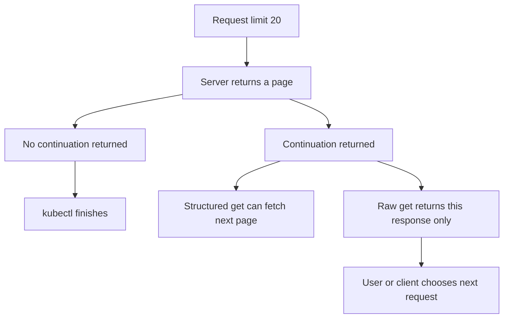

# Paginate Clusterpedia Without Fetching Every Page in kubectl

Author: [nawazdhandala](https://www.github.com/nawazdhandala)

Tags: Kubernetes, Multi-Cluster, kubectl

Description: Request bounded Clusterpedia pages, understand kubectl continuation behavior, and use raw queries for explicit page-by-page navigation.

You set `--chunk-size=20`, expecting twenty objects, but kubectl prints hundreds. The flag controls the size of a list request; it is not generally a cap on the final number of objects kubectl collects. If the server supplies continuation information, kubectl can follow it and combine multiple pages.

Clusterpedia offers a deliberate choice between a bounded page and a response that tells a client how to continue. This guide uses **Clusterpedia v0.9.0's internal storage backend** and **kubectl1.34.0**. A local synthetic HTTP server confirmed kubectl's continuation behavior. It was not a running Clusterpedia or Kubernetes server.

## Separate page size from client behavior

There are three useful request modes:

| Mode | Result to expect |
| --- | --- |
| Structured kubectl get, bounded chunk size, no continuation returned | One bounded list response |
| Structured kubectl get with continuation returned | kubectl can follow pages and collect the full list |
| kubectl get --raw with a bounded URL | One raw response; your workflow decides whether to request another |

Clusterpedia normally omits `metadata.continue` from its list response unless requested. Its [paging documentation](https://clusterpedia.io/docs/usage/search/multi-cluster/#paging) explains that this permits page-sized searches through kubectl. Turning continuation on changes how a structured kubectl request behaves.



The [`kubectl get` reference](https://kubernetes.io/docs/reference/kubectl/generated/kubectl_get/) documents `--chunk-size`, including that zero disables chunking. Disabling chunking is not the same thing as asking for zero results or imposing a small result limit.

## Request a bounded page explicitly

The following assumes `clusterpedia-search.yaml` already points to Clusterpedia's search API. Replace the member and namespace with your intended scope:

```bash
kubectl --kubeconfig clusterpedia-search.yaml get pods -n payments \
  --chunk-size=20 \
  -l 'search.clusterpedia.io/clusters=member-a,search.clusterpedia.io/with-continue=false' \
  -o json
```

This requests a page of at most twenty Pods and explicitly disables continuation in the response. A missing continuation field here does **not** prove that twenty is the total number of matching Pods. It can mean only that you asked the server not to include the next offset.

Avoid using `search.clusterpedia.io/size=20` as your only size control with ordinary kubectl. Its normal list request can already carry a limit from chunking. In v0.9.0's [option conversion code](https://github.com/clusterpedia-io/clusterpedia/blob/v0.9.0/staging/src/github.com/clusterpedia-io/api/clusterpedia/v1beta1/conversion.go), the special size selector fills the limit only when the existing limit is zero. Use `--chunk-size` for this structured-command pattern.

For inspection of a later page, Clusterpedia also accepts an offset selector. However, a page boundary is meaningful only when you keep the filter and ordering consistent. Raw URLs make both the offset and ordering particularly visible.

## Use raw requests for explicit navigation

Use an ordinary hosting-cluster context, `HOST_CONTEXT`, with the full Clusterpedia prefix below. This is different from the already prefixed search kubeconfig above.

```bash
set -euo pipefail
umask 077
mkdir pod-pages
kubectl --context HOST_CONTEXT get \
  --raw='/apis/clusterpedia.io/v1beta1/resources/api/v1/namespaces/payments/pods?clusters=member-a&limit=20&withContinue=true&orderby=namespace,name' \
  > pod-pages/page-1.json
jq '{count: (.items | length), next: (.metadata.continue // "")}' \
  pod-pages/page-1.json
```

The directory must not already exist; creating a new protected evidence directory avoids replacing an earlier capture. Pod JSON can include application configuration, so retain it according to your normal incident-data policy.

This sends one HTTP request and displays its item count and continuation value. The request's fixed member, namespace, resource, and ordering are part of the page sequence. Do not change them between pages while treating the new response as the continuation of the old search.

In the pinned internal-storage implementation, `continue` is a numeric offset. The [query construction](https://github.com/clusterpedia-io/clusterpedia/blob/v0.9.0/pkg/storage/internalstorage/util.go) applies it as a database offset. That is a Clusterpedia-specific behavior; native Kubernetes continuation tokens should not be interpreted as numeric offsets.

## Follow a returned offset once

After reviewing the first page, this shell block requests the next page only when an offset was returned:

```bash
set -euo pipefail
next_offset=$(jq -r '.metadata.continue // ""' pod-pages/page-1.json)
if [ -n "$next_offset" ]; then
  case "$next_offset" in
    *[!0-9]*) printf '%s\n' 'Unexpected nonnumeric Clusterpedia offset' >&2; exit 1 ;;
  esac
  kubectl --context HOST_CONTEXT get \
    --raw="/apis/clusterpedia.io/v1beta1/resources/api/v1/namespaces/payments/pods?clusters=member-a&limit=20&withContinue=true&orderby=namespace,name&continue=${next_offset}" \
    > pod-pages/page-2.json
fi
```

Use this in the same workspace as the first block, and run it once for this evidence set. The digit check is intentionally scoped to v0.9.0 internal storage. A client targeting another backend should follow that backend's documented token format and URL-encode it rather than assuming a number.

The [resource list implementation](https://github.com/clusterpedia-io/clusterpedia/blob/v0.9.0/pkg/storage/internalstorage/resource_storage.go) returns the next offset when continuation is enabled, the limit is positive, and the returned item count equals the limit. It does not necessarily prove that another nonempty page exists. An exact multiple of the page size can require one final empty request to discover the end.

For an automated export, implement an explicit loop with an error path, a page/request budget, and detection of a repeated continuation value. Persist each successful page before proceeding. These examples deliberately show one transition so the request boundary remains visible.

## Do not mistake offsets for a consistent snapshot

A stable sort makes page navigation easier to reason about, but offset pagination over changing data is not a snapshot guarantee. If an earlier row disappears between requests, subsequent offsets can shift. New rows can also change what appears on later pages.

For a dashboard, that may be an acceptable view of recent state. For an audit export, define a completeness strategy: use a controlled observation window where appropriate, retain object identities, detect duplicates, and reconcile counts or known objects against another source. Deduplication alone cannot recover a row skipped because the underlying ordering changed.

Do not infer freshness from successful pagination either. Clusterpedia is returning its stored view; member synchronization health remains a separate check.

## Verify the mode you actually selected

In the local client fixture, a three-Pod dataset with page size two produced one request and two objects when no continuation was returned. With continuation returned, structured kubectl made two list requests and produced three objects. The equivalent raw request made one request and retained the continuation value in its two-object response.

Those checks establish client behavior against controlled JSON responses, not Clusterpedia backend correctness. In staging, repeat a small scoped query with known objects and inspect response metadata. Keep `withContinue=false` for a deliberately bounded structured view, or use `--raw` when your client must control each next-page request. The result size then follows an explicit choice rather than an assumption about `--chunk-size`.
