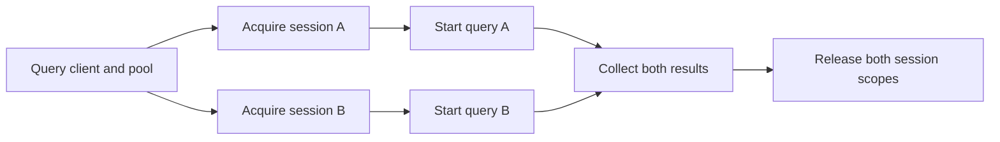

# Run Parallel YDB C++ Queries on Separate Sessions

Author: [nawazdhandala](https://www.github.com/nawazdhandala)

Tags: C++, Database, Performance, Troubleshooting

Description: Fix YDB pending-query errors by giving overlapping operations separate sessions, preserving transaction boundaries, and collecting every launched result.

Two asynchronous calls do not automatically create two independent database execution contexts. If both calls use the same YDB session, the second can fail with `Pending previous query completion`, even when the cluster has spare capacity.

The [YDB error FAQ](https://ydb.tech/docs/en/faq/errors) associates this C++ SDK error with overlapping queries on a single-threaded session. Independent queries that must overlap need separate sessions. Queries belonging to one interactive transaction need a different treatment: preserve their shared transaction context and execute its steps in order.

This guide uses **YDB C++ SDK v3.27.0** for its API examples. It distinguishes fixing session ownership from increasing database capacity.

## Find the overlap at submission time

This pattern starts a second operation before the first has completed:

```cpp
auto first = session.ExecuteQuery(queryA, txControl);
auto second = session.ExecuteQuery(queryB, txControl);
auto secondResult = second.GetValueSync();
```

Waiting for `second` does not retroactively serialize the submissions. The overlap began when the second `ExecuteQuery` call was made. Moving the final waits around does not fix that earlier decision.

Nor does copying the handle create an independent session:

```cpp
auto otherSession = session;
```

The pinned [session implementation](https://github.com/ydb-platform/ydb-cpp-sdk/blob/v3.27.0/src/client/query/client.cpp) uses shared ownership of the underlying session state. A different C++ variable can still refer to the same logical session.

Record session IDs and operation start/end times in a staging trace. Look for two submitted operations whose intervals overlap on the same session. Keep that evidence separate from general overload symptoms such as hot shards, saturated CPU, or a full acquisition pool.

## Decide whether the operations are independent

| Relationship between queries | Appropriate structure |
| --- | --- |
| Query B needs Query A's result | Finish A, inspect the result, then submit B |
| Both are steps in one interactive transaction | Keep the transaction's session and run its steps sequentially |
| Two independent reads may run concurrently | Acquire separate sessions |
| Hundreds of independent tasks arrive together | Use bounded concurrency and a sized session pool |

Separate sessions do not share one interactive transaction automatically. Splitting a debit and credit across sessions to avoid an overlap error changes the correctness problem. Keep atomic business work together and reduce its round trips through an appropriate query or transaction design.

For a sequential path, wait and check the first result before submitting the second. Do not proceed after a failed statement merely because its future is ready. A ready future means a result or exception is available, not that the operation succeeded.

## Acquire two sessions before launching the reads

The accompanying [parallel_reads.cpp](./parallel_reads.cpp) accepts a ready Query client with capacity for at least two acquired sessions. It obtains both sessions while keeping their acquisition results alive:

```cpp
auto first = client.GetSession().GetValueSync();
if (!first.IsSuccess()) return false;
auto second = client.GetSession().GetValueSync();
if (!second.IsSuccess()) return false;
auto a = first.GetSession();
auto b = second.GetSession();
if (a.GetId() == b.GetId()) {
    throw std::logic_error("Sessions must differ");
}
```

This is source-checked against the tagged [Query client declarations](https://github.com/ydb-platform/ydb-cpp-sdk/blob/v3.27.0/include/ydb-cpp-sdk/client/query/client.h). Holding both leases before launching work makes the intended ownership easy to inspect. If the second acquisition fails, the function returns without starting either query, and the first acquisition leaves scope.

The sample then starts one read on each session:

```cpp
auto settings = TExecuteQuerySettings().ClientTimeout(TDuration::Seconds(2));
pending.push_back(a.ExecuteQuery(
    "SELECT 1 AS one;", TTxControl::NoTx(), settings));
pending.push_back(b.ExecuteQuery(
    "SELECT 2 AS two;", TTxControl::NoTx(), settings));
```

The complete file includes the namespace declarations, pending-future container, error handling, and result collection. These constant reads demonstrate independent submissions; they are not a performance benchmark. A two-second query timeout is an illustrative test limit, not a guarantee about total function duration, which also includes session acquisition.



Both requests can be in flight, but separate sessions do not guarantee that the server executes every part of them simultaneously. Data placement, contention, and server capacity still affect scheduling and latency.

## Collect every launched result

A common follow-up bug is to return as soon as the first result fails, leaving other launched work unaccounted for. The sample uses [drain_futures.h](./drain_futures.h) to inspect every queued result before returning a combined success value or rethrowing a captured exception.

If launching the second request throws, the sample retains the launch exception and still waits for any first request already stored in the pending list. The sessions remain in scope throughout collection. That structure makes failures visible and avoids treating abandoned observation as successful cancellation.

For real queries, preserve each status and result under the corresponding operation identity rather than reducing them to one Boolean. Retrying one independent read does not require replaying a successful unrelated read. Writes need explicit idempotency and outcome handling; an interrupted wait is not proof that a write did not happen.

Streaming queries need additional care. Receiving a stream handle is not the same as consuming the complete response. Finish or close the stream according to the API's supported lifecycle before reusing that session for another operation.

## Bound concurrency instead of spawning unlimited work

The [session-pool guide](https://ydb.tech/docs/en/recipes/ydb-sdk/session-pool-limit) relates pool capacity to simultaneous operations and server resource use. If an application has capacity for eight database operations, do not submit thousands and expect the pool to make their memory use and caller latency harmless.

Apply backpressure before launching work. Include retry attempts, long transactions, and streams in the budget. Monitor acquired sessions, acquisition failures, query latency, and successful throughput as concurrency changes.

Increasing the pool limit cannot make one session accept overlapping queries. Conversely, acquiring separate sessions cannot repair a saturated server. Diagnose both layers rather than interpreting every `OVERLOADED` response as the same capacity problem.

## Test ownership and live behavior separately

The included [drain_test.cpp](./drain_test.cpp) compiles with a standard C++17 compiler:

```bash
c++ -std=c++17 -Wall -Wextra -Werror drain_test.cpp \
  -o /tmp/ydb-drain-test
/tmp/ydb-drain-test
```

The local test passed for successful results, a failed status, and an exception in the first result. In each case, both deferred test tasks were collected. It tests completion handling, not parallel scheduling or YDB session behavior.

The SDK integration file was source-reviewed but not compiled against the full SDK or run against a database. In staging, confirm distinct session IDs, overlapping submission intervals, complete result collection, and release after both success and failure. Then compare throughput and tail latency with the sequential version using representative queries before increasing concurrency further.
