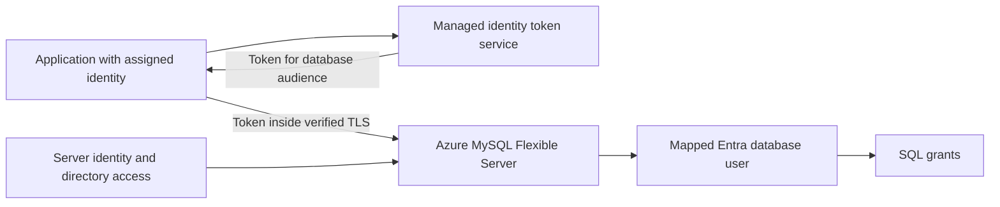

# Connect to Azure MySQL with Managed Identity and Entra Tokens

Author: [nawazdhandala](https://www.github.com/nawazdhandala)

Tags: Azure, MySQL, Security

Description: Use a managed identity for Azure MySQL login with the correct token audience, database user mapping, and verified TLS in a pinned Python example.

Passwordless database access removes the application-managed database password. It does not remove authentication, SQL permissions, or the need to verify the database server. The application obtains a short-lived Microsoft Entra token and presents it through the MySQL authentication protocol.

This tutorial uses an **Azure App Service application with a user-assigned managed identity**, Azure Database for MySQL Flexible Server, and Python 3.11. The client libraries are pinned to **azure-identity 1.25.1** and **mysql-connector-python 9.5.0**. The example targets Azure public cloud; sovereign clouds use different token scopes.

## Separate the server identity from the application identity

There are two identity responsibilities in this setup:

| Identity | Purpose | Access to review |
| --- | --- | --- |
| MySQL server's user-assigned managed identity | Supports the server's Microsoft Entra integration and directory lookup | Documented Microsoft Graph permissions |
| Application's managed identity | Requests a token to authenticate the application | Mapped database user and required SQL grants |

Assigning an identity to the database server does not automatically make that identity the application's database login. Likewise, attaching an identity to App Service does not automatically grant it access to tables.

Configure Microsoft Entra authentication on the server and appoint the intended Entra administrator. The server identity requires the documented directory permissions; keep those separate from ordinary application SQL access. Microsoft's [authentication overview](https://learn.microsoft.com/en-us/azure/mysql/security/security-entra-authentication) explains this architecture.

During migration, choose the server's authentication mode deliberately. Entra-only mode changes how existing native-password consumers can authenticate. Test the new application path before making that broader change.



## Establish and record the database user mapping

For App Service, Microsoft's supported Service Connector workflow can configure a passwordless connection and provide the resulting connection settings. Open Service Connector for the app, create a connection targeting the intended MySQL Flexible Server and database, select the required managed identity and Python client, and review the generated configuration before execution. This is a provisioning step that changes resources and access, not a diagnostic read.

Follow the MySQL-specific prerequisites in the [Service Connector passwordless tutorial](https://learn.microsoft.com/en-us/azure/service-connector/tutorial-passwordless). Record the resulting database username and the application's selected managed identity. Do not guess the SQL username from the Azure resource display name.

If your organization manages mapping manually, use the supported Entra administrator procedure instead. Azure's `CREATE AADUSER` functionality is provider-specific; an ordinary MySQL password user with the same text name is not an equivalent mapping. See the [Entra setup instructions](https://learn.microsoft.com/en-us/azure/mysql/security/security-how-to-entra).

Review the grants produced by either workflow. As the mapped application user, this read-only statement displays its grants:

```sql
SHOW GRANTS FOR CURRENT_USER;
```

Compare them with the application's actual requirements. Provisioning convenience is not a reason to retain unnecessary database-wide privileges. The [MySQL grant-inspection reference](https://dev.mysql.com/doc/refman/8.4/en/show-grants.html) documents this statement. Exercise both an approved read and an operation the account should be denied in staging.

## Prepare the pinned Python client

Install the example dependencies in your application's isolated environment:

```bash
python3 -m pip install azure-identity==1.25.1 mysql-connector-python==9.5.0
```

The exact releases are available from the official publisher packages for [Azure Identity](https://pypi.org/project/azure-identity/1.25.1/) and [MySQL Connector/Python](https://pypi.org/project/mysql-connector-python/9.5.0/). These pins make this example reproducible; assess updates through your dependency-management process.

Configure these non-password settings before running the code:

| Environment variable | Value |
| --- | --- |
| `AZURE_MYSQL_CLIENTID` | Application user-assigned identity's client ID |
| `AZURE_MYSQL_HOST` | Normal server FQDN, matching its certificate |
| `AZURE_MYSQL_NAME` | Database name |
| `AZURE_MYSQL_USER` | Database username from the completed identity mapping |
| `AZURE_MYSQL_SSL_CA_PATH` | Local path to the approved Azure MySQL CA bundle |

The CA-path variable is specific to this example. Obtain and maintain trust material using Azure's [TLS connection guidance](https://learn.microsoft.com/en-us/azure/mysql/security/security-tls-how-to-connect). The application still needs working DNS and network reachability to the server.

## Request a database token and verify TLS

Save the following as `identity_login.py`. Run it inside the Azure hosting environment where the selected managed identity is assigned. A normal local laptop session is not a managed identity endpoint.

```python
import os
from azure.identity import ManagedIdentityCredential
import mysql.connector


def check_login():
    client_id = os.environ["AZURE_MYSQL_CLIENTID"]
    settings = {
        "host": os.environ["AZURE_MYSQL_HOST"],
        "database": os.environ["AZURE_MYSQL_NAME"],
        "user": os.environ["AZURE_MYSQL_USER"],
        "ssl_ca": os.environ["AZURE_MYSQL_SSL_CA_PATH"],
        "ssl_verify_cert": True,
        "ssl_verify_identity": True,
        "auth_plugin": "mysql_clear_password",
        "use_pure": True,
        "connection_timeout": 10,
    }
    credential = ManagedIdentityCredential(client_id=client_id)
    connection = None
    try:
        token = credential.get_token(
            "https://ossrdbms-aad.database.windows.net/.default"
        )
        connection = mysql.connector.connect(password=token.token, **settings)
        cursor = connection.cursor()
        try:
            cursor.execute("SELECT CURRENT_USER(), DATABASE()")
            print(cursor.fetchone())
        finally:
            cursor.close()
    finally:
        if connection is not None:
            connection.close()
        credential.close()


if __name__ == "__main__":
    check_login()
```

The explicit client ID selects the application's user-assigned identity. It is not the server identity's ID or an interchangeable object/principal ID. The [ManagedIdentityCredential reference](https://learn.microsoft.com/en-us/python/api/azure-identity/azure.identity.managedidentitycredential?view=azure-python) documents this selection.

The token request uses the database audience documented in Microsoft's [managed-identity database tutorial](https://learn.microsoft.com/en-us/azure/app-service/tutorial-connect-msi-azure-database). A token for Azure Resource Manager or Microsoft Graph is not the correct database login token.

`mysql_clear_password` passes the token without password hashing, inside TLS. It does not justify sending credentials over an unverified channel. This example explicitly verifies both the certificate and hostname, and selects the pure-Python connector path. The [connector arguments](https://dev.mysql.com/doc/connector-python/en/connector-python-connectargs.html) and [9.5.0 authentication plugin source](https://github.com/mysql/mysql-connector-python/blob/9.5.0/mysql-connector-python/lib/mysql/connector/plugins/mysql_clear_password.py) document those behaviors.

Expected output identifies the authenticated database account and database. No token is printed. Use a protected diagnostic destination for identity information as well.

## Test renewal and failure boundaries

This is a single-connection probe, not a pool implementation. A production connection factory must obtain a usable token when opening a new physical connection. Do not capture one token at startup and assume it remains valid for every future connection. Respect the returned expiry and the credential library's behavior instead of hardcoding a token lifetime.

Test cold startup, a new connection after credential renewal, and loss of token acquisition in staging. Keep existing-session health separate from fresh-login health. If token acquisition fails, inspect the assigned application identity first. If the token is acquired but MySQL rejects it, inspect the audience, tenant, database mapping, and account name before broadening SQL privileges.

The libraries were installed and the Python example compiled locally. Offline checks also exercised the connector's clear-password plugin requirement for TLS. No managed identity token was requested and no live Azure MySQL login was performed.
