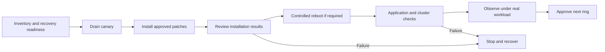

# Patch Linux VMs Across AWS, Azure, and GCP in Canary Rings

Author: [nawazdhandala](https://www.github.com/nawazdhandala)

Tags: Linux, Cloud Automation, Patch Management

Description: Coordinate Linux patching across clouds with representative canaries, explicit reboot decisions, health gates, and tested recovery paths.

A patch job can finish successfully while the application is unhealthy. A package installation might restart a service, a new kernel might fail at the next reboot, or a database node might return before its replicas are ready.

Use canary rings to separate those risks. A ring is a deliberately selected group of machines that advances through installation, reboot, and health validation before the next group starts. Cloud-native patch tools perform the installation; your rollout process decides when it is safe to proceed.

This guide compares AWS Systems Manager Patch Manager, Azure Update Manager, and Google Cloud VM Manager Patch. It includes a narrowly scoped AWS command example and provider-specific settings for the same operating process. It does not imply that one cloud's controls translate directly into another's.

## Build rings around failure domains

Select a small canary from each meaningful combination of distribution, major release, workload, CPU architecture, and cloud image. One idle Ubuntu machine is not representative of a fleet containing busy RHEL database nodes.

Then define progressive rings: representative canaries, a small production slice, and the remaining fleet. Keep quorum members and redundant service replicas in different batches. A failure domain is a group that can fail together, such as an availability zone; application quorum can impose an even tighter boundary.

For each ring, record exact machine identifiers, repository configuration, approved patch policy, maintenance window, drain procedure, health criteria, and recovery artifact. Resolve tags or dynamic scopes to an inventory before starting and investigate unexpected additions. Avoid overlapping schedules from two patch systems on the same host.

| Provider | Installation mechanism | Control to review |
|---|---|---|
| AWS | `AWS-RunPatchBaseline` through Systems Manager | Baseline selection, document version, target list, concurrency and error controls |
| Azure | Update Manager deployment or Maintenance Configuration | Machine scope, update selection, reboot choice, maintenance duration |
| GCP | VM Manager Patch job | Instance filter, package configuration, rollout mode, disruption budget |

Azure Update Manager supports Azure VMs and Azure Arc-connected machines, including Linux. Its orchestration is separate from the older Automation-based approach. [Azure Update Manager overview](https://learn.microsoft.com/en-us/azure/update-manager/overview).

## Establish a recovery path before installing

A canary limits impact; it does not provide rollback. For replaceable application nodes, keep a tested previous image and a way to replace the instance without losing required state. For stateful machines, require a verified backup and a service-specific recovery procedure.

Do not assume a package downgrade reverses configuration changes, schema migrations, or writes made after the patch. Restoring a boot disk can also roll back local data. Define which data must be preserved, who decides to recover, and how a recovered node safely rejoins the service.

Check the management agent, package repositories, free disk space, package-manager locks, and connectivity before entering the window. A machine that cannot report status is not a successful canary. Record exclusions explicitly instead of letting unreachable nodes disappear from the denominator.



## Pin the AWS command document you review

For AWS, use an authenticated AWS CLI session with Systems Manager permissions, managed Linux instances, and an approved baseline. The following examples use AWS CLI 2.38.1 syntax. They were checked locally without dispatching commands.

First inspect the default document and resolve its numeric version. This avoids inventing a version or silently following a changing default during the rollout:

```bash
REGION='eu-west-1'
aws ssm describe-document \
  --name AWS-RunPatchBaseline --document-version '$DEFAULT' \
  --region "$REGION" --output json > patch-document.json

DOC_VERSION=$(python3 -c \
  'import json; print(json.load(open("patch-document.json"))["Document"]["DocumentVersion"])')

aws ssm get-document \
  --name AWS-RunPatchBaseline --document-version "$DOC_VERSION" \
  --document-format JSON --region "$REGION" \
  --output json > patch-document-content.json
```

Review and retain the returned version and content before using it. These are the documented [describe-document](https://docs.aws.amazon.com/cli/latest/reference/ssm/describe-document.html) and [get-document](https://docs.aws.amazon.com/cli/latest/reference/ssm/get-document.html) operations. Pinning the document does not pin the repository contents or patch baseline. Preserve those separately so later rings receive the intended change set.

Replace the example instance ID with one approved canary. The first dispatch performs an assessment:

```bash
CANARY='i-0123456789abcdef0'
aws ssm send-command \
  --document-name AWS-RunPatchBaseline --document-version "$DOC_VERSION" \
  --instance-ids "$CANARY" \
  --parameters 'Operation=Scan,RebootOption=NoReboot' \
  --max-concurrency '1' --max-errors '0' \
  --region "$REGION" --output json > scan-command.json
```

Wait for that machine's command result and inspect the applicable patches. The dispatch response is not completion. Confirm the intended baseline or patch-group association before installation; otherwise the document can use the operating system's default baseline. [AWS-RunPatchBaseline behavior](https://docs.aws.amazon.com/systems-manager/latest/userguide/patch-manager-aws-runpatchbaseline.html).

After draining the canary and passing the preparation gate, installation is a separate, mutating command:

```bash
aws ssm send-command \
  --document-name AWS-RunPatchBaseline --document-version "$DOC_VERSION" \
  --instance-ids "$CANARY" \
  --parameters 'Operation=Install,RebootOption=NoReboot' \
  --max-concurrency '1' --max-errors '0' \
  --region "$REGION" --output json > install-command.json
```

Here, `NoReboot` reserves the operating-system reboot for a separate controlled step. It does not prevent package scripts from restarting services. Keep the canary drained during installation and validation.

`--max-errors 0` stops sending work to additional targets after a counted error; it does not undo work already dispatched. `--max-concurrency 1` limits concurrent command execution, not application disruption caused by every other system. Inspect per-machine outcomes and keep the next ring blocked independently. [SendCommand controls](https://docs.aws.amazon.com/cli/latest/reference/ssm/send-command.html).

## Apply the same gates with each provider's settings

In Azure Update Manager, select the canary machines and reviewed update classifications or package inclusions. Review the resulting selection instead of assuming an old assessment exactly predicts installation. Choose the reboot policy and maintenance duration explicitly. For scheduled Azure VM patching, configure Customer Managed Schedules as required by the service. [Azure deployment controls](https://learn.microsoft.com/en-us/azure/update-manager/deploy-updates) and [scheduled patching prerequisites](https://learn.microsoft.com/en-us/azure/update-manager/scheduled-patching).

Create separate deployment steps for successive rings. A recurring schedule offset is not an application-health gate: the next scheduled group can start even when your canary investigation is incomplete. Ensure the coordinator can withhold that next step.

In GCP, select an explicit instance filter and review zone-by-zone rollout with a deliberately small disruption budget. The budget accounts for patching, reboot, and post-patch steps, and failed machines consume it. Machines that are stopped or lack an active agent do not count toward that budget, so reconcile the requested inventory against reported outcomes. [GCP patch job rollout options](https://docs.cloud.google.com/compute/vm-manager/docs/patch/create-patch-job).

Keep cloud-specific controls visible in the release record. A GCP disruption budget, AWS command concurrency, and Azure maintenance schedule are related controls, but none is a universal application availability guarantee.

## Make reboot and health separate decisions

After installation, inspect pending-reboot status and package failures. Reboot the drained canary through your existing host-management procedure only when the service can tolerate it. Verify that it returns, uses the intended kernel and packages, and can reach its dependencies before allowing traffic.

On AWS, a `NoReboot` installation can remain `InstalledPendingReboot` and noncompliant until reboot and a subsequent scan. The default `RebootIfNeeded` behavior is not a promise to reboot only when the operating system says it is necessary; AWS documents rebooting after installed patches. [AWS reboot semantics](https://docs.aws.amazon.com/systems-manager/latest/userguide/patch-manager-aws-runpatchbaseline.html#patch-manager-aws-runpatchbaseline-parameters).

Budget time for recovery checks. Azure does not terminate an in-progress update simply because the maintenance window expires. Reaching the scheduled end is therefore not proof that the machine is ready to return to service. [Maintenance-window behavior](https://learn.microsoft.com/en-us/azure/update-manager/scheduled-patching).

Before advancing, require successful host reporting, clean required patch results, resolved reboot requirements, a real application transaction, acceptable latency/error rates, and healthy replication or quorum. Observe a representative workload period chosen for the service. Stop on unexplained regressions, preserve the failed node's evidence, and invoke the reviewed recovery path. Advance because the canary demonstrated acceptable behavior, not because the patch command returned a success code.
