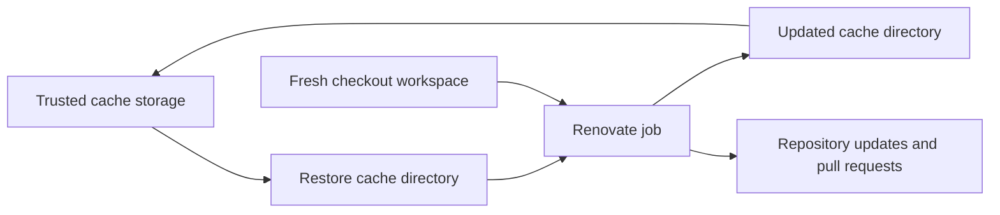

# Persist Renovate Caches Across Ephemeral CI Runs

Author: [nawazdhandala](https://www.github.com/nawazdhandala)

Tags: Renovate, Caching, DevOps

Description: Keep Renovate extraction and package caches between disposable CI jobs, separate them from checkouts, and verify that restored data is useful and safe.

A disposable CI runner starts from a clean filesystem, which is useful for repeatability but expensive when every Renovate run repeats dependency extraction and downloads. Persisting the right directories can reduce that work. Archiving the whole runner, however, retains much more than a cache and makes ownership and access harder to control.

Start with Renovate's cache directory, keep checkouts separate, and measure the second run. This guide uses Renovate 44.257.6. Local tests exercised its actual repository-cache implementation and directory helpers; no hosted CI cache service or production repository was used.

## Name the four kinds of retained data

The word “cache” hides several different jobs:

| Data | Purpose | Main question |
|---|---|---|
| Repository extraction cache | Reuse dependency information derived from files | Is extraction repeating unnecessarily? |
| Package lookup cache | Reuse metadata about available dependency versions | Are repeated registry lookups costly? |
| Package-manager cache | Reuse downloaded package content | Are artifact updates downloading the same packages? |
| Retained repository checkout | Reuse Git objects and working files | Is cloning the main cost? |

Preserving a package download cache does not mean the bot can skip checking current repository state. Preserving extracted dependencies does not provide an offline mirror of all packages. Keep these expectations separate when evaluating a faster run.

## Separate the disposable workspace from the cache

Use this administrative configuration for the self-hosted runner, outside application repositories:

```json
{
  "baseDir": "/runner/work/renovate",
  "cacheDir": "/runner/cache/renovate",
  "repositoryCache": "enabled",
  "repositoryCacheType": "local",
  "persistRepoData": false
}
```

Both paths are placeholders inside the runner. Create writable directories owned by the account executing Renovate. Arrange for your CI system to restore `/runner/cache/renovate` before execution and save it afterward, or mount a persistent volume at that path. The configuration cannot make an ephemeral disk survive job termination on its own.

The extraction cache is explicitly enabled. Checkouts remain disposable because `persistRepoData` is false. Renovate documents these independent controls in its [self-hosted configuration reference](https://docs.renovatebot.com/self-hosted-configuration/#cachedir).



If the job runs in a container, restore to the directory that is actually mounted into that container. A cache on the host is useless when Renovate writes to a different container filesystem path. Check ownership too: a restored directory that the bot cannot update may look like a successful restore followed by another cold run.

## Confirm the package manager uses the retained directory

In the pinned release, the npm artifact-update code sets `NPM_CONFIG_CACHE` using `ensureCacheDir("npm")`. That helper resolved to `cacheDir/others/npm` in the local test. See the [tagged npm update source](https://github.com/renovatebot/renovate/blob/44.257.6/lib/modules/manager/npm/post-update/index.ts).

For the example configuration, that is:

```text
/runner/cache/renovate/others/npm
```

This is an implementation detail checked for 44.257.6, not a universal location for every package manager or future release. Review the effective environment and manager implementation when upgrading. Avoid assuming that caching a developer's `~/.npm` automatically preserves Renovate's npm cache.

As a diagnostic on the runner, with npm installed and no concurrent writer, inspect that specific cache:

```bash
npm cache verify --cache /runner/cache/renovate/others/npm
```

npm verifies cache integrity and performs cache maintenance; this command is not a read-only filesystem listing. Use the intended cache path, not an unrelated developer cache. A successful verification does not prove there are useful package entries: an empty cache can also verify successfully. npm's [cache documentation](https://docs.npmjs.com/cli/v11/commands/npm-cache/) explains its integrity guarantees and why the cache is not permanent package storage.

## Design restore and save as a pair

A frequent mistake is restoring a cache on every run but never saving the newly populated data. Another is using an immutable cache key forever, so the first saved snapshot is the only one later runs can reuse.

For a CI archive cache, choose a stable restore prefix and a unique save key. For example, a key family might encode the trust group, operating system, CPU architecture, and a manually controlled schema generation, followed by the job run identifier. The stable prefix retrieves a compatible previous snapshot; the unique suffix allows the current run to save new content.

GitHub Actions caches, for example, cannot have an existing cache's contents replaced; a new key creates a new cache. Review the provider's [cache matching and access rules](https://docs.github.com/en/actions/reference/workflows-and-actions/dependency-caching) before translating this design into workflow YAML.

Do not make the application lockfile hash the only identity for a shared Renovate cache. A bot processing several repositories needs a design that reflects those repositories and their trust boundary. Conversely, avoid one enormous archive whose restore time costs more than the downloads it saves.

## Keep cache access narrower than ordinary build access

Private package contents and repository-derived metadata can be sensitive even if the cache contains no explicit token. Only trusted bot jobs should write caches consumed by privileged Renovate runs. Do not let arbitrary pull-request workflows replace them.

Keep secret configuration, credentials, and unrelated workspace files outside the archived directory. Check the cache service's read permissions, including behavior for forked pull requests. A harmless-looking restore prefix does not change who the storage service permits to download an archive.

For simultaneous workers, give each shard its own writable cache area unless the selected backend explicitly supports the intended sharing. Avoid two jobs restoring the same archive and racing to publish competing snapshots as if they were one coordinated database. A shared volume also requires a deliberate concurrency design.

## Prove that a warm run helps

Record separate durations for cache restoration, repository extraction, dependency lookup, artifact updates, and cache upload. Compare two runs against the same repository revision before comparing unrelated production runs. Otherwise a smaller update set can masquerade as a caching improvement.

The local review saved a synthetic marker through Renovate's real repository-cache class, constructed a fresh instance, and loaded the marker from disk. A different repository fingerprint correctly refused to reuse it. This proves persistence and invalidation behavior at the helper level; it does not measure a real extraction speedup.

In your runner, inspect the second run for cache reuse and confirm that new dependency changes still appear. Periodically perform a deliberately cold run using a new cache namespace. It should be slower but correct. A pipeline that only works with yesterday's cache has hidden a missing installation or authentication prerequisite.

## Change retention only after measuring

If cloning dominates after cache persistence works, separately evaluate `persistRepoData: true` with retained `baseDir` storage. That keeps substantially more repository data and requires a cleanup and isolation policy. It is not necessary just to enable the extraction cache.

Validate the administrative JSON with the pinned `renovate-config-validator --strict` before rollout. Here it passed on Node 24.11.0 with the reported native RE2 fallback warning. The disk roundtrip, fingerprint rejection, npm directory resolution, and empty-cache verification were tested locally. CI restore permissions, archive uploads, private downloads, concurrent workers, and production timing were not tested.

Retain only data with a measurable benefit, make a cache miss recoverable, and keep the fresh-run path working. That gives ephemeral jobs useful memory without making old filesystem state a prerequisite for correctness.
