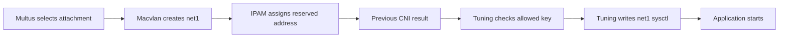

# Apply Pod Network Sysctls with Multus and Tuning CNI

Author: [nawazdhandala](https://www.github.com/nawazdhandala)

Tags: Multus, Kubernetes, Networking

Description: Chain the tuning CNI plugin after a Multus network attachment, restrict allowed sysctls, verify interface-specific settings, and understand what cleanup does not restore.

A Pod with several interfaces may need a network setting applied specifically to its secondary interface. Setting a value in a container startup script is awkward: the script needs permissions, timing matters, and the interface name may vary between attachments.

The tuning CNI plugin can apply supported network settings during attachment creation. It does not create an interface itself. Place it after the plugin that creates the interface, and verify the resulting value inside the Pod's network namespace.

This example reviews **CNI plugins v1.8.0** and **Multus v4.3.1**. It uses a deliberately narrow staging case: applying `arp_ignore=1` to one secondary macvlan interface. This is not a recommendation to enable that setting on every workload. YAML, JSON, and allowlist logic were checked locally; no Linux sysctl or live CNI test was performed.

## Decide which setting actually solves the problem

A sysctl is a Linux kernel setting exposed through files under `/proc/sys`. Some network settings apply to one interface; others affect the entire network namespace shared by the Pod's containers. A setting applied through a secondary attachment can therefore affect primary traffic if its scope is namespace-wide.

ARP, the Address Resolution Protocol, maps an IPv4 address to a link-layer address on a local network. Linux documents `arp_ignore=1` as replying only when the requested local IP belongs to the incoming interface. The effective value is the maximum of the interface's setting and `conf/all/arp_ignore`. Review both before attributing behavior to the interface value alone. See the [kernel IP sysctl documentation](https://www.kernel.org/doc/html/latest/networking/ip-sysctl.html).

Use this setting only when it matches a reviewed multi-interface ARP design. It will not fix missing routes, duplicate addresses, or a switch that rejects additional MAC addresses.

## Put tuning in the same plugin chain



The [tuning documentation](https://www.cni.dev/plugins/current/meta/tuning/) explains that it operates on an existing network namespace and interface. Its [v1.8.0 implementation](https://github.com/containernetworking/plugins/blob/v1.8.0/plugins/meta/tuning/tuning.go) requires a previous CNI result. A standalone tuning attachment cannot substitute for the interface-creating plugin.

For a staging namespace named `network-lab`, use this NetworkAttachmentDefinition after replacing the parent interface and address with approved values:

```yaml
apiVersion: k8s.cni.cncf.io/v1
kind: NetworkAttachmentDefinition
metadata:
  name: macvlan-arp-lab
  namespace: network-lab
spec:
  config: |
    {
      "cniVersion": "0.3.1",
      "name": "macvlan-arp-lab",
      "plugins": [
        {
          "type": "macvlan",
          "master": "REPLACE_DATA_INTERFACE",
          "mode": "bridge",
          "ipam": {
            "type": "static",
            "addresses": [{"address": "192.0.2.50/24"}]
          }
        },
        {
          "type": "tuning",
          "sysctl": {
            "net.ipv4.conf.IFNAME.arp_ignore": "1"
          }
        }
      ]
    }
```

The `plugins` list is one ordered CNI chain. It creates the interface first, then tunes it. Install `macvlan`, `static`, and `tuning` binaries for the node's architecture in the effective CNI search path. The address is reserved for exactly one test Pod; use a real coordinated allocation design before scaling. The [macvlan](https://www.cni.dev/plugins/current/main/macvlan/) and [static IPAM](https://cni.dev/plugins/current/ipam/static/) references document the first plugin's configuration.

The value is a JSON string, not the number `1`. `IFNAME` is a literal placeholder recognized by tuning and replaced with the interface passed to it. It is not a shell variable. For this Pod metadata fragment, that interface is `net1`:

```yaml
annotations:
  k8s.v1.cni.cncf.io/networks: '[{"name":"macvlan-arp-lab","interface":"net1"}]'
```

Apply the annotation through your staging workload template. Keep the existing primary network and avoid adding routes unrelated to the test.

## Restrict the keys the plugin may change

Tuning v1.8.0 reads `/etc/cni/tuning/allowlist.conf` in its execution filesystem. Each nonempty line is a regular expression matched against a requested key. When the file is missing, the allowlist check is skipped. When present but empty, it permits no keys. These behaviors come from `readAllowlist` and `validateSysctlConf` in the pinned implementation.

For this example, the file's complete content can be one anchored expression:

```text
^net\.ipv4\.conf\.IFNAME\.arp_ignore$
```

The literal `IFNAME` belongs in this expression because validation happens before substitution. Anchors prevent the pattern from also matching unwanted prefixes or suffixes. The allowlist restricts the key, not the value; separately review what values users may request.

Deploy this file through the configuration owner, preserving other approved entries where necessary. With host-executed thin Multus, verify the host file. With thick Multus, ensure the plugin sees it inside the daemon's filesystem, commonly through a managed mount. A file inside the application container is not the plugin's allowlist.

Treat permission to edit network definitions as privileged configuration authority. Kubernetes also supports Pod `securityContext.sysctls`, with its own safe/unsafe sysctl rules. CNI tuning is a different execution path, not a reason to bypass your cluster's change policy. The [Kubernetes sysctl guide](https://kubernetes.io/docs/tasks/administer-cluster/sysctl-cluster/) explains the Pod-level mechanism.

## Read the actual value and test the intended behavior

After creating the staging Pod, run these read-only commands with a client authorized to execute `cat` in it:

```bash
kubectl -n network-lab exec REPLACE_POD -- \
  cat /proc/sys/net/ipv4/conf/net1/arp_ignore
kubectl -n network-lab exec REPLACE_POD -- \
  cat /proc/sys/net/ipv4/conf/all/arp_ignore
kubectl -n network-lab exec REPLACE_POD -- \
  cat /proc/sys/net/ipv4/conf/eth0/arp_ignore
```

Expect the first value to be `1`. Compare the other values with your baseline, rather than assuming they are zero. All containers share the Pod network namespace, so selecting another container should not create an independent network setting.

Next run the ARP and application acceptance checks defined for the network: verify the intended address resolves on the intended interface, unwanted cross-interface responses are absent, and legitimate traffic still works. Reading a sysctl file confirms configuration, not packet behavior.

If Pod creation fails, distinguish a missing tuning binary, missing previous result, rejected allowlist key, nonexistent interface path, and denied kernel write. Inspect the first error rather than adding broad privileges to the application container. If the value later changes, investigate another plugin or process writing the same setting.

## Plan rollback around the real lifecycle

Tuning v1.8.0 backs up selected interface attributes, such as MAC address and MTU, for restoration during DEL. Its backup structure does not include the sysctl map. Do not assume deleting an attachment restores every previous sysctl value, especially for namespace-wide settings while the Pod remains alive.

For this controlled test, remove the tuning change from the desired network configuration and recreate the test Pod's sandbox. Verify fresh values and traffic again. Editing the definition alone does not reconfigure an already running Pod.

Keep the change narrow: one justified key, one intended interface, an explicit allowlist, and before/after evidence. That makes the effect understandable and gives the next operator a way to distinguish configuration success from a working network.
