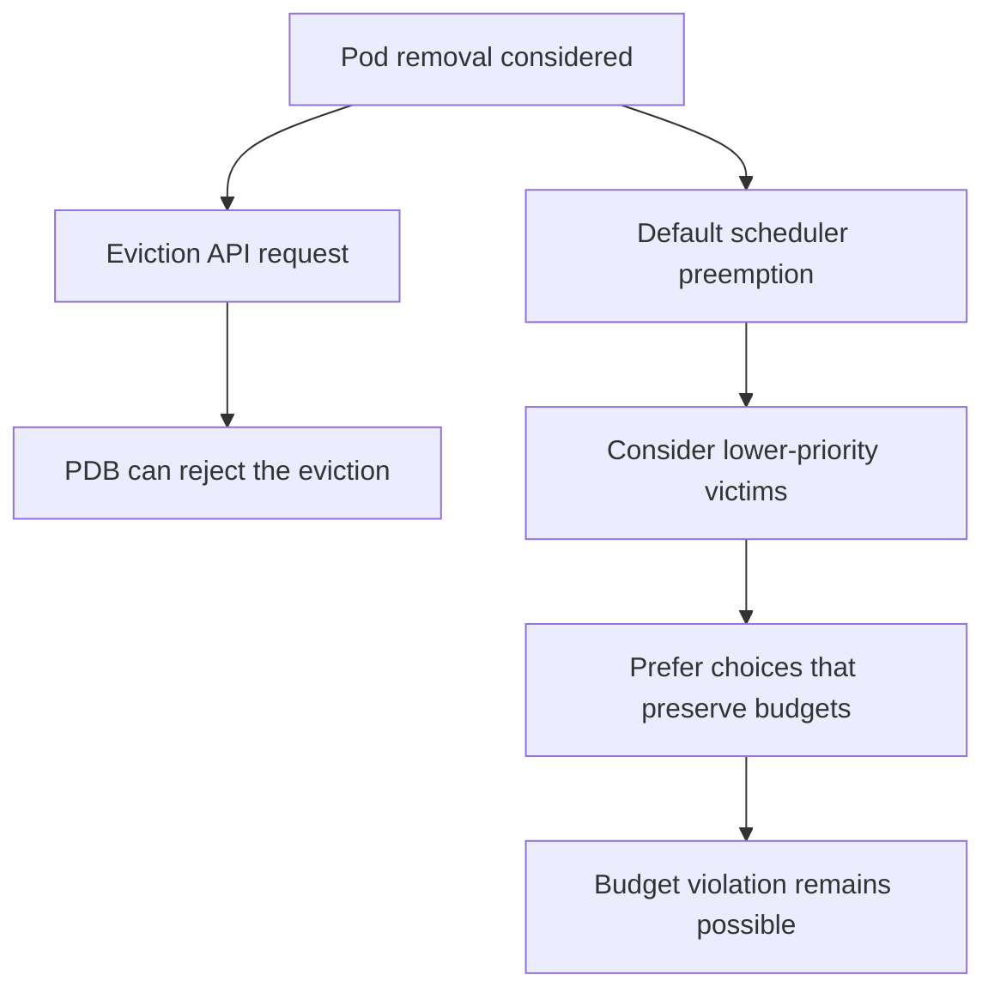

# Why a PodDisruptionBudget Did Not Stop Scheduler Preemption

Author: [nawazdhandala](https://www.github.com/nawazdhandala)

Tags: Kubernetes, Troubleshooting, High Availability

Description: Understand why a Kubernetes disruption budget is not a preemption veto, inspect the actual victim policy, and choose controls that address the cause.

Your service has three healthy replicas and a PodDisruptionBudget requiring all three to remain available. A higher-priority workload arrives, and one service Pod is terminated anyway. The budget can be correctly configured and still produce this outcome.

A PodDisruptionBudget (PDB) is not an absolute promise that its selected Pods cannot disappear. Kubernetes' default scheduler considers disruption budgets when choosing preemption victims, but can violate a budget when it cannot otherwise make room. Diagnose that decision before tightening a budget that is already allowing zero disruptions.

The source discussion below is pinned to **Kubernetes 1.34.0** and its default preemption implementation. Custom schedulers or modified scheduler plugins can behave differently.

## Separate the two decision paths

An eviction request made through the Kubernetes Eviction API is checked against the applicable budget. This is the path used by cooperative maintenance tools such as ordinary node draining. Scheduler preemption is a separate mechanism: a pending, higher-priority Pod can cause lower-priority Pods to be removed so it can fit.

The [disruption documentation](https://kubernetes.io/docs/concepts/workloads/pods/disruptions/) explains the boundary of PDB protection. Direct deletions, failures, and controller-driven rollout behavior also need their own analysis; a PDB is not a universal deletion interceptor.



This distinction explains why `disruptionsAllowed: 0` is not evidence of a scheduler malfunction. That status is useful, but it is not a veto over every removal mechanism.

## Follow a concrete capacity example

Suppose an eligible node has four CPU cores available for Pod requests. Three service replicas each request one core, leaving one core unallocated. An incoming Pod requests two cores and has higher priority than all three replicas. Assume other eligible nodes cannot fit it and no unrelated lower-priority victim can supply the missing capacity.

A PDB with `minAvailable: 3` covers those three replicas. Removing any one would break the budget. Nevertheless, removing one makes the incoming Pod fit, and the scheduler can choose that outcome.

This is a simplified capacity illustration, not a complete scheduling simulator. Real eligibility also depends on memory requests, affinity, taints, volumes, topology, and scheduler configuration. Low observed CPU usage does not establish that requested resources fit.

In the [1.34.0 implementation](https://github.com/kubernetes/kubernetes/blob/v1.34.0/pkg/scheduler/framework/plugins/defaultpreemption/default_preemption.go), victim eligibility requires lower priority. The scheduler first tries to preserve candidates whose removal would violate a PDB, then considers the others. Preserving a Pod means putting it back into the simulated node and checking whether the incoming Pod still fits. If that fails, the Pod can remain a victim.

That is a preference with a feasibility test, not an unconditional exemption.

## Collect the evidence before changing policy

Use your actual context, namespace, and Pod name in these read-only commands. Save the victim object early if it still exists:

```bash
kubectl --context staging -n payments get pod REPLACE_WITH_VICTIM -o yaml
kubectl --context staging -n payments get pdb -o yaml
kubectl --context staging get priorityclass
kubectl --context staging -n payments get events \
  --sort-by=.metadata.creationTimestamp
```

Inspect the victim's `spec.priority`, `spec.priorityClassName`, owner, node, and termination-related conditions. Compare its numeric priority with the incoming workload's actual Pod object. A class name in a deployment template is not sufficient evidence about an older Pod created under different settings.

Also verify that the PDB selector matches the victim's labels and that its status describes the current generation. A mismatched selector is a separate configuration problem even though fixing it would not create absolute preemption protection.

Events can expire, and a replacement Pod can have a different UID even when its name looks familiar. Correlate timestamps and UIDs with retained events, scheduler logs, and audit records where available. A Pod disappearing around the same time as a high-priority deployment is a lead, not proof of causation.

## Use a control that changes the relevant decision

Keep a meaningful PDB for cooperative maintenance. Then choose the additional control based on the incident:

| Problem | Useful control | Remaining limitation |
|---|---|---|
| A batch workload must never evict others | Non-preempting priority class for that batch workload | Batch may wait for capacity |
| Critical service ranks below routine work | Reviewed priority hierarchy | Still vulnerable to higher-priority work and other failures |
| Too many workloads claim high priority | Admission policy and priority-scoped quotas | Policy must cover the relevant tenants |
| Critical capacity is routinely exhausted | Headroom and controlled placement | Capacity must satisfy all scheduling constraints |

For example, the following administrator-created class gives batch work a queue priority while forbidding it from initiating preemption:

```yaml
apiVersion: scheduling.k8s.io/v1
kind: PriorityClass
metadata:
  name: batch-wait-for-capacity
value: 1000
globalDefault: false
preemptionPolicy: Never
description: "Batch work waits for capacity instead of preempting other Pods."
```

Save it as `batch-priority.yaml` and review it against existing class values. The number `1000` is an example, not a recommended organization-wide ranking. Apply it only through your cluster policy process, then set `priorityClassName: batch-wait-for-capacity` in the intended workload's Pod template.

Crucially, `preemptionPolicy: Never` controls what that Pod may do **to other Pods**. It does not stop higher-priority Pods from preempting it. Setting this on the victim does not grant immunity. Kubernetes documents this direction of effect in its [priority and preemption guide](https://kubernetes.io/docs/concepts/scheduling-eviction/pod-priority-preemption/#non-preempting-priorityclass).

Avoid a priority arms race in which every team assigns larger values. Administrators can constrain usage with [PriorityClass-scoped resource quotas](https://kubernetes.io/docs/concepts/policy/resource-quotas/#resource-quota-per-priorityclass) and admission controls. Merely restricting who creates PriorityClass objects does not automatically restrict who references an existing class in a Pod.

## Verify the intended outcome in staging

For a non-preempting batch class, use a bounded staging scenario with insufficient spare requested capacity. The expected result is that the batch Pod remains pending while existing service Pods remain present. Record their UIDs so a fast replacement does not hide disruption. Then make suitable capacity available and confirm that the batch Pod schedules normally.

Do not create artificial resource contention in production to prove the point. Rehearse maintenance separately to confirm the PDB still protects the Eviction API path. These are two different acceptance tests.

This article's YAML and command syntax were checked locally, and the pinned scheduler source was reviewed. No cluster preemption experiment was run. Before closing an incident, document the actual removal mechanism, the competing priorities, the capacity constraint, and the policy change that alters that specific decision. Increasing `minAvailable` alone does not resolve a preemption incident when the budget is already exhausted.
