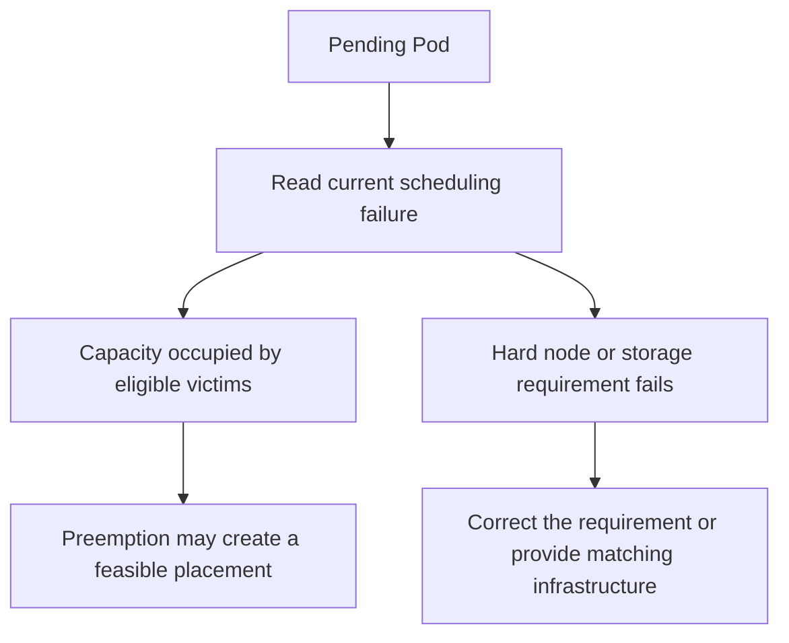

# Why Preemption Cannot Fix Every Pending Kubernetes Pod

Author: [nawazdhandala](https://www.github.com/nawazdhandala)

Tags: Kubernetes, Scheduling, Troubleshooting

Description: Diagnose taints, impossible node selectors, and storage topology before raising Pod priority or removing workloads that cannot solve the placement failure.

A pending Pod has a high priority, and several nodes contain lower-priority workloads. Yet the scheduler reports that preemption is not helpful. This can be correct: removing other Pods only helps when their removal makes a node satisfy the incoming Pod's requirements.

Preemption does not create a missing node label, grant a toleration, move an existing disk to another zone, or repair a broken storage provisioner. Before increasing priority again, identify the exact condition that remains false even on an otherwise empty node.

This guide reviews **Kubernetes 1.34.0** default scheduling behavior. Examples are read-only inspections or explicitly labeled configuration fragments; they do not delete workloads or storage.

## Ask the empty-node question

For each candidate node, ask: if eligible lower-priority Pods were removed, would the incoming Pod satisfy every hard requirement?

| Failure | Could removing Pods help? | Evidence to inspect |
|---|---|---|
| Insufficient requested CPU or memory | Possibly | Requests, available capacity, eligible victims |
| Untolerated `NoSchedule` taint | No, not by itself | Node taints and Pod tolerations |
| Required label does not exist | No | Node labels, node selector, required affinity |
| Bound volume belongs to an incompatible topology | No, not by freeing CPU | PV node affinity and Pod placement rules |
| Provisioning service is failing | No, not by evicting applications | PVC events, StorageClass, storage-controller evidence |

Do not generalize the last two rows to every storage-related scheduling problem. Attachment limits and other resource-like constraints have different behavior. The point is to diagnose the named constraint, not label all storage failures “unpreemptable.”



The [default preemption source](https://github.com/kubernetes/kubernetes/blob/v1.34.0/pkg/scheduler/framework/plugins/defaultpreemption/default_preemption.go) checks feasibility after simulated removals. It does not bypass unrelated scheduling filters because a Pod is important.

## Start with the admitted Pod and recent events

Replace the context, namespace, and object name with the workload under investigation:

```bash
kubectl --context staging -n workloads get pod REPLACE_WITH_POD -o yaml
kubectl --context staging -n workloads describe pod REPLACE_WITH_POD
kubectl --context staging -n workloads get events \
  --sort-by=.metadata.creationTimestamp
```

Read the actual Pod, not only its deployment template. Admission can add settings, and a scheduler profile can impose additional constraints. Keep the UID and event timestamp so old failures are not confused with a new replacement.

A scheduling message may aggregate different reasons across nodes. For example, some nodes can lack CPU while others have untolerated taints. Resolving one reason does not automatically make the entire cluster feasible. Build a short per-node or per-pool explanation instead of searching for a single magic priority value.

## Check taints without weakening isolation

A `NoSchedule` taint repels Pods that lack a matching toleration. Tolerating the taint permits consideration; it does not attract the Pod to that node or guarantee placement. The [taints documentation](https://kubernetes.io/docs/concepts/scheduling-eviction/taint-and-toleration/) explains this asymmetry.

Inspect the candidate node:

```bash
kubectl --context staging get node REPLACE_WITH_NODE -o json \
  | jq '{name: .metadata.name, taints: (.spec.taints // [])}'
```

For an approved workload intended for a pool tainted `dedicated=analytics:NoSchedule`, the relevant **PodSpec fragment** is:

```yaml
tolerations:
  - key: dedicated
    operator: Equal
    value: analytics
    effect: NoSchedule
```

Merge it into the workload's Pod template only after confirming that the workload is authorized for that pool. This is not a complete manifest. Do not add an unrestricted `Exists` toleration simply to silence an event; that can admit workloads to pools or unhealthy nodes they were intended to avoid.

The [1.34.0 taint filter](https://github.com/kubernetes/kubernetes/blob/v1.34.0/pkg/scheduler/framework/plugins/tainttoleration/taint_toleration.go) marks an untolerated blocking taint as unresolvable by preemption. Deleting an unrelated Pod leaves the taint intact.

## Resolve impossible node affinity

Inspect labels and compare them with `nodeSelector` and required node affinity:

```bash
kubectl --context staging get nodes --show-labels
```

An expression requiring `disk-type=local-ssd` cannot match a fleet where that label is absent. Adding a label should reflect a real node property or approved placement policy, not merely make the selector pass. Otherwise, the workload may start on infrastructure that lacks the capability it depends on.

Multiple expressions inside one required node selector term are combined with AND; alternative terms are combined with OR. A Pod's `nodeSelector` also has to match. The [node-affinity documentation](https://kubernetes.io/docs/concepts/scheduling-eviction/assign-pod-node/#node-affinity) describes these combinations. Look for contradictions such as requiring two incompatible values for the same key within one term.

The [pinned node-affinity plugin](https://github.com/kubernetes/kubernetes/blob/v1.34.0/pkg/scheduler/framework/plugins/nodeaffinity/node_affinity.go) identifies failures that removing other Pods cannot repair. If your scheduler profile adds affinity, include that administrator-managed configuration in the investigation.

## Follow the claim to its volume and storage class

A persistent volume claim (PVC) is the workload's request for storage. A persistent volume (PV) is the bound storage object. Start with the claim referenced by the Pod:

```bash
kubectl --context staging -n workloads get pvc REPLACE_WITH_PVC -o yaml
kubectl --context staging -n workloads describe pvc REPLACE_WITH_PVC
kubectl --context staging get storageclass REPLACE_WITH_STORAGE_CLASS -o yaml
kubectl --context staging get pv REPLACE_WITH_BOUND_PV -o yaml
```

Run the final command only when the claim has a bound PV name. Compare the PV's node affinity with the Pod's allowed nodes. A disk limited to one zone cannot become accessible from another zone merely because CPU has been freed there. See the [PV node-affinity documentation](https://kubernetes.io/docs/concepts/storage/persistent-volumes/#node-affinity).

For new dynamically provisioned volumes, `WaitForFirstConsumer` can defer binding or provisioning until workload placement constraints are considered. It requires support from the storage implementation and is not a repair command for an already-bound disk. The [StorageClass binding-mode documentation](https://kubernetes.io/docs/concepts/storage/storage-classes/#volume-binding-mode) also warns against bypassing the scheduler with `nodeName` in this workflow.

If provisioning is failing, investigate the controller's events, credentials, capacity, and backend health. Do not delete a PVC or rewrite PV topology as a scheduling shortcut; data migration or recovery needs a storage-specific plan.

## Confirm that the remaining blocker is gone

After a reviewed configuration or infrastructure change, inspect a newly created Pod from the workload's normal rollout and read its latest events. Confirm that the original taint, label, or storage conflict is gone before analyzing any remaining resource shortage.

The fragment and command syntax were checked locally against Kubernetes 1.34.0 schema and documentation, with a small JSON extraction check. No live admission, storage provisioning, or preemption was executed. The useful outcome is a feasible set of nodes satisfying the real requirements, not simply a higher priority number or fewer running neighbors.
