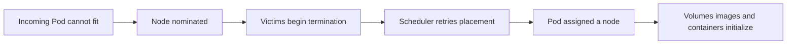

# Why a Preemptor Stays Pending After Victims Start Terminating

Author: [nawazdhandala](https://www.github.com/nawazdhandala)

Tags: Kubernetes, Troubleshooting, Scheduling

Description: Diagnose pending preemptors by separating nomination, victim shutdown, scheduling, and container startup without forcing unsafe deletion.

A high-priority Pod causes lower-priority Pods to terminate, yet it still shows `Pending`. The apparent contradiction often comes from treating preemption as an immediate transfer of a running slot. It is a sequence of decisions and asynchronous cleanup, and the incoming Pod still has to complete scheduling and startup.

Start by separating four states: a node has been nominated, victims are shutting down, the incoming Pod has been assigned a node, and its containers are starting. Each state has different evidence and different reasons for delay.

This guide uses the **Kubernetes 1.34.0 default scheduler** as its source baseline. Commands are read-only and use placeholder names; replace the example context and namespace with the cluster under investigation.

## Nomination is an intention, not a completed binding

`status.nominatedNodeName` records a proposed node associated with scheduling. `spec.nodeName` records the node to which the Pod has actually been assigned. Do not treat the first field as equivalent to the second.

After preemption, victims normally receive their graceful termination period. Meanwhile, another suitable node can become available, or higher-priority work can change the placement decision. A nominated node is therefore not an unconditional promise that the incoming Pod will run there. Kubernetes describes these cases in the [priority and preemption guide](https://kubernetes.io/docs/concepts/scheduling-eviction/pod-priority-preemption/#user-exposed-information).



This is an explanatory path, not a guarantee that every cluster exposes every intermediate state long enough to observe. Scheduling can choose a different node, and not every populated nomination field proves that a particular victim was deleted.

## Capture the incoming Pod first

Save its complete object before relying on a shortened display:

```bash
kubectl --context staging -n workloads get pod REPLACE_WITH_PREEMPTOR \
  -o json > preemptor.json
```

With `jq` installed, print the fields that separate nomination from assignment:

```bash
jq '{
  uid: .metadata.uid,
  phase: .status.phase,
  priority: .spec.priority,
  nominatedNode: (.status.nominatedNodeName // null),
  assignedNode: (.spec.nodeName // null),
  scheduled: [.status.conditions[]? |
    select(.type == "PodScheduled") |
    {status, reason, message, lastTransitionTime}],
  waiting: [(.status.initContainerStatuses[]?,
             .status.containerStatuses[]?) |
    select(.state.waiting != null) |
    {name, reason: .state.waiting.reason, message: .state.waiting.message}]
}' preemptor.json
```

If `assignedNode` is populated and the Pod is waiting for an image or a volume, the immediate problem is no longer “why has the scheduler not placed it?” A Pod can remain in the `Pending` phase while container setup is unfinished. The [Pod lifecycle documentation](https://kubernetes.io/docs/concepts/workloads/pods/pod-lifecycle/#pod-phase) explains why phase alone is too broad for this diagnosis.

Keep the UID in your incident notes. A controller might replace the incoming Pod while you investigate, and the new object can have a different scheduling history.

## Determine whether victims have actually finished

Identify victims from retained scheduling evidence, not just every terminating Pod on the nominated node. A terminating Pod may belong to an unrelated rollout.

Inspect each confirmed victim while its object still exists:

```bash
kubectl --context staging -n workloads get pod REPLACE_WITH_VICTIM \
  -o yaml
```

Record its deletion timestamp, configured termination grace period, current container states, node, and disruption condition. `Terminating` is a display status, not proof that the process has already exited. A shutdown hook, application drain, or slow node can extend the time between a deletion request and completed cleanup.

Graceful termination allows applications to flush work and close connections. The [termination flow](https://kubernetes.io/docs/concepts/workloads/pods/pod-lifecycle/#pod-termination) describes how hooks and process shutdown fit into that interval. Do not subtract the deletion timestamp from the current time and assume that elapsed grace time proves the process is gone; control-plane and node progress can diverge.

In the [1.34.0 default preemption code](https://github.com/kubernetes/kubernetes/blob/v1.34.0/pkg/scheduler/framework/plugins/defaultpreemption/default_preemption.go), the scheduler can avoid initiating more preemptions while qualifying victims are still terminating on the nominated node. There is also special handling when that node becomes unresolvable for the incoming Pod. A delay can therefore reflect deliberate avoidance of unnecessary additional disruption.

## If victims are gone, inspect the latest decision

Do not keep explaining a delay with a grace period after the relevant victims have finished. Read new scheduling events and the current Pod condition:

```bash
kubectl --context staging -n workloads describe pod REPLACE_WITH_PREEMPTOR
kubectl --context staging -n workloads get events \
  --sort-by=.metadata.creationTimestamp
kubectl --context staging describe node REPLACE_WITH_NOMINATED_NODE
```

Look for a new resource shortfall, a node becoming unavailable, changed taints, an affinity requirement, or volume-related placement constraints. A higher-priority arrival may also change who gets the newly available capacity. Preserve the event timestamp and involved object UID so old failure messages are not mistaken for the current blocker.

Some work happens through scheduler plugins or external components. The [preemption evaluator source](https://github.com/kubernetes/kubernetes/blob/v1.34.0/pkg/scheduler/framework/preemption/preemption.go) explicitly notes that an extender can later prevent placement on a nominated node. Review the actual scheduler profile rather than assuming the stock path is the entire installation.

If the Pod is assigned, follow its current waiting reason. Image pulls, volume setup, init-container work, and readiness are distinct from the resource-reclamation step that started the incident.

## Improve the handoff without sacrificing correctness

Measure the timeline before tuning it:

| Interval | Evidence to retain | Likely owner |
|---|---|---|
| Victim deletion requested to process exit | Pod state, shutdown logs, node logs | Application and node operators |
| Capacity available to assignment | Scheduling events and current filters | Scheduling and capacity owners |
| Assignment to container start | Waiting reasons, image and volume events | Runtime and storage owners |
| Container start to readiness | Probes and application startup logs | Application owner |

Use measurements to decide whether shutdown hooks are doing unnecessary work, images need pre-staging, storage startup is slow, or suitable capacity is simply unavailable. Spare capacity can avoid the preemption handoff altogether when placement constraints allow it.

Do not force-delete victims as a routine acceleration technique. Removing an API object does not prove its process has stopped, which is particularly dangerous for stateful writers. Shortening graceful shutdown should follow application-specific testing of data flushes, connection draining, and retries.

The inspection filter was executed locally against nomination, assignment-with-image-wait, and missing-status fixtures. Shell syntax and the pinned source paths were checked. No live scheduler, victim termination, or container startup timing was tested. A useful diagnosis states the current phase of the handoff and the evidence blocking the next step, rather than assuming `nominatedNodeName` guarantees an immediate start.
