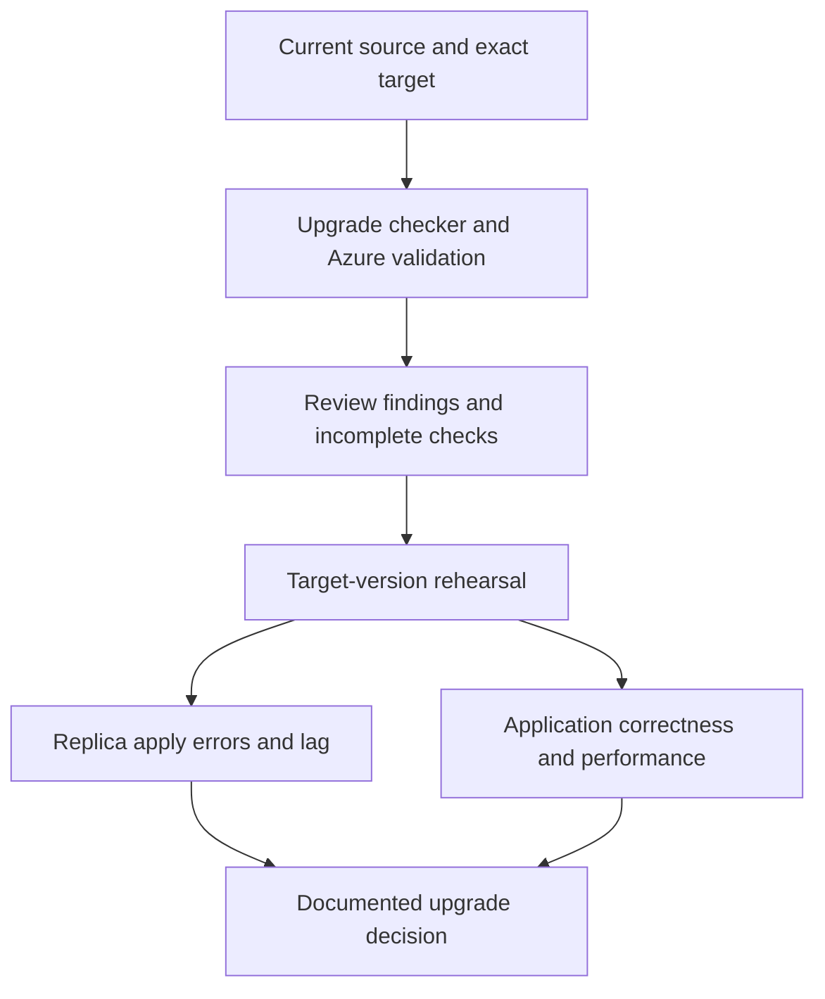

# Preflight Azure MySQL 8.0 Upgrades with Checks and Replica Logs

Author: [nawazdhandala](https://www.github.com/nawazdhandala)

Tags: Azure, MySQL, Testing, Troubleshooting

Description: Assess an Azure MySQL 8.0 upgrade with an explicit checker target, reviewed findings, replica error evidence, and realistic application rehearsal.

An upgrade checker can find an obsolete SQL mode in a stored procedure. It cannot tell you whether your checkout service reconnects correctly after maintenance, or whether a monthly report becomes much slower on the new optimizer.

A useful preflight combines three kinds of evidence: compatibility checks on the current database, replication observations on a rehearsal replica, and application tests against the target version. Keep those results separate so that a green result in one area cannot hide an unfinished check in another.

This walkthrough concerns a **5.7-to-8.0 upgrade** on Azure Database for MySQL Flexible Server. It does not recommend 8.0 as the final destination for every workload. Check Azure's version support policy and the versions available for your server. Azure requires sequential major-version upgrades; a later move from 8.0 to 8.4 is a separate assessment. [Version policy](https://learn.microsoft.com/en-us/azure/mysql/concepts-version-policy), [Upgrade FAQ](https://learn.microsoft.com/en-us/azure/mysql/flexible-server/how-to-upgrade-faq)

## Record the exact change you intend to test

Write down the source server's full engine version, intended Azure target version, application release, driver versions, and test data date. “MySQL 8” leaves too much unspecified.

Run this read-only query on the source using an authorized database account:

```sql
SELECT VERSION() AS engine_version,
       @@GLOBAL.sql_mode AS global_sql_mode,
       @@GLOBAL.character_set_server AS server_character_set,
       @@GLOBAL.collation_server AS server_collation;
```

Save the result with your test record. These server defaults are context, not a complete inventory: individual connections and stored objects can use different settings. For example, a global SQL mode change does not prove that every stored routine has compatible creation settings. [MySQL SQL modes](https://dev.mysql.com/doc/refman/8.0/en/sql-mode.html)

Use a restored copy for the first rehearsal. Plan its network isolation and application configuration so that test jobs cannot send real notifications or run production workflows. A realistic dataset is useful; uncontrolled production side effects are not part of a compatibility test.



## Run the checker with an explicit target

The example uses the **MySQL Shell 26.10.0** API and options. MySQL Shell is the administration client; its version number is not the database version you are upgrading to. Its upgrade checker supports assessing MySQL 5.7 sources for an 8.0 target. [Shell release](https://dev.mysql.com/doc/relnotes/mysql-shell/26.10/en/news-26-10-0.html), [Upgrade checker](https://dev.mysql.com/doc/mysql-shell/26.10/en/mysql-shell-utilities-upgrade.html)

Start MySQL Shell in JavaScript mode with `mysqlsh --js`. In that shell, use the following call after replacing the hostname, username, CA path, and **`8.0.PATCH` with the full Azure target version**. `8.0.PATCH` is deliberately not a valid version and must not be pasted unchanged.

```javascript
util.checkForServerUpgrade(
  {
    scheme: "mysql",
    host: "source-server.mysql.database.azure.com",
    port: 3306,
    user: "upgrade_review",
    "ssl-mode": "VERIFY_IDENTITY",
    "ssl-ca": "/approved/certificates/azure-mysql-roots.pem"
  },
  {
    targetVersion: "8.0.PATCH",
    outputFormat: "JSON"
  }
);
```

This opens a classic MySQL connection, prompts for the omitted password, and produces JSON findings. Use the server's canonical hostname and a maintained trusted CA bundle. `VERIFY_IDENTITY` checks the certificate identity as well as its trust chain; do not replace it with a weaker mode to bypass a connection problem. [Encrypted connections](https://dev.mysql.com/doc/mysql-shell/26.10/en/mysql-shell-encrypted-connections.html)

The pinned implementation requires `PROCESS` and `SELECT` privileges. Arrange an approved review account rather than granting broad privileges blindly. Older Shell documentation can list different requirements; keep the tool version with your report. [26.10.0 privilege validation](https://github.com/mysql/mysql-shell/blob/26.10.0/modules/util/upgrade_check.cc)

Run during an agreed low-impact window and observe server load. A compatibility inspection still executes database work. Save the complete output securely, including the reported source and target versions, and note any connection or permission failure separately.

## Separate incompatible objects from incomplete inspections

Read the individual checks, not just the summary count. There are several distinct outcomes:

| Evidence | Meaning | Follow-up |
|---|---|---|
| An incompatible object is identified | The checker ran and found a problem | Review a targeted schema or application fix |
| A check reports an execution or configuration error | That area was not fully assessed | Resolve the cause or document an alternative assessment |
| Warnings or manual checks remain | A decision or additional test is required | Assign an owner and record the result |
| No findings, with complete checks | Automated inspection found no known blocker | Continue with runtime rehearsal |

The pinned JSON formatter can emit `ERROR` and `CONFIGURATION_ERROR` check statuses in addition to `OK`. Even `OK` means that the check executed successfully, not that its `detectedProblems` array is empty. Preserve both status and findings when building a review report. [26.10.0 report implementation](https://github.com/mysql/mysql-shell/blob/26.10.0/modules/util/upgrade_checker/upgrade_check_formatter.cc)

Some checks require access to the server configuration file. Azure manages that file; do not point `configPath` at an unrelated local `my.cnf` and claim the managed configuration was assessed. Review Azure server parameters and its built-in validation, and record what remains unverified. [Checker configuration requirements](https://dev.mysql.com/doc/mysql-shell/26.10/en/mysql-shell-utilities-upgrade.html)

Azure documents specific warnings involving its built-in `mysql.` procedures that can be ignored. Record the exact match and supporting documentation. Do not generalize that exception to application procedures, all parser errors, or every object in the system schema. Run Azure's **Validate** action as an additional service-specific check before scheduling the upgrade. [Azure upgrade prerequisites](https://learn.microsoft.com/en-us/azure/mysql/flexible-server/how-to-upgrade)

## Observe an upgraded replica doing real work

For the replication part of rehearsal, use an approved test topology with a replica upgraded before its source. That ordering follows Azure's upgrade prerequisites and the upstream replication upgrade guidance. Do not independently upgrade a production replica as an unannounced experiment. [Replication upgrade order](https://dev.mysql.com/doc/refman/8.0/en/replication-upgrade.html)

Enable error logs on the test replica before the exercise. In Azure's **Server logs** page, enable logging, select **Error logs**, and save. Download files covering the upgrade and workload period. The documented error-log feature is in preview and exposes files through Server logs; do not assume they are already available in Log Analytics. [Azure error logs](https://learn.microsoft.com/en-us/azure/mysql/flexible-server/concepts-error-logs)

On the upgraded 8.0 replica, an account allowed to read Performance Schema can inspect replication worker errors:

```sql
SELECT CHANNEL_NAME, WORKER_ID, SERVICE_STATE,
       LAST_ERROR_NUMBER, LAST_ERROR_MESSAGE, LAST_ERROR_TIMESTAMP
FROM performance_schema.replication_applier_status_by_worker
WHERE LAST_ERROR_NUMBER <> 0
ORDER BY CHANNEL_NAME, WORKER_ID;
```

A worker applies replicated changes. These fields identify its most recent error and when it occurred. Correlate timestamps with the current rehearsal; an old recorded error is not automatically a new failure. Empty results alone do not prove replication is progressing. [Worker status fields](https://dev.mysql.com/doc/refman/8.0/en/performance-schema-replication-applier-status-by-worker-table.html)

Check Azure's replication status and lag metrics alongside the logs. Its storage-based replicas can display `No` for the SQL replica I/O-running field without that indicating a replication fault. Preserve the managed-service evidence instead of diagnosing from that field alone. [Azure replica monitoring](https://learn.microsoft.com/en-us/azure/mysql/flexible-server/concepts-read-replicas)

## Require application evidence before approval

Exercise application authentication, prepared statements, reports, date handling, sorting, and representative query plans. Use the same drivers and connection settings as production. Test writes against an isolated writable upgraded copy; a read-only replica cannot establish write compatibility.

For each failure, record the operation, expected result, actual result, server version, and relevant log interval. A replication error should lead to investigation of the affected statement or data, not skipping a transaction to make the dashboard green. A slower query should lead to plan and workload analysis, not an assumption that the newer version must be faster.

Approve the change only when findings are resolved or explicitly accepted, incomplete checks have owners, and the rehearsal meets agreed correctness and performance limits. Include a recovery exercise: Azure major-version upgrades are irreversible in place, and a pre-upgrade backup restores the older version to a recovery server. That recovery still needs application routing and reconciliation of writes made after the backup. A clean checker report is useful evidence; this tested recovery plan makes the upgrade operationally manageable. [Azure upgrade recovery behavior](https://learn.microsoft.com/en-us/azure/mysql/flexible-server/how-to-upgrade-faq)
