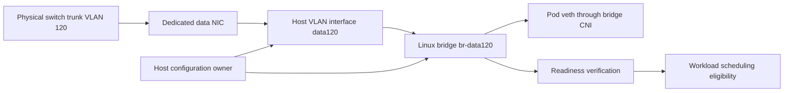

# Prepare Host Bridges and VLANs Before Multus Workloads

Author: [nawazdhandala](https://www.github.com/nawazdhandala)

Tags: Multus, Kubernetes, Networking

Description: Prepare a dedicated host VLAN and Linux bridge, verify the external path, and gate Multus workload placement on persistent node network configuration.

A Pod can be scheduled successfully while the host network it needs is still missing. Multus then invokes a delegate that references an absent parent interface, or connects the Pod to a bridge with no external uplink. Restarting the Pod does not repair the missing host preparation.

Separate node networking from Pod attachment. Provision the host topology first, verify it, and only then make the node eligible for the workloads that depend on it. Recheck the same contract after reboot and maintenance.

This guide reviews **CNI plugins v1.8.0**, **Multus v4.3.1**, and Linux iproute2 documentation. The command sequence is a transient staging example for a dedicated data interface. It was syntax-checked, not executed against a Linux host.

## Assign one owner to each layer

Multus selects and invokes plugins; it does not generally configure your physical switch or persistent host networking. Plugin behavior also differs. The Linux bridge plugin can create a missing bridge, whereas a macvlan attachment expects its selected parent interface to exist. An automatically created bridge without the intended uplink can make local attachment succeed while external traffic fails. The [bridge documentation](https://www.cni.dev/plugins/current/main/bridge/) explains its creation and layer-two behavior.

For this example, use one VLAN-specific Linux bridge:



The switch-to-node link carries tagged VLAN 120. The host VLAN interface handles that tag, while the bridge and Pod-facing ports carry ordinary frames for that one network. This is different from a VLAN-aware bridge carrying several tagged networks. Do not add a second Pod-port VLAN configuration to this example without redesigning the topology.

A host VLAN interface retained as a bridge uplink is also different from the CNI `vlan` plugin. That plugin creates a VLAN interface and places it in the container namespace, as its [documentation](https://www.cni.dev/plugins/current/main/vlan/) describes. Choose the design before choosing the similarly named configuration fields.

## Inventory the intended node

Use console or independent management access to a staging node. Identify a dedicated data NIC that carries no management address, default route, storage dependency, or existing bridge membership. Check the switch port's permitted VLANs and the actual interface names; names can differ across node models.

Run these read-only inspections with the node's approved diagnostic tools:

```bash
ip -brief address
ip route show
ip -d link show dev REPLACE_DATA_NIC
bridge link show
```

The first two commands help expose addresses and routes you must preserve. The detailed link view identifies existing relationships, and `bridge link show` lists bridge-port membership. The [ip-link](https://man7.org/linux/man-pages/man8/ip-link.8.html) and [bridge](https://man7.org/linux/man-pages/man8/bridge.8.html) manuals document these inspection commands.

Stop if the intended parent is already owned by another network design. Do not remove an existing address or enslave the node's management NIC to make the example fit. Record the intended parent, VLAN number, bridge name, MTU, switch port, configuration owner, and workloads that will use it.

## Build a transient topology in staging

The following Bash sequence requires root privileges through `sudo`, a reviewed dedicated parent, and unused names `data120` and `br-data120`. It does not assign a host IP address or change the default route. Run it only after confirming VLAN 120 is the approved staging network.

```bash
set -euo pipefail
parent=REPLACE_DATA_NIC
sudo ip link add link "$parent" name data120 type vlan id 120
sudo ip link add name br-data120 type bridge
sudo ip link set dev data120 master br-data120
sudo ip link set dev "$parent" up
sudo ip link set dev data120 up
sudo ip link set dev br-data120 up
```

These commands create a VLAN child, create a bridge, attach the child to the bridge, and bring the links up. They are deliberately not an idempotent production provisioning script. If a command fails, stop and inspect what was created rather than suppressing the error or deleting unfamiliar interfaces. A partial run must be reconciled by the owner before retrying.

The data NIC remains the VLAN's parent; only `data120` becomes a bridge port. With one external uplink, this example does not introduce a second physical forwarding path. Adding additional uplinks requires a separate loop-prevention or bonding design.

Verify the result:

```bash
ip -d link show dev data120
ip -d link show dev br-data120
bridge link show dev data120
```

Expect VLAN ID 120, the intended parent, and bridge membership under `br-data120`. Link state alone does not prove the physical switch forwards the VLAN. Test traffic from a controlled attachment to a known peer before making application nodes eligible.

## Keep the Pod attachment consistent

This NetworkAttachmentDefinition joins Pods to the prepared bridge at layer two. It intentionally has no IP allocation; it is an attachment example, not a complete application network.

```yaml
apiVersion: k8s.cni.cncf.io/v1
kind: NetworkAttachmentDefinition
metadata:
  name: data120-l2
  namespace: network-lab
spec:
  config: |
    {
      "cniVersion": "0.3.1",
      "name": "data120-l2",
      "type": "bridge",
      "bridge": "br-data120",
      "ipam": {}
    }
```

The [v1.8.0 bridge implementation](https://github.com/containernetworking/plugins/blob/v1.8.0/plugins/main/bridge/bridge.go) distinguishes layer-two operation by the absence of an IPAM type. Supply your approved address-management configuration before testing IP applications. Avoid enabling gateway, masquerading, or default-route options merely because another bridge example includes them; they change the design.

Use an existing staging namespace and ensure the bridge binary is installed in the path used by Multus. The bridge name must match the host configuration on every eligible node.

## Gate scheduling and make readiness persistent

A node label can express that the network has been prepared, provided a trusted operator or controller owns its lifecycle. For example, a workload Pod-template fragment can require:

```yaml
spec:
  nodeSelector:
    networking.example.com/data120-ready: "true"
```

Replace the example domain with your organization's label namespace. Kubernetes's [node assignment guide](https://kubernetes.io/docs/concepts/scheduling-eviction/assign-pod-node/) documents that `nodeSelector` is a placement requirement. The scheduler does not inspect the bridge itself. A stale label can therefore misrepresent readiness, and removing it does not automatically evict already-running Pods.

Publish eligibility only after checking the intended topology and its external path. Withdraw eligibility before planned network teardown, then handle existing workloads through the normal maintenance procedure. Reconcile the signal after failures instead of relying on a label set once during installation.

The `ip` commands above do not survive reboot by themselves. Express the topology through the host's existing network manager or provisioning system. For systemd-networkd, `.netdev` and `.network` files define virtual devices and link relationships; its [network configuration manual](https://www.freedesktop.org/software/systemd/man/latest/systemd.network.html) also explains file matching and precedence. Do not let two managers compete for the same interface.

Finally, reboot a staging node with application placement controlled. Confirm that the VLAN and bridge return, the correct interface is attached, traffic reaches the peer, and only then eligibility is restored. That sequence tests the operational dependency you need: the network is ready before a workload depends on it.
