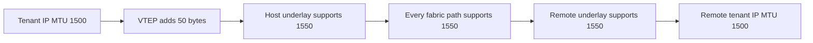

# Preserve a 1500-Byte Tenant MTU Across a VXLAN Underlay

Author: [nawazdhandala](https://www.github.com/nawazdhandala)

Tags: VXLAN, Linux, Networking

Description: Plan the underlay capacity needed for a 1500-byte VXLAN tenant MTU, distinguish IP and Ethernet limits, and stage changes with measurable acceptance checks.

Keeping a tenant network at MTU 1500 means the network underneath it must carry something larger. VXLAN wraps each tenant Ethernet frame in additional headers. A workload can therefore send a perfectly valid 1500-byte IP packet that becomes too large for an ordinary 1500-byte underlay.

The repair is a capacity change across a path, not just a larger number on one server. This guide plans that change for a simple Linux VXLAN deployment. The example uses an IPv4 underlay, untagged inner Ethernet frames, and no additional encryption or tunneling. Recalculate the budget when those assumptions change.

## Define the size you are promising

MTU is the maximum transmission unit. Here, the tenant promise is an **inner IP packet of 1500 bytes**, including its IP header. It is not a 1500-byte application payload.

For this design, the underlay IP packet needs room for:

| Content | Bytes |
| --- | ---: |
| Tenant IP packet | 1500 |
| Inner Ethernet header | 14 |
| VXLAN header | 8 |
| UDP header | 8 |
| Outer IPv4 header without options | 20 |
| Required outer IP size | **1550** |

The inner Ethernet frame's checksum trailer is not carried in this VXLAN format. The outer Ethernet framing is outside the 1550-byte IP calculation. [RFC 7348 packet format](https://www.rfc-editor.org/rfc/rfc7348.html).

Changing only the outer IP version changes the budget. IPv6's base header is 40 bytes, so this same inner packet needs 1570 bytes before any extension headers. A VLAN tag actually carried inside the tunnel adds another four bytes. Do not add an inner tag merely because the physical underlay uses VLANs; those are different locations in the packet. [IPv6 header format](https://www.rfc-editor.org/rfc/rfc8200.html).

## Translate the budget into each device's terminology

On Linux, setting an Ethernet interface MTU to 1550 allows a 1550-byte IP packet at that interface. A switch's maximum-frame setting may use different accounting. Look up whether its documented limit includes Ethernet headers, VLAN tags, and the frame check sequence, or FCS.

For the example packet, the arithmetic is:

| Measurement | Untagged outer Ethernet | One outer VLAN tag |
| --- | ---: | ---: |
| Outer IP packet | 1550 | 1550 |
| Ethernet frame excluding FCS | 1564 | 1568 |
| Ethernet frame including four-byte FCS | 1568 | 1572 |

These are packet-format calculations, not vendor configuration values. They exclude the preamble and inter-frame gap. A device setting named “MTU 1550” is acceptable only when its documented meaning accommodates the required frame.

A larger supported underlay policy, such as a consistently provisioned jumbo MTU, can provide headroom. It does not require tenants to use the same larger MTU. Record the minimum capacity the path guarantees rather than assuming every device interprets “jumbo” identically.

## Map every path that can carry the tunnel

A VTEP is a VXLAN tunnel endpoint. Between two VTEPs, inventory the transmitting interface, VLAN or bond layers, switch ports, routed interfaces, firewall paths, and receiving interface. Include alternative paths used after failures.



The diagram's 1550 labels refer to outer IP capacity. Switch frame limits must accommodate the surrounding Ethernet framing too.

For each hop, write down the current value, required value, configuration owner, persistence mechanism, and evidence. For a bond, include every member that may become active. For equal-cost routing, include the alternate next hops rather than testing only the route selected by one ping.

Cloud boundaries deserve an explicit row. AWS, for example, documents 1500-byte limits for traffic over internet gateways and VPN connections. An EC2 interface configured for jumbo frames does not override those path restrictions. Check the particular service and connection used by your overlay. [EC2 MTU guidance](https://docs.aws.amazon.com/AWSEC2/latest/UserGuide/network_mtu.html).

If a required hop cannot carry the budget, the 1500-byte tenant promise cannot be met by this unfragmented design. Choose another transport path or revise the tenant MTU consistently. Do not quietly depend on outer fragmentation: RFC 7348 notes that destination VTEPs may discard fragmented packets. [VXLAN fragmentation guidance](https://www.rfc-editor.org/rfc/rfc7348.html).

## Inspect the Linux endpoints before changing them

The following syntax is checked against **iproute2 6.12.0**. Replace `UNDERLAY_INTERFACE` with the actual device, and use your bridge and tunnel names:

```bash
ip -d link show dev UNDERLAY_INTERFACE
ip -d link show dev vxlan100
ip link show dev br100
```

Record their reported MTUs and the tunnel's local address, remote configuration, and underlying device. Inspect guest or container interfaces from their own network context as well. The host's bridge listing does not establish a guest's configured MTU. [Pinned ip-link manual](https://raw.githubusercontent.com/iproute2/iproute2/v6.12.0/man/man8/ip-link.8.in).

Separate the two intended policies: underlay capacity at least 1550 for this example, and tenant-facing IP MTU 1500. Do not raise the tenant MTU to 1550 just because the underlay was enlarged.

## Stage the capacity change

Prepare console access and the previous configuration before touching interfaces that carry management traffic. Schedule the work with the network owner. Some devices require port disruption or a broader system change; their model-specific instructions determine the procedure.

Provision the fabric's required capacity first, then verify the endpoint underlay. Keep ordinary tenant traffic controlled until the complete path passes acceptance. Raising capacity does not require immediately generating larger application traffic.

For an isolated Linux staging endpoint with a dedicated, simple Ethernet underlay, this is the relevant runtime operation:

```bash
sudo ip link set dev UNDERLAY_INTERFACE mtu 1550
ip link show dev UNDERLAY_INTERFACE
```

Run it only after replacing the placeholder and confirming the interface and upstream network support the value. The expected listing contains `mtu 1550`; that proves the local configuration, not remote delivery. Execute changes individually and inspect errors. Bonds, VLAN stacks, and managed container networks need their owner's procedure rather than this simplified sequence.

The command does not establish persistent configuration. Apply the approved value through the system that owns the interface, then verify it survives a controlled restart. Avoid competing manual settings and a network manager that restores a different value. [ip-link MTU operation](https://raw.githubusercontent.com/iproute2/iproute2/v6.12.0/man/man8/ip-link.8.in).

## Accept the path and preserve evidence

Using Linux **iputils 20240905**, probe the remote VTEP from the intended underlay source context:

```bash
ping -4 -n -c 3 -W 2 -w 10 -M do -s 1522 192.0.2.20
```

Replace the documentation address. The payload plus 20-byte IPv4 and 8-byte ICMP headers totals 1550. The command requests don't-fragment behavior and has a ten-second overall deadline. Repeat in the reverse direction. [Pinned ping options](https://raw.githubusercontent.com/iputils/iputils/20240905/doc/ping.xml).

Then test between staging tenants with a 1472-byte ping payload, which produces a 1500-byte inner IPv4 packet. Observe actual VXLAN traffic to confirm the expected outer size and absence of fragmentation. Inner ping DF and outer VXLAN DF are separate policies; one successful tenant ping alone does not prove an unfragmented outer path.

ICMP and VXLAN UDP may follow different forwarding choices. Exercise representative application flows, inspect drop counters, and test permitted alternate paths during the maintenance window. Retain endpoint settings, device frame-limit definitions, packet observations, and results in both directions.

If acceptance fails, keep tenant traffic controlled while restoring the approved prior configuration. Record which path could not meet the budget. Release normal traffic only after the complete tenant path works, not merely after every configuration command succeeds.

The calculations and shell syntax here were checked locally; no switch configuration or live Linux MTU change was performed. Your deployment evidence must come from the actual interfaces, forwarding paths, and applications that will carry the traffic.
