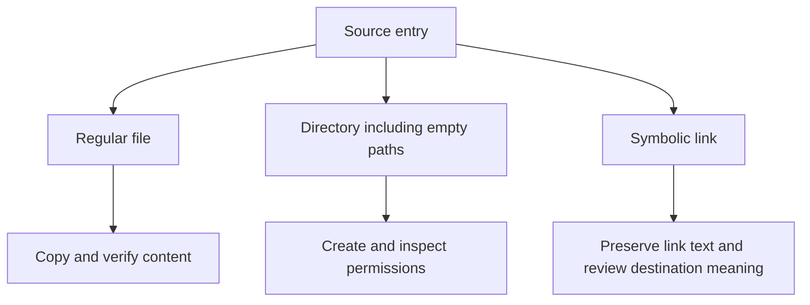

# Preserve Directory Structure and Permissions When Migrating to JuiceFS

Author: [nawazdhandala](https://www.github.com/nawazdhandala)

Tags: JuiceFS, Data Migration, Linux

Description: Migrate local trees into JuiceFS with explicit empty-directory, permission, and symlink handling, then verify filesystem semantics as well as file bytes.

A migration can copy every regular file and still break an application. An empty directory may be a required output location. A script may lose its executable bit. A symbolic link may become a copied target or point somewhere unexpected after the directory moves.

Define the filesystem behavior you need before choosing transfer flags. Then verify those properties independently of the command's byte count and exit status.

This guide targets **JuiceFS Community Edition 1.4.2** and a Linux source tree. It uses the native `jfs://` destination, so the copying process can access an existing JuiceFS volume without mounting it locally. The final application checks still need the application's real access path and identity.

## Decide which attributes belong to the migration

| Property | Transfer choice | Acceptance check |
| --- | --- | --- |
| Empty directories | `--dirs` | Expected empty paths exist as directories |
| Ownership and permission mode | `--perms` | Numeric UID/GID and mode match policy |
| Symbolic links | `--links` | Link text is retained and resolves as intended |
| Regular-file contents | `--check-all` | No unresolved mismatches; application reads pass |
| ACLs, extended attributes, hard-link relationships | Separate requirements | Explicit platform-specific validation |

The last row is deliberately separate. Do not interpret a permissions flag as proof that every filesystem attribute or relationship is preserved. Inventory anything your application relies on before transferring the full tree.

UID and GID are numeric user and group identifiers. Coordinate them across the migration host and application hosts. A familiar username displayed on two machines does not guarantee the same numeric identity.

## Prepare a small representative fixture first

Choose a staging sample containing an empty directory, a restricted configuration file, an executable file, a relative symlink, and any link types present in the real dataset. Include a dangling link if the application intentionally uses one; a dangling link stores a target path that does not currently exist.

Pause source changes during the final transfer and keep the destination isolated from writers. Also check that directory permissions permit traversal by the migration identity. Reading a file requires access through its parents, not just permission on the file itself.

Use a new destination prefix so pre-existing data does not obscure the result. Keep the source until acceptance is complete. This walkthrough does not request deletion from either side.

## Transfer with explicit semantics

Supply the existing volume's approved metadata address through your protected environment, then assign the native destination alias:

```bash
export migrationfs="$META_URL"

juicefs sync \
  --dirs \
  --perms \
  --links \
  --check-all \
  --threads 4 \
  /srv/migration-source/release-a/ \
  jfs://migrationfs/imports/release-a/
```

Replace the local source and destination prefix. `migrationfs` is an environment-variable alias containing the metadata address, not necessarily the volume's display name. The trailing slashes express copying the contents of the source directory into the chosen destination prefix. Review that layout on the sample before scaling up.

The [native sync documentation](https://github.com/juicedata/juicefs/blob/v1.4.2/docs/en/guide/sync.md#sync-without-mount-point) explains the alias form. This uses the existing filesystem; do not format a new volume merely to run a migration.

`--check-all` can repair destination contents from the source. It is not a read-only audit. The source must be authoritative while the command runs. Four workers are a starting point, not a universal capacity recommendation.

## Understand what happens to links

A symbolic link stores a path string. With `--links`, copying preserves that string rather than following it as ordinary file content. A relative link such as `../shared/config.json` is interpreted relative to its new location. An absolute link such as `/srv/legacy/config.json` still names that absolute path after migration.



Preserving link text does not guarantee that the target belongs inside the migrated tree or that the application can access it. Review absolute links and links that escape the tree as explicit dependencies. Do not automatically rewrite them without application-owner agreement.

The [sync guide](https://github.com/juicedata/juicefs/blob/v1.4.2/docs/en/guide/sync.md#copy-symbolic-links) notes that symlink modification times are not synchronized and that ordinary permission copying does not apply to preserved links. In the pinned implementation, link-aware comparison checks link text rather than reading the pointed-to file. Treat target-file validation as a separate question.

## Verify attributes without following links accidentally

Use this small inspection helper for selected source and destination paths. Save it outside both trees as `inspect_entry.py` and run it with Python 3:

```python
import argparse
import json
import os
import stat

parser = argparse.ArgumentParser()
parser.add_argument("path")
args = parser.parse_args()
value = os.lstat(args.path)
result = {
    "uid": value.st_uid,
    "gid": value.st_gid,
    "mode": oct(stat.S_IMODE(value.st_mode)),
}
if stat.S_ISLNK(value.st_mode):
    result.update(kind="symlink", target=os.readlink(args.path))
elif stat.S_ISDIR(value.st_mode):
    result.update(kind="directory")
elif stat.S_ISREG(value.st_mode):
    result.update(kind="file", size=value.st_size)
else:
    result.update(kind="other")
print(json.dumps(result, sort_keys=True))
```

`lstat` reports the link itself, while `readlink` retrieves its stored target. Neither resolves the target as part of this inspection. These functions are documented in Python's [filesystem interface](https://docs.python.org/3/library/os.html#os.lstat).

Through a mount of the destination volume, compare representative paths:

```bash
python3 inspect_entry.py /srv/migration-source/release-a/config.json
python3 inspect_entry.py /mnt/jfs/imports/release-a/config.json
```

Repeat for an empty directory, executable, and link. A matching file size does not prove content equality; use the transfer's verification results and a trusted manifest where available. Sampling is useful for diagnosing the setup, but complete acceptance of a large tree needs a complete inventory of the required properties.

## Read permission warnings as migration failures to investigate

The [1.4.2 sync implementation](https://github.com/juicedata/juicefs/blob/v1.4.2/pkg/sync/sync.go) attempts ownership changes before mode changes. Failures can be logged as warnings, so a successful process status alone is insufficient evidence that all attributes were retained.

Inspect warnings about `Chown` and `Chmod`, compare numeric results, and test the intended service identity. If the migration account cannot assign required ownership, resolve that through the approved administrative procedure. Do not compensate with recursive world-writable permissions.

Check the destination root and its parents too. Even if every child file has the right owner, an inaccessible parent can prevent the application from reaching them. For symlinks, distinguish attributes of the link from permissions on its target and target parents.

## Accept the application-facing result

Verify the expected empty paths, executable behavior, configuration reads, link destinations, and application-created output files. Compare source and destination inventories under the agreed stable source state. Record exceptions such as intentionally external links and unsupported special-file types.

Local validation for this guide imported a fixture through `jfs://` into a SQLite/file-backed JuiceFS volume and exported it for inspection. Empty directories, regular-file contents, current-user numeric ownership, selected modes, relative links, and dangling-link text survived the round trip. The inspection helper was also tested locally.

Those checks did not cover root-owned files, cross-host identity mapping, ACLs, extended attributes, hard-link preservation, or a live Linux FUSE mount. Validate those requirements explicitly before switching applications to the destination and releasing the source copy.
