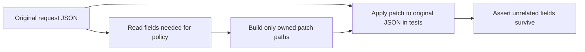

# Preserve New Pod Fields When a Webhook Uses Older Go Types

Author: [nawazdhandala](https://www.github.com/nawazdhandala)

Tags: Kubernetes, Go, DevOps

Description: Prevent older Go admission webhooks from deleting newer Pod fields by keeping the original JSON and emitting narrowly scoped patches.

A cluster upgrade enables a new Pod field. Your webhook only adds an annotation, yet the new field disappears after admission. The webhook has not necessarily made a deliberate policy decision. It may have decoded the Pod into an older Go struct, serialized that struct again, and generated a patch that removes everything the struct could not represent.

This is a compatibility problem at the serialization boundary: the point where JSON becomes a programming-language value and back again. You can prevent it by separating what the webhook reads from what it writes.

## Understand the destructive round trip

Go's standard JSON decoder normally ignores object keys that have no matching struct field. That is convenient for reading newer messages, but re-encoding the struct cannot restore the ignored content. The [Go JSON documentation](https://pkg.go.dev/encoding/json@go1.25.0#Unmarshal) describes the decoder's field matching and unknown-key behavior.

Consider a Pod with `spec.resources`. Pod-level resource requests and limits are documented in [Kubernetes resource management](https://kubernetes.io/docs/concepts/configuration/manage-resources-containers/#pod-level-resource-specification). The older [`k8s.io/api` v0.28.4 PodSpec](https://github.com/kubernetes/api/blob/v0.28.4/core/v1/types.go) does not contain that field. This is a deliberately historical library version for demonstrating the problem, not a dependency recommendation.

There are two different failure patterns:

| Patch inputs | Possible result |
|---|---|
| Original request JSON versus re-encoded old Pod | The difference includes removal of fields unknown to the old struct. |
| Re-encoded old Pod before mutation versus the same struct afterward | Unrelated serialization changes can be hidden, but replacing a whole nested object or array can still erase newer content. |

Passing the original bytes as the first argument to a diff helper is necessary for an accurate comparison. It does not make a lossy second argument safe. For example, controller-runtime's [`PatchResponseFromRaw` in v0.23.0](https://github.com/kubernetes-sigs/controller-runtime/blob/v0.23.0/pkg/webhook/admission/response.go) computes a JSON difference between the two supplied byte sequences. It cannot know that a missing field was accidentally discarded.



## Write only the field you own

For a small annotation default, do not round-trip the whole Pod at all. The following helper reads metadata and constructs a JSON Patch. JSON Patch describes operations such as adding one map entry; it is the patch format supported by [mutating admission responses](https://kubernetes.io/docs/reference/access-authn-authz/extensible-admission-controllers/#response).

This is a complete Go package file, tested with Go 1.25.0. Save it as `patch.go` in your webhook's package, adjusting the package name if needed. The helper requires an object with metadata. The surrounding handler must restrict requests to the intended Pod resource and operations, handle errors, and construct the AdmissionReview response.

```go
package podpatch

import (
    "bytes"
    "encoding/json"
    "fmt"
)

type operation struct {
    Op    string `json:"op"`
    Path  string `json:"path"`
    Value any    `json:"value"`
}

func DefaultProfilePatch(raw []byte) ([]byte, error) {
    var object map[string]json.RawMessage
    if err := json.Unmarshal(raw, &object); err != nil {
        return nil, err
    }
    var metadata map[string]json.RawMessage
    if err := json.Unmarshal(object["metadata"], &metadata); err != nil {
        return nil, err
    }
    if metadata == nil {
        return nil, fmt.Errorf("metadata must be an object")
    }

    const key = "platform.example.com/profile"
    const value = "standard"
    annotationsRaw, exists := metadata["annotations"]
    if !exists || bytes.Equal(bytes.TrimSpace(annotationsRaw), []byte("null")) {
        return json.Marshal([]operation{{
            Op: "add", Path: "/metadata/annotations",
            Value: map[string]string{key: value},
        }})
    }

    var annotations map[string]string
    if err := json.Unmarshal(annotationsRaw, &annotations); err != nil {
        return nil, err
    }
    if _, present := annotations[key]; present {
        return []byte("[]"), nil
    }
    return json.Marshal([]operation{{
        Op: "add",
        Path: "/metadata/annotations/platform.example.com~1profile",
        Value: value,
    }})
}
```

`json.RawMessage` retains the encoded value until you choose to decode it. Here, the helper never decodes or re-encodes `spec`. It cannot accidentally turn a new scheduling option into a removal operation because it emits no path under `/spec`.

When annotations are absent or null, the patch creates the annotations map. When the map exists, it adds only its owned key. An existing profile, including an empty string, is preserved: this is a default, not an enforcement rule. The slash in the annotation key becomes `~1` in the JSON Pointer path. That escaping follows [RFC 6901](https://www.rfc-editor.org/rfc/rfc6901.html#section-3); the structural slashes separating `metadata` and `annotations` remain unchanged.

Use the returned bytes as the patch payload, not as a replacement Pod. Set `patchType` to `JSONPatch` when returning a nonempty patch and echo the admission request UID in the response. The protocol represents patch bytes as base64 in JSON; a correctly typed AdmissionResponse with a byte slice handles that serialization. Do not base64-encode twice. For `[]`, your handler can return an ordinary allowed response without a patch.

## Test preservation, not just the new annotation

A test that checks only the new annotation will pass even if the webhook removes half the Pod specification. Apply the returned patch to the original request and compare the rest of the object.

Use a real newer-field fixture on a cluster version that supports it:

```json
{
  "apiVersion": "v1",
  "kind": "Pod",
  "metadata": {
    "name": "preservation-check",
    "annotations": {"owner.example.com/team": "payments"}
  },
  "spec": {
    "resources": {"requests": {"cpu": "100m", "memory": "64Mi"}},
    "containers": [{"name": "app", "image": "registry.example.internal/app:APPROVED_VERSION"}]
  }
}
```

The image is a placeholder; this JSON is a local patch fixture, not a runnable application recommendation. Expected results are precise: the profile annotation appears, the owner annotation survives, and `spec` remains structurally equal to the original. Applying the helper again should produce `[]`.

Also cover missing annotations, null annotations, an empty map, an explicit profile, malformed input, and unexpected metadata shapes. Add synthetic future fields to local tests, clearly labeling them as preservation probes. Such fields are not claims that the Kubernetes API accepts arbitrary properties. Server-side [field validation](https://kubernetes.io/docs/reference/using-api/api-concepts/#field-validation) is a separate boundary.

For this article, local tests reproduce the loss of `spec.resources` through the old v0.28.4 Pod type and verify preservation through the helper. They do not establish live admission behavior or prove that a particular cluster enables Pod-level resources.

## Plan the dependency upgrade too

Narrow patches reduce accidental deletion; they do not give an old webhook knowledge of new semantics. If policy depends on a newer security, scheduling, or resource field, update the Kubernetes libraries and the policy logic together. Unknown fields should not silently bypass a requirement the webhook claims to enforce.

Review every patch that replaces a parent object or a complete array. A container replacement can lose new container fields even when the top-level Pod is preserved. Prefer the smallest owned paths, with explicit conflict handling when another injector already owns related configuration.

Before rolling out the revised webhook, compare old and new outputs against captured, sanitized requests from the supported Kubernetes versions. Record unexpected removals as test failures. The compatibility contract should be clear: the webhook changes its documented fields and preserves the rest, while explicitly rejecting requests it cannot safely interpret when policy requires that interpretation.
