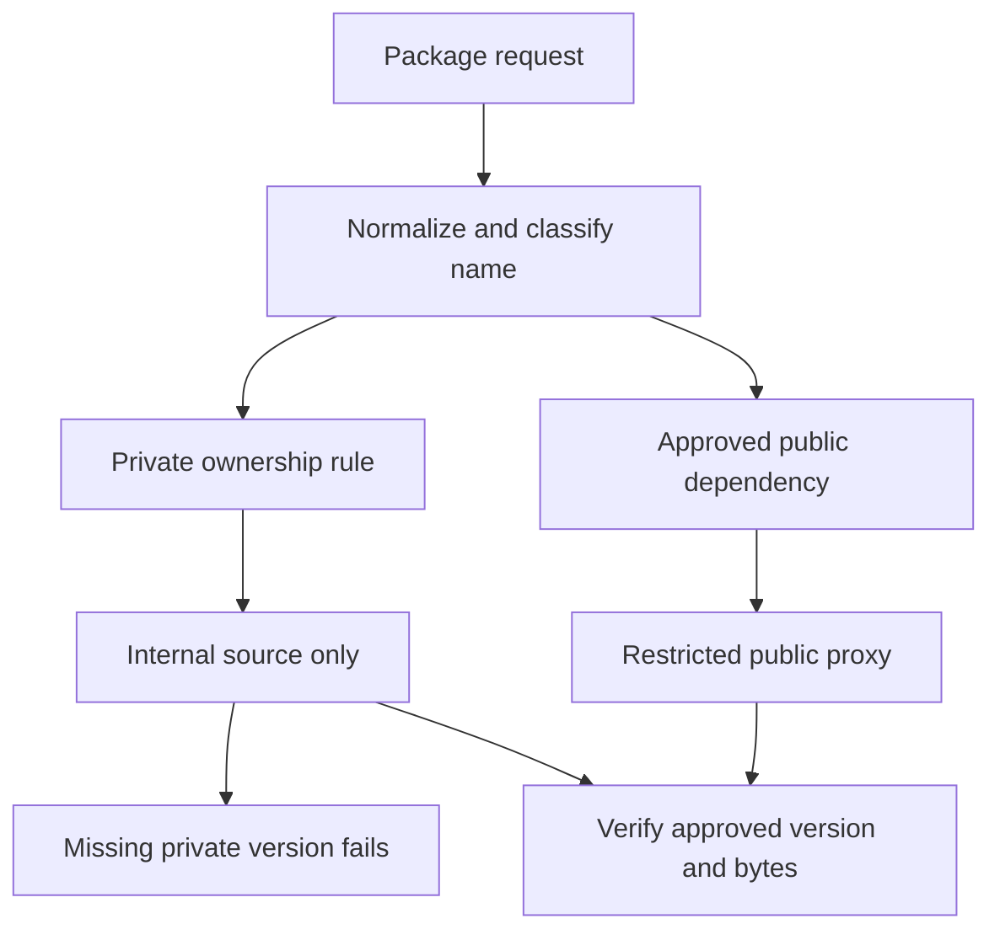

# Prevent Dependency Confusion with Explicit Namespace Routing

Author: [nawazdhandala](https://www.github.com/nawazdhandala)

Tags: Artifact Management, Software Supply Chain, Security, npm, Python

Description: Route private package names to trusted repositories, restrict public upstreams, and test missing-package behavior instead of relying on repository order.

A build needs an internal package called `acme-payments`. Your private repository has version 1.4.0, while a public registry contains a different package with the same name and a much higher version. Depending on the resolver and configuration, the public package can become a candidate.

That is dependency confusion: a package manager crosses the intended trust boundary because a name does not unambiguously identify its source. Putting the private repository first in a list is not a complete defense. Define which source owns each private namespace, then test what happens when the package is missing there.

The examples use npm **11.10.0** for a local routing test. Python and repository-manager behavior is checked against official documentation; no public packages were published and no production repository was changed.

## Make ownership explicit before changing the resolver

Write down the namespaces your organization controls. Examples include an npm scope such as `@acme`, a Maven group prefix such as `com.acme`, and an exact list of private Python distribution names. Avoid assuming that the same punctuation or hierarchy works across package formats.

For every private name, the desired rule is simple: resolve it only from its approved internal source. A missing version should fail with a useful error. It should not widen the search to unrelated public content.

| Request | Approved source | Missing-package result |
|---|---|---|
| Internal npm scope | Private npm repository | Fail without public fallback |
| Internal Maven group | Approved internal Maven path | Public proxy rejects the namespace |
| Private Python distribution | Internal index with ownership policy | No public candidate for that name |
| Approved public dependency | Controlled public proxy | Apply upstream allow-list and review policy |

Keep this ownership policy independent of package versions. A public version number should not be able to override the source assigned to a private name.

## Route npm scopes directly

npm supports associating a scope with a registry. Its [scope documentation](https://docs.npmjs.com/cli/v11/using-npm/scope/) explains that packages in that scope are retrieved from the associated registry.

For npm 11.10.0, put this in the project's reviewed `.npmrc`:

```ini
registry=https://packages.example.internal/repository/npm-public-approved/
@acme:registry=https://packages.example.internal/repository/npm-private/
```

Replace both URLs and `@acme` with your approved endpoints and scope. The default registry provides reviewed public packages; the scoped registry serves private packages. Configure authentication separately and scope credentials to the intended host and path. Do not commit a token in this file.

This only helps packages that actually use the scope. An old unscoped package named `acme-payments` does not become protected by an `@acme` rule. Migrate its naming or implement an explicit server-side ownership rule for that exact name.

A safe routing probe is a metadata request for a deliberately absent test name:

```bash
npm view @acme/retired-routing-probe version \
  --fetch-retries=0 --update-notifier=false
```

Run it in an isolated test project with the intended `.npmrc` and an empty client cache. The expected result is a private-registry not-found response. Verify from proxy or fixture logs that no package lookup reached the public source. A client-side error by itself does not establish where the request went.

The local test for this article used two loopback HTTP fixtures. The private endpoint returned 404; a separate default endpoint was prepared to advertise a higher version. npm 11.10.0 failed the scoped lookup without consulting the default endpoint for that package. Update notifications were disabled to keep unrelated requests out of the measurement. This tests that client configuration, not the policy inside your private repository.

## Do not use pip extra indexes as a priority boundary

Pip's [install documentation](https://pip.pypa.io/en/stable/cli/pip_install/) warns about dependency confusion when using `--extra-index-url` for private packages. It considers candidates from the configured locations; the extra index is not simply a fallback consulted only after the first index has failed.

Use one controlled index for the build, with server-side rules that keep private names away from public upstreams. For example, the approved build command might be:

```bash
python -m pip install \
  --index-url https://packages.example.internal/repository/pypi-approved/simple/ \
  --require-hashes -r requirements.lock
```

This assumes an existing reviewed lock file containing exact versions and hashes for all dependencies, suitable authentication, and trusted HTTPS certificates. Remove conflicting extra-index configuration from the managed environment. Inspect requirements for direct URLs and other sources that bypass index selection.

Hashes bind installation to reviewed bytes. They do not establish that the original dependency selection was trustworthy. An attacker-controlled package selected while creating the lock file can still have a perfectly valid hash.

Python names also require normalization. The [packaging specification](https://packaging.python.org/en/latest/specifications/name-normalization/) treats runs of dots, underscores, and hyphens equivalently after lowercasing. An ownership list containing `acme-payments` must also recognize `Acme_Payments` as the same normalized name.

Use the documented normalization rule when preparing policy inputs:

```python
import re

def normalize_distribution(name):
    return re.sub(r"[-_.]+", "-", name).lower()

assert normalize_distribution("Acme_Payments") == "acme-payments"
assert normalize_distribution("acme...payments") == "acme-payments"
```

This helper normalizes names; it does not validate allowed characters, enforce routing, or create a Python namespace. Apply it to names already validated by your package inventory process.

## Enforce the boundary at every public proxy

Client configuration is only one layer. An internal group endpoint can still mix private and public sources. Apply namespace restrictions to each external proxy so changing group order or accessing a proxy directly does not bypass the policy.

Nexus [routing rules](https://help.sonatype.com/en/routing-rules.html) support ALLOW and BLOCK modes with Java regular-expression matchers and provide a request-path tester. They apply to proxy repositories. For a Maven private group, test actual metadata, POM, and artifact paths under that group; do not copy an npm path pattern into a Maven rule.

Keep patterns narrow and verify boundary cases. A pattern intended for `com.acme` should not accidentally block an unrelated `com.acmecommunity` group or omit nested private groups. The rule tester is useful, but also exercise real requests and review any previously cached public content for protected names. Do not assume a new outbound restriction cleans up old cache contents.

Artifactory provides [include and exclude patterns](https://docs.jfrog.com/artifactory/docs/virtual-repositories) that affect repository searches. Its patterns and resolution behavior are product-specific. Do not translate a Nexus Java regular expression directly into an Artifactory pattern without checking its syntax and scope.

## Test absence, collisions, and bypasses



Use owned staging repositories or local fixtures, never a real public namespace as an experiment. Test an existing private package, a missing private package, and an absent private version. Add a harmless higher-version collision in the staging public source and confirm it cannot win.

Repeat with cold caches, normalized Python name variants, direct proxy access, and the actual build's configuration. Include transitive dependencies and package-manager settings inherited from users, environment variables, and automation. Explicit download URLs need their own review because they may not follow namespace routing.

Record both client results and server requests. If the private package is missing, the correct outcome is a clear failure that stays within its assigned trust boundary. Only after that behavior is demonstrated should repository order be treated as an operational optimization rather than a security guarantee.
