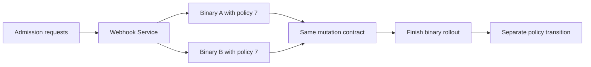

# Keep Mixed Webhook Replicas Consistent During Rolling Upgrades

Author: [nawazdhandala](https://www.github.com/nawazdhandala)

Tags: Kubernetes, DevOps

Description: Separate webhook code rollouts from policy changes, compare admission results locally, and manage mixed replicas without assuming an atomic cutover.

Two identical Pod creation requests arrive seconds apart. One receives a small sidecar; the other receives a different image and resource limit. Both requests succeeded. The difference came from which webhook replica answered while a Deployment was rolling out.

A rolling update deliberately overlaps old and new replicas. Kubernetes' [Deployment documentation](https://kubernetes.io/docs/concepts/workloads/controllers/deployment/#rolling-update-deployment) describes the surge and availability controls, but those controls do not guarantee that two application versions make the same admission decision. Readiness means a replica can serve according to your probe. It does not prove agreement with its neighbors.

The safest routine upgrade keeps the mutation contract stable while changing the executable. Change policy afterward, using an explicit compatibility plan.

## Identify everything that controls the result

A webhook's output depends on more than its image tag. Record its executable digest, policy revision, enabled features, templates, and external lookup inputs. If replicas read mutable configuration independently, the same binary can still return different patches.

Use an image digest for an immutable executable reference; Kubernetes documents the distinction between [tags and digests](https://kubernetes.io/docs/concepts/containers/images/#image-names). Digests do not freeze external configuration or runtime downloads. Those need separate controls.

Separate these two questions in release review:

| Question | Required evidence |
|---|---|
| Can the new binary implement the current policy? | Old and new results agree on a representative request corpus. |
| Can the new policy coexist with the old one? | A defined transition contract, including reinvocation and existing injected fields. |

A request corpus is simply a collection of sanitized admission inputs and expected outcomes. Include defaults, explicit user choices, already-injected Pods, conflicts, and fields introduced by newer Kubernetes versions.

## Keep policy stable during binary replacement

Suppose executable versions A and B both understand policy revision 7. Roll B out while all replicas continue using revision 7. Only after A has left the serving pool should you consider activating revision 8.



This is a compatibility strategy, not a Kubernetes feature that enforces agreement. Your executable must actually support selecting and loading the intended policy.

An immutable ConfigMap can identify one configuration artifact. This example uses ordinary Kubernetes fields available in v1.35; `policy.json` and its contents are an illustrative application-owned format, not built-in webhook settings:

```yaml
apiVersion: v1
kind: ConfigMap
metadata:
  name: webhook-policy-7
  namespace: admission-system
immutable: true
data:
  policy.json: |
    {"revision":"7","defaultProfile":"standard"}
```

Reference that exact ConfigMap name from the webhook's Pod template and have the server load it before becoming ready. Keep the same reference during the executable-only rollout. Kubernetes [immutable ConfigMaps](https://kubernetes.io/docs/concepts/configuration/configmap/#immutable-configmaps) prevent changes to their data, but do not stop an authorized actor deleting and recreating the object. Retain controlled configuration ownership and, if necessary, verify the content checksum at startup.

Avoid treating updates to a mounted, mutable ConfigMap as a synchronized policy switch. Kubernetes describes [mounted ConfigMap updates](https://kubernetes.io/docs/tasks/configure-pod-container/configure-pod-configmap/#mounted-configmaps-are-updated-automatically) as eventually propagated; environment variables are not automatically updated. Application reload behavior adds another independent delay.

## Compare the resulting objects

Different patch bytes can express the same result. One replica might add an annotations map; another might add two entries to an existing map. Compare the decision and resulting object, while separately reviewing whether either patch touches fields it does not own.

The following local checker uses Python 3.11 and `jsonpatch==1.33`. Its [upstream package](https://pypi.org/project/jsonpatch/1.33/) applies RFC 6902 patches. Supply a sanitized AdmissionReview request and the two complete responses captured by your test harness for that exact request. This script does not contact a webhook or cluster.

Save as `compare-admission.py`:

```python
import base64
import json
import sys
import jsonpatch

request_path, old_path, new_path = sys.argv[1:]
with open(request_path) as stream:
    request = json.load(stream)["request"]

def result(path):
    with open(path) as stream:
        response = json.load(stream)["response"]
    if response.get("uid") != request["uid"]:
        raise ValueError(f"{path}: response UID mismatch")
    if response.get("allowed") is not True:
        raise ValueError(f"{path}: expected an allowed response")
    if not response.get("patch"):
        return request["object"]
    if response.get("patchType") != "JSONPatch":
        raise ValueError(f"{path}: unexpected patch type")
    operations = json.loads(base64.b64decode(response["patch"], validate=True))
    if not isinstance(operations, list):
        raise ValueError(f"{path}: patch must be an array")
    return jsonpatch.apply_patch(request["object"], operations, in_place=False)

old_result = result(old_path)
new_result = result(new_path)
if json.dumps(old_result, sort_keys=True) != json.dumps(new_result, sort_keys=True):
    raise SystemExit("FAIL: replicas produce different objects")
print("PASS: allowed responses produce the same object")
```

Run it inside a disposable virtual environment after installing the pinned package:

```bash
python3.11 -m venv .venv
.venv/bin/python -m pip install jsonpatch==1.33
.venv/bin/python compare-admission.py request.json old-response.json new-response.json
```

A pass means these two allowed responses produce equal JSON objects for this input. It does not prove that the object is valid, the policy is correct, or the whole server is compatible. The checker deliberately fails on denied responses; maintain separate cases that compare expected denials, reasons, and failure behavior. Also inspect warnings and audit annotations separately when they form part of your contract.

Do not log unsanitized admission bodies merely to collect fixtures. They can contain application configuration and credentials. Keep reproducible synthetic cases for routine tests and tightly control any captured production examples.

## Test the mixed-version sequences

Agreement on a fresh request is only the first test. Send the output of each implementation back through each implementation: A after A, B after B, A after B, and B after A. Exercise the actual handlers again, not just the previously returned patch. The next patch depends on the updated input.

Kubernetes requires mutating webhooks to be [idempotent and compatible with reinvocation](https://kubernetes.io/docs/reference/access-authn-authz/extensible-admission-controllers/#reinvocation-policy). Idempotence means repeating the operation does not keep adding changes. Mixed-version tests should catch duplicate sidecars, alternating annotation values, and repeated resource rewrites.

Keep per-replica logs for binary digest, policy revision, admission UID, decision, and a safe summary of changed paths. A readiness check should verify that the expected policy loaded successfully, not only that the HTTP listener opened. Test configuration-load failure before rollout so an unconfigured replica cannot quietly serve defaults.

## Finish the rollout before changing behavior

Inspect the Deployment and the Service's EndpointSlices, including target Pod identities and readiness conditions. [EndpointSlices](https://kubernetes.io/docs/concepts/services-networking/endpoint-slices/) represent the Service's backend endpoints. A completed rollout and the expected endpoints are useful evidence, but allow for in-flight requests and configuration propagation before claiming the old behavior is gone.

If incompatible policies cannot coexist, use a separately planned transition. Separate Services can isolate versions, but changing a webhook configuration or Service selector is not a global instantaneous barrier across API servers and existing requests. A coordinated maintenance window may be necessary for a strict boundary; define who stops affected writes and how completion is verified.

Retain the previous image and policy artifact together. Rolling the executable back while leaving a newer, unsupported policy active can worsen the incident. Rollback also does not remove fields already injected into stored workloads. Address those through their own reviewed migration, then resume normal changes once the serving replicas and policy revision are again consistent.
