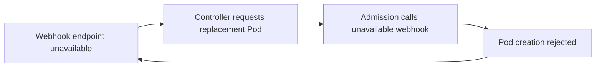

# Prevent a Mutating Webhook from Blocking Its Own Recovery

Author: [nawazdhandala](https://www.github.com/nawazdhandala)

Tags: Kubernetes, Reliability, DevOps

Description: Break webhook startup dependency loops with explicit namespace exclusions, inspect failed replacement Pods, and rehearse recovery without disabling all admission.

A webhook can look healthy for months and still contain a recovery deadlock. Its existing Pods keep serving requests, so nothing reveals that creating their replacements requires calling the same webhook. When the last reachable replica disappears, Kubernetes cannot admit the Pods that would bring it back.

More replicas reduce the likelihood of reaching that state. They do not remove the dependency. The durable fix is to make the webhook's recovery path independent of its own admission service, then test that path with no healthy webhook endpoint in a controlled environment.

The configuration examples below target **Kubernetes v1.35.0**. Names such as `admission-system`, `profile-webhook`, and `profile-mutator` are illustrative: replace them with the namespace, Service, and Deployment from your own installation.

## Recognize the circular dependency

A Deployment's controller creates or manages ReplicaSets, which create replacement Pods. Those Pod creation requests still pass through admission. If the webhook matches its own namespace and uses `failurePolicy: Fail`, a failed call can reject the replacement request.



The Pod might never exist, so repeatedly checking Pod logs can miss the problem. Inspect the controller's events and admission error messages instead. Kubernetes describes the controller relationships in the [Deployment guide](https://kubernetes.io/docs/concepts/workloads/controllers/deployment/).

An available webhook can also reject its own replacement through its business rules. Excluding self-managed resources protects against both situations. Kubernetes explicitly recommends avoiding [self-mutation and dependency loops](https://kubernetes.io/docs/concepts/cluster-administration/admission-webhooks-good-practices/#avoid-self-mutations).

## Exclude the serving namespace before a failure

For a webhook intended only to mutate new application Pods, this fragment belongs inside the relevant `webhooks[]` entry:

```yaml
rules:
  - operations: ["CREATE"]
    apiGroups: [""]
    apiVersions: ["v1"]
    resources: ["pods"]
    scope: Namespaced
namespaceSelector:
  matchExpressions:
    - key: kubernetes.io/metadata.name
      operator: NotIn
      values:
        - admission-system
        - kube-system
```

This is a matching fragment, not a complete `MutatingWebhookConfiguration`. Keep the working endpoint, certificate authority bundle, admission review versions, and other required fields in the full configuration.

The selector excludes Pods in either listed namespace. Kubernetes automatically sets the immutable `kubernetes.io/metadata.name` label on namespaces, so the exclusion does not depend on someone remembering to add a custom label during recovery. See the [automatic namespace label documentation](https://kubernetes.io/docs/concepts/overview/working-with-objects/namespaces/#automatic-labelling).

Merge this exclusion with existing selectors instead of replacing your production scope with this fragment. Existing `matchLabels` and `matchExpressions` continue to apply together. If you already use an opt-in namespace label, retain it and add the explicit infrastructure exclusions.

Also review every webhook entry. One excluded mutator does not help if another mutator or validator still blocks the replacement Pod. A namespace selector does not exclude arbitrary cluster-scoped resources, so avoid broad wildcard rules for resources the handler does not need. The [admission matching reference](https://kubernetes.io/docs/reference/access-authn-authz/extensible-admission-controllers/#matching-requests-namespaceselector) explains that boundary.

## Make the excluded workload self-contained

Exclusion means the webhook server cannot depend on its own mutation to become runnable. Put required settings directly in its Deployment's Pod template: image pull credentials, volumes, security settings, proxy configuration, and any required helper containers.

Check dependencies that live elsewhere. For example, the serving certificate may depend on a certificate controller, and image pulls may depend on an internal registry. If those components' Pods require the unavailable webhook to start, excluding only `admission-system` leaves an indirect cycle.

Write a short inventory with the component, its namespace, the admission entries that match it, and how it recovers. Expand exclusions based on that inventory rather than exempting every platform namespace without review. If other teams can deploy arbitrary applications into an exempt namespace, tighten namespace access and use appropriate independent validation controls.

## Collect evidence with read-only commands

Run these commands with a kubeconfig for the intended cluster and permission to read the named resources. Adjust names before copying them:

```bash
kubectl -n admission-system get deployment profile-mutator -o yaml
kubectl -n admission-system get replicasets -o wide
kubectl -n admission-system get events --sort-by=.metadata.creationTimestamp
kubectl -n admission-system get pods -o wide
kubectl -n admission-system get service profile-webhook -o yaml
kubectl -n admission-system get endpointslices \
  -l kubernetes.io/service-name=profile-webhook -o yaml
```

Look for failed Pod creation events mentioning the webhook name and a connection, timeout, or certificate error. Compare desired replicas with actual Pods. Then check whether the Service selects the intended Pods and whether its EndpointSlices contain usable ready endpoints.

EndpointSlices describe Service backends; they do not prove that the API server can reach them or validate their certificates. A ready endpoint with continuing admission failures needs network and TLS investigation, not an assumption that the controller is broken. Consult the [EndpointSlice reference](https://kubernetes.io/docs/concepts/services-networking/endpoint-slices/) and [Service debugging procedure](https://kubernetes.io/docs/tasks/debug/debug-application/debug-service/).

The commands use standard [`kubectl get` output and sorting options](https://kubernetes.io/docs/reference/kubectl/generated/kubectl_get/). They do not delete Pods, drain nodes, change failure policy, or alter admission scope.

## Rehearse recovery when the endpoint is absent

Use a staging installation with the same admission rules and workload template. Arrange a controlled loss of webhook availability through your approved failure-testing procedure. Do not experiment by taking down production endpoints without a recovery plan.

The essential acceptance test has two parts: a replacement webhook Pod must be admitted while the endpoint is unavailable, and that Pod must subsequently start and restore service. Passing only a server-side dry run establishes neither scheduling nor container startup.

| Observation | Meaning |
|---|---|
| Replacement Pod request rejected by the webhook | A direct or indirect admission dependency remains |
| Pod created but Pending | Investigate capacity, scheduling constraints, or volumes |
| Pod created but image pull fails | Registry access or credentials block recovery |
| Pod running but no usable endpoint | Investigate readiness and Service selection |
| Endpoint restored but calls still fail | Investigate API-server connectivity and TLS |

Also verify that an ordinary application Pod still receives its intended mutation after recovery. Fixing startup by accidentally excluding the application cohort is not a successful test.

## Keep availability controls and recovery controls separate

Spread replicas across appropriate failure domains and reserve enough capacity for replacements. Scheduling constraints need to fit the available nodes; overly strict constraints can leave all replacement Pods Pending. Kubernetes documents these tradeoffs in [topology spread constraints](https://kubernetes.io/docs/concepts/scheduling-eviction/topology-spread-constraints/).

A PodDisruptionBudget can limit voluntary evictions but cannot prevent a node from failing. It also does not repair an admission dependency. The [disruption documentation](https://kubernetes.io/docs/concepts/workloads/pods/disruptions/) makes that distinction.

If an incident already exists, identify the exact blocking entry and use your reviewed emergency procedure for the smallest necessary scope change. Coordinate with the configuration owner so reconciliation does not immediately revert it. Making every webhook fail open or deleting all configurations can create unrelated policy gaps.

After service returns, preserve the permanent namespace exclusions and independently configured server template. Record the replacement admission evidence and the remaining runtime dependencies. Recovery should work because the dependency loop is gone, not because someone remembers an emergency switch.
