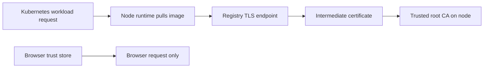

# Fix Private Registry Unknown-Authority Errors with Correct CA Trust

Author: [nawazdhandala](https://www.github.com/nawazdhandala)

Tags: Container Registry, TLS, Troubleshooting

Description: Diagnose private-registry certificate failures, repair the certificate chain, and install CA trust in the Docker or containerd client that actually pulls images.

A private registry opens successfully in your browser, but an image pull fails with `x509: certificate signed by unknown authority`. That is not necessarily a contradiction. The browser, Docker daemon, Kubernetes node runtime, and build worker may use different trusted certificate authorities.

A certificate authority, or CA, signs certificates. A client must build a valid chain from the registry's certificate to a CA it trusts. This guide uses OpenSSL3.6.2 for inspection and containerd2.1.5 for its concrete runtime configuration. It keeps verification enabled throughout.

## Identify the process reporting the error

Start with the failing operation and its execution location. A Docker CLI can control a daemon on another host. A Kubernetes image pull happens through the node's container runtime, before the application container starts. Installing a CA inside that application image cannot fix the preceding image download.

| Failure location | Trust configuration to investigate |
| --- | --- |
| `docker pull` | The Docker daemon performing the pull |
| Pod image pull | The runtime on the scheduled Kubernetes node |
| Separate build worker | That worker's registry client and configuration |
| Browser or standalone HTTP request | That browser or HTTP client's trust configuration |

Also identify the hostname in the error. Token authentication or blob redirects can involve another endpoint. Fixing trust for the registry hostname does not automatically fix an identity service or object-storage hostname.



## Inspect the connection with its intended name

From an approved diagnostic environment, use the real registry name and port:

```bash
openssl s_client \
  -connect registry.example.internal:5000 \
  -servername registry.example.internal \
  -verify_hostname registry.example.internal \
  -verify_return_error -showcerts </dev/null
```

Replace the example authority. `-servername` supplies Server Name Indication, which helps a shared TLS endpoint select the certificate. `-verify_hostname` checks the expected identity. `-verify_return_error` stops on verification errors rather than treating the session as a successful diagnostic connection. The [OpenSSL s_client manual](https://docs.openssl.org/3.6/man1/openssl-s_client/) explains these options.

A failure here may simply mean this diagnostic machine does not trust your internal CA. Repeat with `-CAfile /protected/approved-root.pem` after obtaining the root through your organization's trusted distribution process. Do not decide to trust a root merely because the failing server presented it.

Compare the result with the original runtime's network path. A successful request from a laptop does not prove that a node sees the same load balancer, proxy, or certificate chain.

## Distinguish missing trust from other certificate failures

An unknown-authority error often means a missing trusted root or an incomplete intermediate chain. Other errors need different corrections:

- A hostname mismatch requires a certificate covering the registry name used by clients.
- An expired or not-yet-valid certificate requires certificate or clock investigation.
- A missing intermediate requires the server to present the necessary chain.
- An unexpected issuer may indicate an approved TLS-inspection proxy or a misrouted connection that must be investigated.

The server normally sends the leaf and required intermediate certificates. The client already holds its trusted root. Simply copying the leaf into every trust store makes renewal brittle and bypasses the intended CA lifecycle.

For certificate files supplied through an approved inspection process, verify the chain offline:

```bash
openssl verify -purpose sslserver \
  -verify_hostname registry.example.internal \
  -CAfile root.pem \
  -untrusted intermediates.pem \
  registry-leaf.pem
```

Here `root.pem` is the approved trust anchor, `intermediates.pem` contains intermediate certificates, and `registry-leaf.pem` is the serving certificate. Success should report the leaf as OK. The intermediate file helps build the chain; it is not being declared the trust anchor. See the [OpenSSL verification reference](https://docs.openssl.org/3.6/man1/openssl-verify/).

## Configure Linux Docker Engine trust

For the exact authority `registry.example.internal:5000`, the Docker Engine layout is:

```text
/etc/docker/certs.d/registry.example.internal:5000/ca.crt
```

Install the approved CA certificate or CA bundle there using your host-configuration process. Keep the `.crt` extension: Docker treats `.cert` files as client certificates, which serve a different purpose. The directory must match the registry authority. A registry accessed on default HTTPS without an explicit port uses the corresponding hostname-only directory.

Follow [Docker's certificate documentation](https://docs.docker.com/engine/security/certificates/) and your platform's reload procedure, then repeat the actual pull on that daemon. Do not assume a Linux path on your workstation changes a remote daemon or Docker Desktop's managed environment. Avoid an unplanned daemon restart on a busy host just to test a trust change.

## Configure containerd2.1.5 explicitly

For the Kubernetes Container Runtime Interface, abbreviated CRI, containerd2.x uses this registry configuration under its version3 configuration format:

```toml
version = 3

[plugins."io.containerd.cri.v1.images".registry]
  config_path = "/etc/containerd/certs.d"
```

Merge the setting into the existing reviewed configuration; do not replace the node's entire file with this fragment. containerd1.x uses a different plugin key.

For this authority, place `hosts.toml` under `/etc/containerd/certs.d/registry.example.internal:5000/`:

```toml
server = "https://registry.example.internal:5000"

[host."https://registry.example.internal:5000"]
  capabilities = ["pull", "resolve"]
  ca = "/etc/containerd/certs.d/registry.example.internal:5000/ca.crt"
```

Install the approved CA at the indicated path. Leave `skip_verify` unset. Check that no higher-priority host directory, such as the Unix `registry.example.internal_5000_` form, already defines conflicting settings. The [tagged containerd host-configuration guide](https://github.com/containerd/containerd/blob/v2.1.5/docs/hosts.md) documents directory lookup, CA paths, CRI settings, and the distinction from `ctr` options.

Changes inside an already configured hosts directory do not require a containerd restart according to that guide. Changing the daemon's `config_path` is a different operation and belongs in a planned node configuration rollout.

## Prove the fix through the original client

Repeat the failing image pull using an approved test repository. On Kubernetes, test on each relevant node class, including newly provisioned nodes. A cached image can conceal a broken registry connection, so use a controlled uncached image digest in staging.

A certificate fix may reveal the next independent failure, such as missing credentials. An `imagePullSecret` supplies authentication data; it does not install a CA into the runtime. Preserve that distinction rather than repeatedly rotating passwords for a trust failure.

Local tests for this guide built a disposable root, intermediate, and leaf chain. OpenSSL3.6.2 accepted the correct chain and rejected a missing intermediate, wrong root, and wrong hostname. No Docker or containerd pull was performed.

For future CA rotation, distribute the new root before serving certificates that require it. Retain the old root during the planned overlap, validate uncached pulls across clients, and remove old trust only after dependent certificates and endpoints have moved. A verified pull from the process that originally failed is the useful completion signal.
