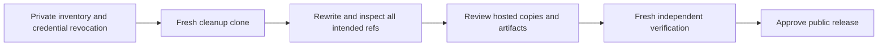

# Review Secrets and Git History Before Making a Repository Public

Author: [nawazdhandala](https://www.github.com/nawazdhandala)

Tags: Open Source, Git, Security

Description: Revoke exposed credentials, rehearse history cleanup in a fresh clone, and review hosted artifacts before changing a private repository's visibility.

The current branch contains no passwords, the build passes, and the README is ready. That is a useful start for an open-source release, but Git can still contain an old configuration file, a forgotten tag, or credentials copied into a test fixture.

Public release needs two separate decisions: whether the material is appropriate to disclose, and whether any credentials previously stored there still grant access. Deleting a string from Git does not revoke the credential it represented.

## Revoke credentials before cleaning history

If you discover a real token, password, or private key, identify its owner and revoke or rotate it at the issuing service first. Update legitimate consumers through your secret-management process and verify that the old credential no longer works. Do not place either value in the cleanup ticket.

GitHub's sensitive-data guidance makes credential revocation the first step. History rewriting changes commit identifiers and can invalidate signatures; it also requires coordination with collaborators to avoid restoring the original history. [GitHub removal guidance](https://docs.github.com/en/authentication/keeping-your-account-and-data-secure/removing-sensitive-data-from-a-repository).

Record credential identifiers, affected services, rotation time, and verification results. For a production dependency, the service owner should control the transition so credential replacement does not become an unexplained outage. Keep incident evidence in a restricted location rather than leaving a backup of the contaminated repository beside the public release files.

## Inventory what will become visible

Start with a disclosure worksheet. A repository can contain sensitive material that no credential scanner recognizes:

| Surface | Examples to review |
| --- | --- |
| Tracked history and tags | Old environment files, certificates, customer fixtures, internal endpoints |
| Commit and tag messages | Copied command lines, incident details, personal information |
| Hosted collaboration | Issue attachments, pull request text, review comments, wiki pages |
| Generated material | Release archives, packages, container layers, workflow logs and artifacts |
| Linked content | Submodules, Git Large File Storage objects, external downloads |

Assign an owner to each surface and record what was inspected. Git Large File Storage, or LFS, stores large content separately from ordinary Git blobs; do not confuse a clean pointer file with a reviewed payload.

GitHub specifically warns that Actions history and logs become visible when a private repository becomes public. Treat the visibility change as a publication event across those surfaces, not merely a switch on the default branch. [Repository visibility consequences](https://docs.github.com/en/repositories/managing-your-repositorys-settings-and-features/managing-repository-settings/setting-repository-visibility).

## Scan history while the project is still private

Use a history-aware secret scanner and review its findings before publication. GitHub documents scanning the full Git history across branches for supported secret types. That is valuable coverage, but supported patterns do not describe every confidential document or organization-specific credential format. Combine automated detection with the disclosure worksheet and targeted searches for known exposures. [Secret scanning](https://docs.github.com/en/code-security/concepts/secret-security/secret-scanning).

Agree on a temporary change freeze with maintainers before rewriting. Otherwise an accepted cleanup can become obsolete as another branch is pushed. Preserve a restricted recovery copy and record its retention policy. The recovery copy is still sensitive even when the cleaned project is ready to publish.



## Rehearse whole-file removal in a fresh clone

This example uses **git-filter-repo 2.47.0**, Python 3.11, and Git. Install the pinned tool using its official instructions and put `git-filter-repo` on your PATH. It is a reference version for this walkthrough. Work in a new, access-controlled review directory, not an active development checkout.

The example removes an entire private configuration file, including its historical renamed path. Replace the URL and both paths with reviewed values:

```bash
git clone 'https://github.com/YOUR-ORG/YOUR-PRIVATE-REPO.git' cleanup-review
cd cleanup-review
git filter-repo --sensitive-data-removal --invert-paths \
  --path config/private.env --path .env.private
```

This changes the local clone's history. Do not run it merely to inspect a repository. The sensitive-data mode fetches additional refs and reports cleanup information; use a fresh clone so local-only work is not lost. Path filtering does not follow renames automatically, which is why both known names are listed. Keep the tool's report in restricted evidence. [Versioned filter-repo manual](https://github.com/newren/git-filter-repo/blob/v2.47.0/Documentation/git-filter-repo.txt).

If legitimate source files contain an isolated secret, deleting the whole file may be inappropriate. Design a reviewed content replacement instead, then rerun the build and tests. Do not narrow cleanup to one branch just because it is the branch you normally release.

## Check known paths and content independently

First inspect the removed paths across locally available refs:

```bash
git log --all --format='%h' -- config/private.env .env.private
```

Expect no output. This checks those path histories; it does not establish that their contents were never copied elsewhere. `--all` covers the local references available to Git, not every hosted cache or another developer's clone. [Git revision traversal](https://git-scm.com/docs/git-rev-list).

For a bounded repository review, save the following as `check_known_content.py` outside the repository. It checks file contents at each reachable commit against literal patterns from a protected file. It prints commit identifiers, never the matched content:

```python
from pathlib import Path
import subprocess
import sys

patterns = Path(sys.argv[1]).resolve()
lines = patterns.read_bytes().splitlines()
if not lines or any(not line for line in lines):
    raise SystemExit('Use a nonempty pattern file without blank lines')
commits = subprocess.check_output(
    ['git', 'rev-list', '--all'], text=True
).splitlines()
if not commits:
    raise SystemExit('No reachable commits; review the intended ref inventory')
found = False
for commit in commits:
    result = subprocess.run([
        'git', 'grep', '--quiet', '--fixed-strings',
        '-f', str(patterns), commit, '--'
    ])
    if result.returncode == 0:
        print('Known content found in commit', commit)
        found = True
    elif result.returncode != 1:
        raise SystemExit('Git search failed; review is incomplete')
print('Reachable commits checked:', len(commits))
raise SystemExit(1 if found else 0)
```

Create the pattern file through an approved secure workflow, with one known value per line and restrictive permissions. Do not place secrets in command-line arguments, shell history, or the repository being scanned. Run from the cleanup clone:

```bash
python3.11 /review-tools/check_known_content.py /protected/known-patterns.txt
```

Exit zero means those literal patterns were not found in the checked file snapshots. Exit one indicates a match or an incomplete review; read the message. A Git error blocks acceptance. Git's fixed-string matching treats patterns literally, while quiet mode reports matches through status rather than printing content. [Git grep](https://git-scm.com/docs/git-grep).

This deliberately simple checker rereads snapshots and can be slow on large histories. It does not scan commit messages, tag messages, separate LFS payloads, encoded variants, or remote-only references. It supplements a maintained scanner and manual review; it is not a certificate that the project contains no secrets.

## Reconcile the hosting service and collaborators

After local validation, coordinate the reviewed history replacement with repository administrators. Do not paste a blanket force-push command into an incident before deciding which refs are authoritative and whether anybody has pushed new work. Keep a record of the expected before-and-after ref identities.

GitHub documents additional cleanup for cached views and pull request references, sometimes involving Support. Other clones and forks can retain the original objects. Ask collaborators to use clean clones or follow the documented cleanup process before resuming work. [Hosted cleanup and recontamination risks](https://docs.github.com/en/authentication/keeping-your-account-and-data-secure/removing-sensitive-data-from-a-repository).

Separately review or replace generated assets. A rebuilt release should come from the accepted history and configuration, with the project's normal validation results attached. Rewriting Git does not itself rebuild a package or remove text already emitted into a workflow log.

## Make publication a verified handoff

Have another reviewer inspect a fresh clone from the final private remote. Run the approved scanner, the targeted checks, and the project's build and tests again. Record the reviewed commit, branches, tags, tool versions, known exclusions, and artifact inventory. Verify that actual secret values have not leaked into the review evidence itself.

Replace private configuration with documented placeholders and an example file. Add ignore rules for local secret files, but remember that `.gitignore` does not stop tracking files already committed. Prevention rules do not remove existing history. [Git ignore semantics](https://git-scm.com/docs/gitignore).

The local fixture for this article contained only a synthetic marker. Tests confirmed that history scanning found it after deletion from the current tree, and that removing both historical paths eliminated it from the retained branches and tag while preserving ordinary documentation. No real credential was used, no remote history was replaced, and no repository visibility was changed. Publish only after the actual project has the same explicit evidence for its broader, real disclosure scope.
