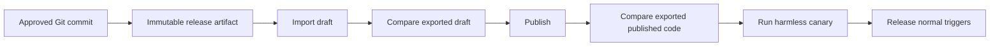

# Promote Azure Runbooks from Git and Verify the Published Code

Author: [nawazdhandala](https://www.github.com/nawazdhandala)

Tags: Azure Automation, CI/CD, PowerShell

Description: Promote an approved runbook artifact through draft import, content verification, publication, and published-content checks without racing another editor.

A deployment pipeline reports success, but the next scheduled Azure Automation job still runs yesterday's code. One explanation is simple: the pipeline imported a draft and never published it. Another is harder to spot: something changed the draft between your import and publication.

Treat promotion as a sequence of evidence checks. Select one approved Git revision, preserve its artifact, verify the imported draft, publish it, and verify the published content. A runbook name or a successful upload does not identify the code that future jobs will run.

## Understand the two versions

Azure Automation maintains a Draft and a Published version of a runbook. Editing the draft does not change the published version. Publishing replaces the published version with the draft. Normal execution uses the published version; the test experience works with the draft. [Runbook management documentation](https://learn.microsoft.com/en-us/azure/automation/manage-runbooks).



The comparisons are necessary but cannot stop another writer. Serialize the entire promotion per Automation account and runbook, and coordinate portal editors and source-control synchronization. A CI lock that excludes only other CI jobs does not exclude a person editing in the portal.

## Choose one publication owner

If you use Automation's built-in source-control integration, inspect the configured branch, folder, Auto Sync, and Publish Runbook settings. Auto Sync and automatic publication are separate choices. The folder selection does not recursively include every child folder. A successful synchronization can therefore be the wrong evidence for the deployment you intended. [Source-control integration settings](https://learn.microsoft.com/en-us/azure/automation/source-control-integration).

For this walkthrough, a release pipeline owns import and publication. Suspend competing synchronization or place it outside the promotion window. Do not leave two systems independently publishing the same runbook.

Before changing production, preserve the current published artifact and record the runtime, module dependencies, worker placement, parameters, and trigger bindings. Arrange a controlled window for normal triggers and existing jobs according to the workload's requirements. Changing source code is not a migration plan for work that is already running.

## Prepare an approved artifact

Use a checkout of an exact approved commit in a clean release workspace. Copy the intended textual PowerShell runbook into a release artifact and record its SHA-256 digest in the protected release record. Keep the digest and approval outside the mutable file that the deployment will upload.

The example uses deployment-host PowerShell 7.4.6, Az.Accounts 5.3.0, and [Az.Automation 1.11.2](https://www.powershellgallery.com/packages/Az.Automation/1.11.2). These are explicit example versions, not a latest-version recommendation. The Azure runbook runtime is configured separately. The example assumes an existing textual `PowerShell` runbook with the intended runtime and dependencies already established; it does not provision or upgrade that environment.

The following runs in an already authenticated deployment session. Replace the account, resource group, file path, and approved hash. Verify the session's tenant and subscription before using it. [Get-AzContext](https://learn.microsoft.com/en-us/powershell/module/az.accounts/get-azcontext) captures that reviewed context for the later operations.

```powershell
$ErrorActionPreference = 'Stop'
Import-Module Az.Accounts -RequiredVersion 5.3.0
Import-Module Az.Automation -RequiredVersion 1.11.2

$context = Get-AzContext
if ($null -eq $context) { throw 'Authenticate the deployment session first.' }
$target = @{
    ResourceGroupName = 'REPLACE-resource-group'
    AutomationAccountName = 'REPLACE-automation-account'
    Name = 'InventoryRunbook'
    DefaultProfile = $context
}
$artifact = (Resolve-Path './release/InventoryRunbook.ps1').Path
$approvedHash = 'REPLACE-WITH-APPROVED-SHA256'
if ((Get-FileHash -LiteralPath $artifact -Algorithm SHA256).Hash -cne $approvedHash) {
    throw 'Artifact hash does not match the approved release.'
}
$tokens = $null
$parseErrors = $null
$null = [Management.Automation.Language.Parser]::ParseFile(
    $artifact, [ref]$tokens, [ref]$parseErrors)
if ($parseErrors.Count) { throw 'Artifact has PowerShell syntax errors.' }
```

Use the uppercase hash returned by [Get-FileHash](https://learn.microsoft.com/en-us/powershell/module/microsoft.powershell.utility/get-filehash?view=powershell-7.4) in this exact comparison. [ParseFile](https://learn.microsoft.com/en-us/dotnet/api/system.management.automation.language.parser.parsefile?view=powershellsdk-7.4.0) checks syntax for the deployment host's parser; it does not test Azure modules, permissions, or compatibility with a different runbook runtime. Execute tests in the intended runtime before approval.

## Import, then compare the draft

Use fresh export directories for each deployment. This avoids mistaking a file left by a previous run for the latest export. The following helper compares decoded text while normalizing Windows line endings. It does not trim whitespace or ignore comments.

```powershell
function Assert-RunbookContent {
    param([string] $ExpectedPath, [string] $ActualPath)
    $expected = [IO.File]::ReadAllText($ExpectedPath).Replace("`r`n", "`n")
    $actual = [IO.File]::ReadAllText($ActualPath).Replace("`r`n", "`n")
    if (-not [string]::Equals($expected, $actual, [StringComparison]::Ordinal)) {
        throw 'Runbook content differs from the approved artifact.'
    }
}
```

Save that helper in the deployment script before the next commands. Create a unique evidence directory for this promotion:

```powershell
$evidence = Join-Path (Get-Location) ('promotion-' + [guid]::NewGuid().ToString())
$draftFolder = Join-Path $evidence 'draft'
$publishedFolder = Join-Path $evidence 'published'
$null = New-Item -ItemType Directory -Path $draftFolder, $publishedFolder

Import-AzAutomationRunbook @target -Path $artifact -Type PowerShell -Force | Out-Null
Export-AzAutomationRunbook @target -Slot Draft -OutputFolder $draftFolder | Out-Null
Assert-RunbookContent $artifact (Join-Path $draftFolder 'InventoryRunbook.ps1')
```

`-Force` permits the intended overwrite of the existing draft; review any draft edits before entering this workflow. Import deliberately omits `-Published`, so verification happens first. The documented [import command](https://learn.microsoft.com/en-us/powershell/module/az.automation/import-azautomationrunbook?view=azps-16.5.0) supports a separate publication option, which this sequence does not use.

The [export command](https://learn.microsoft.com/en-us/powershell/module/az.automation/export-azautomationrunbook?view=azps-16.5.0) supports `Draft` and `Published` slots and names the exported file after the runbook. A missing file or content mismatch must stop the deployment. Do not catch that error and continue to publication.

## Publish and verify the executable version

Keep the promotion lock held and the approved artifact immutable while publishing:

```powershell
Publish-AzAutomationRunbook @target | Out-Null
Export-AzAutomationRunbook @target -Slot Published -OutputFolder $publishedFolder | Out-Null
Assert-RunbookContent $artifact (Join-Path $publishedFolder 'InventoryRunbook.ps1')
Write-Output 'Published runbook content matches the approved artifact.'
```

The [publish command](https://learn.microsoft.com/en-us/powershell/module/az.automation/publish-azautomationrunbook?view=azps-16.5.0) changes the production version. This is a deployment action, not a dry run. If the final comparison fails, publication may already have changed production. Keep normal triggers controlled, capture evidence, and investigate before declaring success.

This sequence is not an atomic compare-and-publish transaction. Preventing concurrent writers is essential. For particularly sensitive workloads, use a separately named release runbook and a reviewed trigger handover rather than relying on a narrow gap between verification and publication.

## Verify behavior and preserve rollback evidence

Run a harmless canary through the published execution path with explicitly reviewed parameters. Verify the resulting job, its output, and the intended business result. A draft test-pane success does not replace this check. Resume normal writers or triggers only after the canary succeeds.

Keep the commit, original artifact hash, module versions, target identity, exported published content, and canary job identifier together. Do not embed secrets in the artifact or evidence bundle. Hash equality demonstrates content identity; it does not demonstrate correct runtime dependencies or least-privilege access.

For rollback, select the previously approved artifact and promote it through the same checks. Reverting Git alone does not republish the old runbook. Also determine whether the newer code changed external state before restoring old behavior; source rollback does not reverse those effects.

The local checks for this article loaded the pinned Azure modules and verified command metadata. Nine content-comparison cases accepted encoding and line-ending equivalents while rejecting stale text, case changes, whitespace changes, missing final newlines, and added content. No Azure import, export, publication, or job execution was performed. Those deployment checks remain necessary before adopting the workflow.
