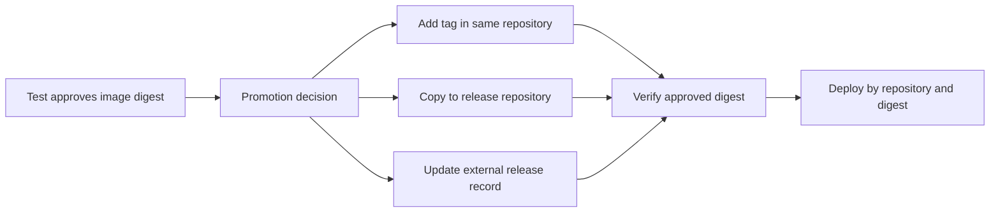

# Promote Container Images by Digest Without Rebuilding Them

Author: [nawazdhandala](https://www.github.com/nawazdhandala)

Tags: Artifact Management, Docker, CI/CD, Software Supply Chain

Description: Choose between retagging, copying repositories, and updating release metadata while preserving tested image digests and deployment evidence.

Your test environment has approved an image. Production uses a different registry, and the release process asks for a friendly version tag. Should the pipeline build again with a production label, add a tag, or copy the image?

Start with the identity of the tested artifact. A tag is a name that a registry resolves. A digest identifies particular content. Promotion should preserve the approved digest unless you intentionally create and test a different artifact. The destination address may change; the tested bytes should not.

This walkthrough uses **crane v0.20.3**, a registry client that does not require a Docker daemon. The examples assume approved registry access, trusted HTTPS certificates, and an existing tested image. Replace the example repositories and supply the digest recorded by your test job. They are promotion operations, not commands for building a production image.

## Choose the operation that matches the boundary

| Situation | Preferred operation | What changes |
|---|---|---|
| Same repository, release needs a version name | Add a tag to the approved digest | The name pointing at the manifest |
| Production pulls from another repository or registry | Copy from an immutable digest reference | Artifact location and access boundary |
| Every environment can pull the same approved repository | Update a reviewed release record | Which existing digest the environment selects |
| Production needs different files or image configuration | Build and test a new artifact | Image content and identity |

A release record might be a reviewed deployment configuration or a signed approval document. It lives outside the image. Adding an environment label *inside* the image configuration is different: the configuration is content addressed, and changing it changes the manifest that refers to it.

Do not rebuild merely to put the word `production` on an image. Keep environment choices, approval history, and deployment destinations outside the immutable build output when the application permits that separation.



## Pin the tested input before writing anything

An [OCI image index](https://github.com/opencontainers/image-spec/blob/v1.1.1/image-index.md) can reference several platform-specific manifests. For example, one index can contain Linux AMD64 and ARM64 images. Record whether testing approved the whole index or a particular child manifest. Testing one platform does not establish that the other platform works.

Use the test system's recorded digest, rather than resolving a moving candidate tag again during promotion:

```bash
set -euo pipefail
: "${TESTED_DIGEST:?Set the sha256 digest recorded by the test job}"
[[ "$TESTED_DIGEST" =~ ^sha256:[0-9a-f]{64}$ ]] || exit 1

SOURCE_REPO='build.example.internal/payments/api'
RELEASE_REPO='release.example.internal/payments/api'
RELEASE_TAG='1.4.0'
SOURCE_REF="$SOURCE_REPO@$TESTED_DIGEST"

test "$(crane digest "$SOURCE_REF")" = "$TESTED_DIGEST"
```

This checks the expected digest format and confirms the source reference is readable. It does not authenticate the test report or prove that an approval exists. Your promotion job must obtain the digest from a trusted test result and enforce the required approvals separately.

Configure credentials using your approved credential helper or protected Docker configuration. Crane's [authentication implementation](https://github.com/google/go-containerregistry/blob/v0.20.3/pkg/authn/README.md) supports Docker configuration and credential helpers. Give the job source read access and only the destination write access it needs. Keep tokens out of shell examples, logs, and release records.

## Option one: add a tag in the same repository

If production already reads the source repository, add the release name directly:

```bash
crane tag "$SOURCE_REF" "$RELEASE_TAG"
test "$(crane digest "$SOURCE_REPO:$RELEASE_TAG")" = "$TESTED_DIGEST"
```

The second argument is the new tag, not another repository address. [Crane's tagged command documentation](https://github.com/google/go-containerregistry/blob/v0.20.3/cmd/crane/doc/crane_tag.md) describes this operation as tagging a remote image without downloading its layers. The command does not rebuild the application.

Apply registry-side release-tag immutability and serialize release-name allocation. A preliminary check that a tag does not exist leaves a race before the write. A successful digest comparison also cannot stop another authorized writer from moving the tag later. Deploy by digest and enforce tag policy at the registry.

## Option two: copy across the production boundary

Use this path when production has separate permissions, availability requirements, or network reachability:

```bash
crane copy "$SOURCE_REF" "$RELEASE_REPO:$RELEASE_TAG"
ACTUAL_DIGEST=$(crane digest "$RELEASE_REPO:$RELEASE_TAG")
test "$ACTUAL_DIGEST" = "$TESTED_DIGEST"
printf 'Verified deployment reference: %s@%s\n' \
  "$RELEASE_REPO" "$ACTUAL_DIGEST"
```

Do not add `--platform` when your approval covers the full index. In v0.20.3, the [copy implementation](https://github.com/google/go-containerregistry/blob/v0.20.3/pkg/crane/copy.go) copies the remote descriptor by default; selecting a platform instead selects an image from that index. That produces a different top-level identity even when the selected child's bytes are unchanged.

After copying, check that each required platform is represented and that a clean production-like client can fetch its manifests and layers using production credentials. Matching the index digest establishes index identity; it does not test production networking, permissions, or successful application startup.

If the destination digest differs, stop promotion. Investigate platform selection, content conversion, or an incorrect input. Do not simply replace the expected digest with whatever the destination returned.

## Keep approval evidence with the promoted artifact

Copying the image is only part of promotion. Inventory the required signatures, provenance, software bill of materials, vulnerability decisions, and test results. Decide which must be available inside the production boundary and which may remain in a separately retained evidence store.

OCI referrers are manifests that point to a subject, such as an image digest. The [distribution specification](https://github.com/opencontainers/distribution-spec/blob/v1.1.1/spec.md) defines their discovery separately from fetching the subject itself. Do not assume that copying an image automatically transfers everything referring to it. Crane's copy path above is not a general evidence-migration workflow.

Use the evidence producer's supported copying mechanism, then verify evidence from its destination. Verification must enforce your trusted signer or builder policy and bind the evidence to the promoted digest. Repository-sensitive policies may also need explicit review when the repository changes. A matching filename or a successful evidence download is insufficient.

## Option three: update release metadata only

When production can read the same durable repository, promotion can be a reviewed change to the selected digest. Keep the old selection available for rollback, and record the approved platforms, test run, approval identity, and evidence locations alongside the new selection.

This avoids copying storage unnecessarily, but it does not remove access and retention requirements. Production must remain able to fetch the referenced content. A cleanup policy must preserve active releases and rollback targets even if their candidate tags disappear.

Treat the release-record update as a controlled transition. Validate evidence and destination readability first; switch the environment selection last. If a copy or evidence check fails, leave the existing production selection intact. Rolling back the selection also does not automatically reverse application data migrations.

## What was checked

A local test used crane v0.20.3 and two temporary loopback registries. Retagging preserved the digest. Cross-registry copying preserved an index containing two synthetic platform images, and both child manifests, configurations, and layers were readable at the destination. Selecting only AMD64 produced the child digest instead of the index digest.

Those fixtures were not executable application images. The test did not cover production authentication, HTTPS, registry immutability, signature transfer, or deployment. Rehearse those controls against your actual registry before making the promotion job authoritative. The useful acceptance condition is a verified destination reference and complete approval evidence, followed by a controlled deployment of that exact reference.
