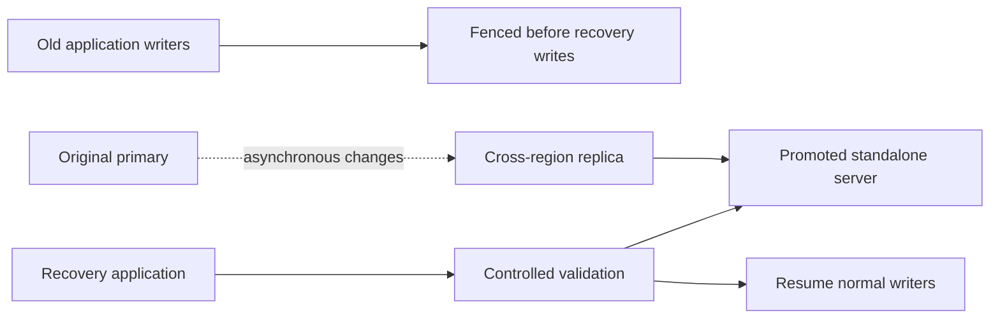

# Promote an Azure MySQL Cross-Region Replica During an Outage

Author: [nawazdhandala](https://www.github.com/nawazdhandala)

Tags: Azure, MySQL, Disaster Recovery

Description: Promote an Azure MySQL read replica with an explicit data-loss decision, fenced writers, verified application cutover, and a separate failback plan.

A cross-region replica is useful only if you can turn it into the application's working database when the primary region is unavailable. Promotion is one step in that recovery. The larger job is deciding which data you can trust, preventing writes to two independent servers, and moving every application writer to the chosen destination.

Azure MySQL read replicas use asynchronous replication. Promotion can therefore leave behind changes that never reached the replica. Azure does not automatically promote a read replica or reconfigure your application during a regional outage. See Microsoft's [regional recovery guidance](https://learn.microsoft.com/en-us/azure/reliability/reliability-database-mysql).

This guide assumes an existing, healthy cross-region replica and a rehearsed recovery application environment. The CLI examples were reviewed against Azure CLI 2.80.0 source and checked for shell syntax. No promotion or live recovery was performed.

## Prepare the recovery path before the incident

Record the replica's resource ID, region, hostname, networking mode, and application credentials or identity configuration. Test connectivity from the recovery application's actual network. A replica reachable from an administrator's laptop may still be unreachable from the production recovery environment.

Maintain enough capacity for the promoted workload. A lightly sized reporting replica may replicate adequately but struggle when all application reads and writes arrive at once.

Also record the expected data-loss tolerance and who can authorize recovery when evidence is incomplete. Recovery point objective, or RPO, describes the acceptable data-loss window. Recovery time objective, or RTO, describes how quickly useful service must return. Neither is established merely by having a replica.

## Determine whether promotion is necessary

Confirm that the problem affects the primary service rather than only one client's DNS, network route, or credentials. Correlate application failures with Azure Service Health, Resource Health, and independent connection observations where available.

If the primary is reachable and you can pause all writers, a controlled cutover can wait for a verified final replication boundary. During a regional outage, you may not be able to establish that boundary. State that uncertainty explicitly instead of converting the last visible lag metric into a guaranteed maximum loss.

Keep the last healthy replica-lag sample with its timestamp. Compare it with independently retained application acknowledgments or business-operation identifiers. A stale zero-lag sample from before the incident does not prove the replica contains the primary's final transactions. Microsoft's [read-replica documentation](https://learn.microsoft.com/en-us/azure/mysql/flexible-server/concepts-read-replicas) explains the asynchronous relationship and promotion implications.

## Fence the old writers

Fencing means preventing the old application path from continuing to write after you choose a new primary. Stop or disable old workers, scheduled jobs, and automatic application restarts through controls that remain available during the incident. Remove the old destination from active writer configuration and prevent automation from restoring it.

Do not rely on “the primary is down” as your fence. It might recover while some clients still use its hostname. DNS changes also do not terminate existing sessions or update every cached connection immediately.



The promotion breaks the replication relationship. It does not merge two independently writable histories later. If you cannot establish fencing, keep recovery writes paused and escalate the decision; allowing both sides to write creates a separate reconciliation problem.

## Review the target before the irreversible action

In the portal, verify the replica identity and its current relationship to the intended source. Azure's **Promote** action stops replication and converts the replica into a standalone read/write server. The former replica cannot simply be changed back into a read replica afterward. See the [portal promotion procedure](https://learn.microsoft.com/en-us/azure/mysql/flexible-server/how-to-read-replicas-portal).

For a CLI review, use an authenticated account with permission to inspect the destination. Replace the placeholders with the **replica's** subscription, resource group, and name:

```bash
SUBSCRIPTION_ID='REPLACE_WITH_REPLICA_SUBSCRIPTION_ID'
REPLICA_GROUP='REPLACE_WITH_REPLICA_RESOURCE_GROUP'
REPLICA_NAME='REPLACE_WITH_REPLICA_SERVER_NAME'

az mysql flexible-server show \
  --subscription "$SUBSCRIPTION_ID" \
  --resource-group "$REPLICA_GROUP" \
  --name "$REPLICA_NAME" \
  --query '{id:id,location:location,state:state,role:replicationRole,fqdn:fullyQualifiedDomainName}' \
  --output json
```

Expect the intended resource and a replica role before promotion. Check the full response or portal if the projected values are missing or unexpected; do not proceed on assumptions about a blank field.

After the incident owner accepts the recovery point and the old writers are fenced, the documented command is:

```bash
az mysql flexible-server replica stop-replication \
  --subscription "$SUBSCRIPTION_ID" \
  --resource-group "$REPLICA_GROUP" \
  --name "$REPLICA_NAME"
```

This changes the resource; it is not a preview. Review the confirmation and wait for completion. The [CLI reference](https://learn.microsoft.com/en-us/cli/azure/mysql/flexible-server/replica?view=azure-cli-latest) documents the command. In [CLI 2.80.0 source](https://github.com/Azure/azure-cli/blob/azure-cli-2.80.0/src/azure-cli/azure/cli/command_modules/mysql/custom.py), the implementation updates the replica's replication role to `None`. It does not perform an application cutover or reconcile missing business records.

If the operation fails or remains in progress, inspect the destination's current state before retrying. Do not assume an interrupted client command means the server operation never started.

## Validate before opening normal write traffic

Run the inspection command again and confirm the completed standalone state in Azure. Connect to the destination using its hostname with certificate and hostname verification enabled. Keep normal producers paused while the recovery application performs a known read and a designated controlled write.

Use a test operation with a unique identifier and verify its result through the application. Record the target endpoint and result externally. This verifies more than a successful TCP connection: it exercises authentication, database permissions, application configuration, and the write path.

Review existing MySQL scheduled events and external jobs as well. Ensure that only the intended scheduler is active after promotion; the absence of old application traffic does not prove every background writer has been disabled.

Then update all writer configuration to the promoted server, renew connection pools through supported application controls, and resume traffic gradually. Each server has its own connection string, and [Azure's failover instructions](https://learn.microsoft.com/en-us/azure/mysql/flexible-server/concepts-read-replicas) require the application to point to the former replica.

## Reconcile uncertain operations

Classify operations around the outage by evidence:

| Evidence | Recovery action |
| --- | --- |
| Acknowledged and present on destination | Preserve the completed result |
| Acknowledged but absent on destination | Investigate missing replicated data before replay |
| Client timed out and result is present | Avoid duplicating the operation |
| Client timed out and outcome remains unknown | Resolve through the application's reconciliation procedure |

A request timeout does not establish whether the original transaction committed. Use stable operation identifiers and idempotent replay where the application supports it. Do not re-import an entire source dump over the promoted database after new writes have begun.

## Treat failback as a new migration

Keep the original primary isolated when its region returns. Preserve its data for investigation, including transactions that may never have reached the promoted server. Do not point traffic back merely because it is reachable again.

Microsoft documents that the promoted server does not automatically have HA enabled and that failback is your responsibility. Review its protection requirements and plan a new replica or migration path from the current authoritative server. See the [post-failover guidance](https://learn.microsoft.com/en-us/azure/reliability/reliability-database-mysql).

Close the recovery only after the application is stable, writers have one authoritative destination, uncertain operations are tracked, and protection of the new primary is addressed. Record measured downtime and the evidence behind the accepted recovery point so the next rehearsal can improve both.
