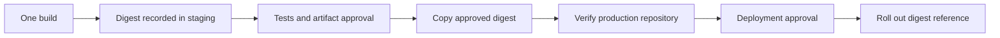

# Promote the Same Image Digest from Staging to Production

Author: [nawazdhandala](https://www.github.com/nawazdhandala)

Tags: Container Registry, CI/CD, Deployment

Description: Promote an approved container image without rebuilding, verify its production digest, and keep release evidence attached to the exact tested artifact.

A staging test approves a particular artifact. If the production pipeline rebuilds that artifact from the same Git commit, it can produce different bytes: a base-image tag may have moved, a package repository may have changed, or build metadata may differ. The commit still identifies the source, but it no longer proves that production runs the image staging tested.

A stronger release process builds once and promotes the approved image digest. A digest is a content-derived identifier for a registry manifest or image index. The repository tells a client where to find the object; the digest identifies which object to retrieve.

This tutorial uses **crane 0.20.6** for promotion examples. It separates artifact approval, registry copying, and workload rollout so a successful push cannot accidentally become permission to deploy.

## Decide what the approval covers

Record the source repository and digest when staging is deployed, rather than resolving its tag again after tests finish. Attach the test result, source revision, build provenance, relevant scan results, and approval identity to that immutable reference.

For a multi-platform image, decide whether the release approves the entire image index or one platform-specific manifest. An index can point to separate AMD64 and ARM64 images. Testing one child does not test every platform, even though an index digest fixes the full set of descriptors. [OCI image-index specification](https://github.com/opencontainers/image-spec/blob/v1.1.1/image-index.md).

A compact approval record might contain:

| Record | Example meaning |
|---|---|
| Source reference | Staging repository plus approved digest |
| Artifact type | Multi-platform index or single image manifest |
| Tested platforms | Platforms actually exercised, not merely listed |
| Configuration revision | Exact staging settings used for tests |
| Production destination | Authorized repository and unique release tag |
| Deployment approval | Separate decision allowing the rollout |

Keep the actual digest in a machine-readable file or signed release record. Do not reconstruct it from a mutable `staging`, `latest`, or branch tag.



The boundary between verification and rollout lets a team pre-stage artifacts before a maintenance window without starting a production change.

## Copy from the approved reference

Prepare trusted TLS connections and authorized credentials for both registries. The examples assume Bash, crane 0.20.6, and an approval file containing exactly one reviewed SHA-256 digest. Replace the repository names and release tag with your own values.

Run this from the release workspace:

```bash
set -eu
source_repo='registry.staging.example/team/api'
destination_repo='registry.production.example/team/api'
release_tag='release-2026-11-20-01'
approved_digest=$(cat approved-image.digest)

if [ "${#approved_digest}" -ne 71 ] ||
  ! printf '%s\n' "$approved_digest" |
  LC_ALL=C grep -Eq '^sha256:[0-9a-f]{64}$'; then
  printf 'Expected one approved SHA-256 digest\n' >&2
  exit 1
fi

crane copy --platform all --no-clobber \
  "$source_repo@$approved_digest" \
  "$destination_repo:$release_tag"
actual=$(crane digest --platform all "$destination_repo:$release_tag")
test "$actual" = "$approved_digest"
printf '%s@%s\n' "$destination_repo" "$approved_digest"
```

The output is the production image reference to place in the reviewed deployment change. The shape check catches an empty or malformed digest; it does not authenticate the approval file. Protect that file through the release system's authorization and integrity controls.

Selecting all platforms avoids silently promoting only the preparation machine's architecture. The pinned copy implementation handles an index as an index when no individual platform is selected. [crane copy implementation](https://github.com/google/go-containerregistry/blob/v0.20.6/pkg/crane/copy.go), [copy command options](https://github.com/google/go-containerregistry/blob/v0.20.6/cmd/crane/doc/crane_copy.md).

`--no-clobber` checks whether the destination already exists. It is not an atomic reservation against competing writers. Use a unique release tag and registry-side immutability or serialized release ownership. If a retry encounters an existing tag, inspect its digest and approval record; do not automatically overwrite it or switch off the check.

A mismatch is a release failure. Investigate platform selection, media-type conversion, the destination tag's history, and concurrent writers. Changing the recorded approved digest to match the destination would erase the evidence the comparison was meant to protect.

## Know when tagging is enough

If staging and production use the same repository and differ only in human-readable labels, an additional tag can refer to the existing artifact:

```bash
# Assumes source_repo and approved_digest from the previous example.
# Use only when this repository is also the approved production location.
crane tag "$source_repo@$approved_digest" 'production-release-2026-11-20-01'
```

In crane 0.20.6, tagging writes a tag in the source reference's own repository. It is not a cross-repository copy command and it does not provide the copy command's `--no-clobber` behavior. Reserve the alias and verify its digest afterward. [Pinned tag implementation](https://github.com/google/go-containerregistry/blob/v0.20.6/pkg/crane/tag.go).

A convenience alias such as `production-current` can be useful to humans, but it is a poor sole identifier for deployment evidence. Preserve a durable release reference even if operational aliases later move.

## Keep deployment settings outside the image

Promoting the same digest does not require identical staging and production environments. Supply environment-specific URLs, credentials, resource limits, and feature settings through the deployment system. Review these settings separately because a perfectly preserved image can still behave differently under different configuration.

For Kubernetes, replace the application container's image value in the existing workload definition with the verified production digest reference. The following is a fragment, not a complete Deployment:

```yaml
spec:
  template:
    spec:
      containers:
        - name: api
          image: registry.production.example/team/api@sha256:REPLACE_WITH_APPROVED_64_HEX_DIGEST
```

Replace the entire placeholder before applying anything. Preserve the other container fields and the rest of the workload definition. Kubernetes supports digest references, which avoid a tag later resolving to another image. Pull policy still controls when the runtime attempts resolution or uses available content; it does not turn a mutable tag into a fixed release identity. [Kubernetes image documentation](https://kubernetes.io/docs/concepts/containers/images/).

Verify the reviewed workload template and the resulting Pods, including admission-time changes. Runtime-reported image identifiers can represent a platform-specific image rather than the parent index, so do not declare failure solely because an `imageID` differs from the approved multi-platform index digest. Compare the platform descriptor and runtime evidence deliberately.

## Carry the release evidence across repositories

Digest equality proves artifact identity at the compared manifest level. It does not prove publisher authorization, absence of vulnerabilities, compatibility with production configuration, or that the destination contains every associated signature.

Repository-scoped signatures, attestations, and software bills of materials may require their own transfer and verification. Referrers discovery happens in a repository; copying the image does not promise that every external artifact will follow it. Re-run the destination verification policy before deployment. [OCI Distribution referrers API](https://github.com/opencontainers/distribution-spec/blob/v1.1.1/spec.md#listing-referrers).

Retain the previous approved digest and its deployment configuration for rollback planning. Application or database migrations can make an older image incompatible with current data, so artifact availability alone is not a rollback guarantee.

For local validation, crane 0.20.6 promoted a synthetic two-platform image after its staging tag had deliberately been moved to another image. The digest-pinned copy still preserved the originally approved index and both readable platform layers. Adding a same-repository release alias preserved that digest too. These tests used owned anonymous HTTP registries on loopback; no production credentials, Kubernetes rollout, signatures, or real application tests were exercised.

A promotion is ready when its approved source reference, destination digest, verification evidence, and deployment change agree. Keeping those records connected makes it possible to answer the operational question that matters: whether production received the artifact that was actually approved.
