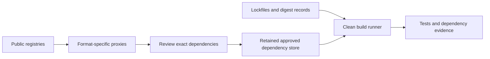

# Keep Proxy Cache Expiry from Breaking Reproducible Builds

Author: [nawazdhandala](https://www.github.com/nawazdhandala)

Tags: Artifact Management, Maven, npm, Python, Docker

Description: Proxy Maven Central, npm, PyPI, and Docker Hub while preserving exact dependencies beyond cache expiry, cleanup, and upstream outages.

A build passed yesterday through your internal repository. Today the same commit fails because an upstream package is unavailable. The lockfile did not change, but the proxy had removed the only cached copy.

This is an availability failure, not necessarily a version-resolution failure. A lockfile or digest tells a client what to fetch. It cannot provide bytes that no reachable server retains. Reliable builds need both exact dependency identities and a deliberate retention policy for those identities.

Use a proxy for controlled access and efficient downloads. For releases that must remain rebuildable, preserve the complete approved dependency set independently of ordinary cache eviction.

## Separate three different cache behaviors

“Cache expiry” often refers to different mechanisms:

| Mechanism | What expires | Typical symptom |
|---|---|---|
| Metadata freshness | How long cached version information is considered current | A new upstream check or changed version selection |
| Negative caching | A remembered not-found response | A newly available dependency still appears absent |
| Content cleanup | Stored artifact bytes | A previously successful build must download again |

These settings are not interchangeable. Nexus's [repository action documentation](https://help.sonatype.com/en/repository-actions.html), for example, says invalidating a cache expires freshness information and clears not-found results; it does not delete locally stored components. Changing a metadata age therefore is not the same operation as removing old artifacts.

Document these behaviors for each proxy product and format. Avoid setting every timeout to an enormous value as a substitute for dependency retention. That can delay legitimate metadata updates without guaranteeing that the bytes survive cleanup.

## Put durable dependencies behind the build path

A practical design separates ordinary discovery from approved release inputs:



The retained store can be an appropriately protected hosted repository or a verified installation bundle. Preserve metadata needed by the client as well as content. Copying a folder of random files is not automatically a valid Maven, npm, or Python repository.

Keep the original source, version, checksum, approval, and applicable license information with retained dependencies. Retention is not an exemption from security review: refresh vulnerable dependencies through an intentional change and rerun tests rather than silently replacing an approved version.

## Maven Central: route resolution and retain the build toolchain

Maven's [mirror settings](https://maven.apache.org/guides/mini/guide-mirror-settings.html) can direct repository resolution to an internal endpoint. In an organization-managed `settings.xml`, this example routes all repositories through an approved Maven group:

```xml
<settings>
  <mirrors>
    <mirror>
      <id>approved-maven</id>
      <url>https://packages.example.internal/repository/maven-approved/</url>
      <mirrorOf>*</mirrorOf>
    </mirror>
  </mirrors>
</settings>
```

Replace the endpoint with your actual Maven-compatible repository. It must provide everything the project requires, including private dependencies where applicable. Configure credentials separately using the matching server ID and your credential-management process; do not embed passwords in the URL.

Pin dependency and plugin versions, and account for parent POMs, extensions, reports, profiles, and the Maven/JDK toolchain. Avoid treating mutable snapshots or version ranges as stable release inputs. A repository proxy cannot make a floating dependency declaration deterministic.

The [dependency plugin's go-offline goal](https://maven.apache.org/plugins-archives/maven-dependency-plugin-3.9.0/go-offline-mojo.html) resolves project dependencies, plugins, and reports. It can help prepare an environment, but the actual build with its production profiles remains the acceptance test. Plugins may launch tools or download assets outside Maven's normal dependency resolver.

## npm: commit the lockfile and inspect its download locations

Use a reviewed `package-lock.json` and `npm ci` for the intended Node/npm versions. The [npm 11 command documentation](https://docs.npmjs.com/cli/v11/commands/npm-ci/) explains that this command requires an existing lockfile, rejects a mismatch with `package.json`, and does not update the lockfile during installation.

An example using npm 11 is:

```bash
npm ci --registry=https://packages.example.internal/repository/npm-approved/
```

Run it in the project directory after installing its pinned Node and npm versions and configuring authentication securely. The expected result is installation of the locked dependency tree, not a fresh version-selection decision.

Review the lockfile's `resolved` and `integrity` information. The [lockfile format](https://docs.npmjs.com/cli/v11/configuring-npm/package-lock-json/) can include tarball locations and integrity values. Git dependencies, explicit URLs, and package lifecycle scripts require separate attention. Changing the registry option is not proof that every network request now stays inside your repository boundary.

Do not permanently disable required install scripts merely to make an offline test pass. Identify their external assets and preserve them, or choose a supported installation path that does not need those downloads.

## PyPI: retain a hashed wheel bundle for each target

For Python, pin every dependency and record approved hashes. In [pip's hash-checking mode](https://github.com/pypa/pip/blob/26.2.1/docs/html/topics/secure-installs.md), all requirements must be pinned and hashed; including just the top-level package is insufficient.

With pip **26.2.1**, prepare a target-compatible wheelhouse from an approved Python index:

```bash
python -m pip download \
  --index-url https://packages.example.internal/repository/pypi-approved/simple/ \
  --only-binary=:all: --require-hashes \
  --dest wheelhouse -r requirements.lock
```

Run this in a fresh working directory on the target Python/platform combination, using a reviewed `requirements.lock` and secure index authentication. `--only-binary=:all:` rejects dependencies without suitable wheels instead of unexpectedly starting a source build. If you require source builds, build and approve their outputs in a separately controlled process.

Then test installation in a fresh virtual environment with the same Python and pip versions:

```bash
python -m pip install \
  --no-index --find-links=wheelhouse \
  --only-binary=:all: --require-hashes --no-cache-dir \
  -r requirements.lock
```

Use named, pinned requirements rather than direct remote URLs in this bundle workflow. `--no-index` disables index lookup; it is not a general network firewall for arbitrary URLs or application behavior. Pip's [repeatable-install guidance](https://pip.pypa.io/en/stable/topics/repeatable-installs/) also notes that wheel bundles can depend on the operating system and architecture. Keep a verified bundle for each supported target.

## Docker Hub: a pull-through cache is not a permanent mirror

Docker's [mirror documentation](https://docs.docker.com/docker-hub/image-library/mirror/) explains that tag pulls check the upstream for current content and that old cached content can be removed and fetched again later. A warm cache therefore does not establish independence from Docker Hub.

For required releases, preserve images in a retained internal repository and reference their approved digests. Copy the complete required platform set and associated evidence, then test a pull from a clean runner. Keep base images used by builds as well as final deployment images. A cached final image does not preserve everything needed to rebuild it.

## Rehearse failure before cache cleanup becomes an incident

Use an isolated staging runner with empty client caches. Allow only the intended internal endpoints, and make upstream unavailable for the staging proxy or use the retained store without upstream access. Do not change production egress while performing this experiment.

Run the real build, installation scripts, tests, and packaging steps. Check repository and network evidence for bypasses. Repeat across supported platforms and after the staging cache's normal expiry or cleanup conditions. A successful warm-cache run is not enough.

The local validation for this article used a synthetic wheel with pip 26.2.1. Installation from the local hashed bundle succeeded; changed bytes and a missing wheel failed. No live Maven, npm, PyPI proxy, Docker daemon, or production build was tested. The four format examples describe what to verify in your environment, with durable retention providing the availability that pinning alone cannot supply.
