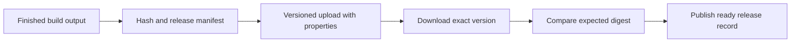

# Publish Immutable Generic Artifacts with Checksums and Metadata

Author: [nawazdhandala](https://www.github.com/nawazdhandala)

Tags: Artifact Management, Artifact Repository, CI/CD, Security

Description: Publish a versioned generic artifact with SHA-256 verification and searchable properties, while separating immutable storage policy from upload-script checks.

A generic artifact might be a report archive, command-line binary, firmware bundle, or generated dataset. Unlike a package with an established ecosystem, it often has no standard coordinates or metadata. A filename such as `report-latest.tar.gz` then becomes the entire release process, until two builds overwrite each other.

Give each published release a stable path, record which bytes it contains, and make its source identity searchable. This example uses Artifactory's documented REST interfaces with **curl 8.7.1** and **Python 3.9.6**. The shell and Python examples were exercised against a local HTTP test fixture; no Artifactory server release was deployed or tested.

## Establish immutability on the server

Use a local Generic repository such as `generic-releases`, with paths like:

```text
generic-releases/payments/1.4.0/report.tar.gz
```

Reserve the version before publishing. A corrected build gets a new release version; it does not replace the bytes at the old path. A mutable “latest” pointer may help discovery, but deployment records should retain the exact version and digest they resolved.

The publishing identity needs deployment access to its assigned path, not repository administration. Artifactory documents separate Deploy/Cache and Delete/Overwrite permissions, and describes preventing release overwrites by withholding Delete permission. Review the identity's effective permissions, including group grants, using the [official permissions model](https://docs.jfrog.com/administration/docs/permissions).

A script that checks “does this path exist?” before upload cannot prevent two concurrent publishers from racing. Nor does a checksum header make a destination immutable. Enforce the write policy on the server and test replacement attempts with the actual publishing identity in staging. Administrators remain privileged; this is a release-control policy, not a claim of tamper-proof archival storage.

## Freeze and describe the output

Complete the build before hashing, then keep the output unchanged during publication. Work from a dedicated release directory containing `report.tar.gz`. CI should supply `RELEASE_VERSION` and the full lowercase `GIT_COMMIT`; these are non-secret identifiers.

Save this as `manifest.py`:

```python
import hashlib
import json
import os
import re
from pathlib import Path

artifact = Path("report.tar.gz")
version = os.environ["RELEASE_VERSION"]
commit = os.environ["GIT_COMMIT"]
if not re.fullmatch(r"[0-9]+\.[0-9]+\.[0-9]+", version):
    raise ValueError("this example requires a three-part release version")
if not re.fullmatch(r"[0-9a-f]{40}|[0-9a-f]{64}", commit):
    raise ValueError("use the full lowercase Git commit ID")
h = hashlib.sha256()
with artifact.open("rb") as source:
    for chunk in iter(lambda: source.read(1024 * 1024), b""):
        h.update(chunk)
manifest = {
    "name": "payments-report",
    "version": version,
    "git_commit": commit,
    "filename": artifact.name,
    "size_bytes": artifact.stat().st_size,
    "sha256": h.hexdigest(),
}
Path("manifest.json").write_text(json.dumps(manifest, indent=2) + "\n")
print(manifest["sha256"])
```

The program reads in chunks, so it does not need the entire artifact in memory. Its version rule intentionally accepts only a simple three-part release string; it is not a complete Semantic Versioning parser. The commit check accepts full SHA-1 or SHA-256 Git identifiers. Restricting these values also prevents arbitrary punctuation from becoming deployment URL parameters.

Retain `manifest.json` in the protected release record. A checksum proves byte equality against a trusted expected value. It does not prove who produced the artifact or that the build was safe; signatures and build provenance address those separate questions.

## Upload the bytes and attach discovery properties

Set `ARTIFACTORY_URL` to your approved HTTPS base, including `/artifactory` and without a trailing slash. Set `ARTIFACTORY_CURL_CONFIG` to a protected, mode-0600 curl configuration file supplied by CI's secret mechanism. That file should provide the authorization header for the intended identity; do not print it or enable shell tracing around secrets.

The repository must already exist. If your policy requires separate annotation privileges for property operations, grant only the necessary scope and verify it in staging.

```bash
set -euo pipefail
: "${ARTIFACTORY_URL:?set the approved HTTPS Artifactory base URL}"
: "${ARTIFACTORY_CURL_CONFIG:?set the protected curl credential file}"
: "${RELEASE_VERSION:?set the release version}"
: "${GIT_COMMIT:?set the full commit ID}"
SHA256=$(python3 manifest.py)
DEST="$ARTIFACTORY_URL/generic-releases/payments/$RELEASE_VERSION/report.tar.gz"
curl --config "$ARTIFACTORY_CURL_CONFIG" --fail-with-body \
  --silent --show-error --connect-timeout 10 --max-time 300 \
  --upload-file report.tar.gz \
  --header "X-Checksum-Sha256: $SHA256" \
  "$DEST;release.version=$RELEASE_VERSION;git.commit=$GIT_COMMIT" \
  --output upload-result.json
```

The upload performs an HTTP PUT. Artifactory's [Deploy Artifact API](https://docs.jfrog.com/artifactory/reference/deployartifact) documents the SHA-256 header and rejection when the supplied checksum does not match. The semicolon-separated values are [matrix parameters](https://docs.jfrog.com/artifactory/docs/jfrog-properties) that attach properties during deployment.

`--fail-with-body` makes an HTTP error fail the command while retaining the response for diagnosis. Connection and overall deadlines bound the wait. The [curl manual](https://curl.se/docs/manpage.html) documents these options. The example leaves TLS verification enabled and does not follow redirects automatically; use the correct final service URL.

Do not blindly retry an ambiguous timeout. The server might have committed the upload before the response was lost. Inspect the destination and compare its digest. Matching bytes may represent the successful first attempt; different bytes require stopping and investigating, not obtaining overwrite permission.

## Verify what readers receive

Download the exact versioned path to a separate file. Do not overwrite your original build output while checking it.

```bash
curl --config "$ARTIFACTORY_CURL_CONFIG" --fail-with-body \
  --silent --show-error --connect-timeout 10 --max-time 300 \
  "$DEST" --output downloaded-report.tar.gz
python3 - <<'PY'
import hashlib, json
from pathlib import Path
expected = json.loads(Path("manifest.json").read_text())["sha256"]
h = hashlib.sha256()
with Path("downloaded-report.tar.gz").open("rb") as source:
    for chunk in iter(lambda: source.read(1024 * 1024), b""):
        h.update(chunk)
if h.hexdigest() != expected:
    raise SystemExit("download checksum mismatch")
print("Downloaded bytes match the release manifest")
PY
```

This verifies retrieval of the expected bytes using the publishing identity. Add a separate read test using the deployment consumer's credentials; publisher access does not establish reader access.

For a release containing several files, upload and verify every required member before exposing a ready release record. Ordinary individual uploads are not one transaction across the whole directory. A manifest or readiness marker needs its own controlled publication rule so consumers cannot mistake a partial release for a complete one.



## Search metadata without making it the source of truth

To find artifacts associated with a commit:

```bash
curl --config "$ARTIFACTORY_CURL_CONFIG" --fail-with-body \
  --silent --show-error --max-time 30 --get \
  "$ARTIFACTORY_URL/api/search/prop" \
  --data-urlencode 'repos=generic-releases' \
  --data-urlencode "git.commit=$GIT_COMMIT"
```

The [Property Search API](https://docs.jfrog.com/artifactory/reference/searchProperty) returns matching file-info URIs. Results are subject to permissions, and a commit may produce several artifacts. Do not deploy the first search result arbitrarily. Resolve the intended component and version, then verify its digest against the release record.

Search properties can be edited by sufficiently privileged identities. Use them for discovery; preserve authoritative release identity and approval evidence separately. Avoid credentials, customer information, or temporary access URLs in properties.

The local fixture verified upload bytes, checksum headers, property parameters, encoded search criteria, and downloaded digest comparison. It also confirmed that an HTTP rejection stops the shell, altered downloaded bytes fail verification, and malformed version/commit inputs are rejected. It did not validate Artifactory authorization, property indexing, TLS deployment, or overwrite enforcement. Those are explicit staging acceptance checks before this becomes a production publishing job.
