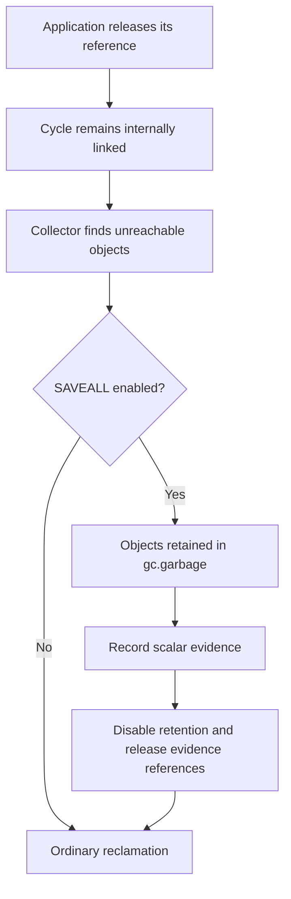

# Debug Python Reference Cycles Without Creating a False Leak

Author: [nawazdhandala](https://www.github.com/nawazdhandala)

Tags: Python, Garbage Collection, Troubleshooting

Description: Use gc.DEBUG_SAVEALL in an isolated Python reproduction, distinguish retained evidence from leaks, and clean up inspection references before measuring again.

You enable Python's garbage-collection diagnostics, repeat a request, and watch `gc.garbage` grow. That looks like confirmation of a memory leak. But one of the diagnostic settings deliberately prevents the collector from releasing objects it could otherwise reclaim.

The useful question is whether objects accumulate under normal collection, under diagnostic retention, or because the application still owns them. This tutorial separates those cases with a small, repeatable experiment. The example ran on CPython 3.14.10 on macOS ARM64; it does not diagnose native extensions or reproduce a production service's memory behavior.

## Understand what the debugger changes

A reference cycle is a group of objects that refer back to one another. A list containing itself is the smallest convenient example. Once its external owner disappears, the cycle still has internal references. Python's cyclic collector handles that situation alongside reference counting.

`gc.DEBUG_SAVEALL` changes the outcome: unreachable objects found during collection are saved in `gc.garbage`. `gc.DEBUG_LEAK` includes this setting, so its reassuring name does not make it safe to leave enabled during a memory baseline. These settings are documented in the [GC debugging reference](https://docs.python.org/3.14/library/gc.html#gc.DEBUG_SAVEALL).



Treat the saved objects as a diagnostic collection you now own. A rising count during that experiment proves that you are retaining evidence. It does not, by itself, establish a leak in the original workload.

## Run a bounded experiment in a separate process

Use a disposable interpreter, with no application threads or existing GC investigation. The following program temporarily disables automatic collection so each explicit collection has a clear purpose. It creates only twenty tiny cycles at each stage. Do not paste its global cleanup operations into a running server or shared notebook.

Save this as `cycles.py`, also included alongside this article:

```python
import gc
import platform


def make_cycles(count):
    for _ in range(count):
        ring = []
        ring.append(ring)


def main():
    if gc.garbage or gc.get_debug():
        raise RuntimeError("Run in a fresh interpreter without GC debug flags")
    was_enabled = gc.isenabled()
    gc.disable()
    try:
        gc.collect()
        make_cycles(20)
        ordinary = gc.collect()
        assert not gc.garbage
        print("ordinary:", ordinary, "saved:", len(gc.garbage))

        gc.set_debug(gc.DEBUG_SAVEALL)
        make_cycles(20)
        saved = gc.collect()
        # Store only scalar evidence, never a second list of these objects.
        self_cycles = sum(
            type(obj) is list and len(obj) == 1 and obj[0] is obj
            for obj in gc.garbage
        )
        assert self_cycles == 20
        print("saveall:", saved, "self-cycles:", self_cycles)

        gc.set_debug(0)
        gc.garbage.clear()
        recovered = gc.collect()
        assert not gc.garbage
        print("cleanup:", recovered, "saved:", len(gc.garbage))
    finally:
        gc.set_debug(0)
        gc.garbage.clear()
        gc.collect()
        if was_enabled:
            gc.enable()


if __name__ == "__main__":
    print(platform.python_implementation(), platform.python_version())
    main()
```

Run it with your CPython executable, recording the printed version:

```bash
python3 cycles.py
```

Our local run printed:

```text
CPython 3.14.10
ordinary: 20 saved: 0
saveall: 20 self-cycles: 20
cleanup: 20 saved: 0
```

The first phase shows that these cycles are normally collectable. The second phase recreates exactly the same shape but retains it for inspection. The final phase releases that diagnostic ownership and collects again. Other interpreter startup activity can affect aggregate collection counts; the shape-specific assertion is more informative than demanding an identical total on every build.

The generator expression records a number instead of building another list of objects. Its local `obj` disappears after evaluation. That detail matters: an inspection variable can accidentally become the surviving owner you later mistake for an application reference.

## Separate three different findings

| Observation | Working interpretation | Next experiment |
|---|---|---|
| Saved cycles appear only with SAVEALL | Diagnostic retention | Repeat with normal flags in a fresh process |
| Workload objects remain reachable from a cache or queue | Application ownership persists | Measure that owner's size and release policy |
| Uncollectable objects remain without SAVEALL | Specialized cleanup problem | Identify types and inspect extension behavior |

A cache can grow without containing any cycles. Conversely, a workload can create thousands of cycles without leaking if they become unreachable and collection keeps pace. Start from a bounded workload and an expected steady-state object population, rather than treating a particular object graph as inherently wrong.

Modern Python also invalidates the old rule that any cycle containing `__del__` is uncollectable. [PEP 442](https://peps.python.org/pep-0442/) introduced safe finalization for such cycles. A finalizer can still resurrect an object by publishing a new reference, and legacy C-extension finalization remains a separate concern. Diagnose the actual ownership and type instead of deleting finalizers on suspicion.

## Inspect ownership without keeping it alive accidentally

For a real reproduction, narrow the suspected type and operation first. Avoid printing entire request objects: their representation can expose credentials, produce huge logs, or execute custom code. Prefer type names, bounded counts and allocation locations.

`gc.get_referrers()` is a debugging aid, not a complete ownership oracle. It sees GC-aware containers, and its returned list itself holds references. The official [inspection API documentation](https://docs.python.org/3.14/library/gc.html#gc.get_referrers) also warns about temporarily incomplete objects. Perform inspection in a short-lived function, return only summaries, and let its frame disappear before another measurement.

Weak references can avoid introducing a strong owner for supported types. However, a cleared weak reference during cyclic processing is not proof that SAVEALL retained no object: weak-reference processing precedes final disposal in the [finalization sequence](https://peps.python.org/pep-0442/#disposal-of-cyclic-isolates). Use the saved-object evidence and a normal-mode control together.

## Repeat the workload under normal settings

Once you understand the cycle, restart the reproduction without retention flags. Warm up imports and caches, run a fixed number of operations, let scheduled work finish, and compare several equal batches. Record both the suspected owner size and memory behavior.

For allocation evidence, start `tracemalloc` before the workload and compare snapshots around equal batches. Its [snapshot comparison API](https://docs.python.org/3.15/library/tracemalloc.html#compute-differences) identifies Python allocation locations whose retained sizes changed. An allocation location tells you where memory originated; it does not automatically identify the container that still owns it.

Do not equate stable Python allocations with stable process memory either. Native allocations and allocator behavior need separate investigation. Likewise, freeing these twenty objects does not promise an immediate drop in resident memory reported by the operating system.

Close the investigation with a repeatable regression: the same operation count, equivalent warmup, normal GC settings, and a bounded owner or allocation trend after cleanup. Keep SAVEALL as a temporary way to understand unreachable graphs, then remove the diagnostic retention before judging whether the application still leaks.
