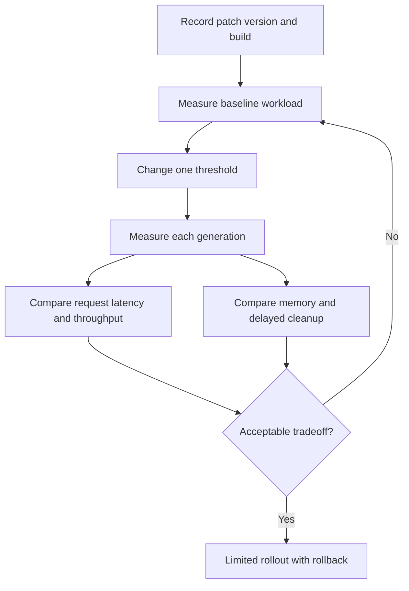

# Tune Python GC Thresholds After Generation 1 Returned

Author: [nawazdhandala](https://www.github.com/nawazdhandala)

Tags: Python, Garbage Collection, Performance

Description: Recheck CPython GC settings after Python 3.14.5, measure all three generations, and compare threshold changes without confusing collection counts with performance.

A GC tuning note written for Python 3.14.0 can describe different behavior from the interpreter now running your service. Python 3.14 initially removed the middle generation of its cyclic garbage collector. Python 3.14.5 restored generation 1, restored the third threshold, and changed what an explicit generation-1 collection means.

Before applying a copied threshold tuple, identify the patch version and build. Then measure a representative workload using that interpreter. This guide uses the ordinary, GIL-enabled CPython 3.14.10 build on macOS ARM64. GIL means global interpreter lock; a free-threaded build has different collection considerations and needs its own measurements.

## Reconcile old tuning advice with the installed runtime

The [Python GC API change notes](https://docs.python.org/3.14/library/gc.html) document the 3.14.5 restoration. In the restored model, new objects begin in generation 0 and survivors move toward older generations. Generation 1 is again meaningful, and `threshold2` is no longer an ignored compatibility argument.

This matters operationally. A setting chosen when `threshold2` did nothing can affect collection after an upgrade. Similarly, `gc.collect(1)` again collects the middle generation rather than performing the earlier incremental operation. Review application startup code and libraries that explicitly configure or invoke GC.

| Setting | What to investigate |
|---|---|
| `threshold0` | Net allocation activity before automatic young collection |
| `threshold1` | Frequency of middle-generation collection relative to young collections |
| `threshold2` | Old-generation scheduling, together with internal heuristics |

These are scheduling controls, not byte limits. The [tagged collector implementation](https://github.com/python/cpython/blob/v3.14.10/Python/gc.c) also applies an old-generation growth heuristic. Do not turn the third number into a promise that a full collection occurs after an exact number of requests.



## Exercise the measurement path before using it on a service

The following standalone probe creates 100,000 self-referencing lists while retaining the most recent thousand. Older lists become unreachable as slots are replaced. This is intentionally a cycle-heavy workload: ordinary short-lived objects without cycles may be released by reference counting and show a different response.

Save the included program as `threshold_probe.py`. It reads the actual default tuple rather than hard-coding a presumed default. Its callback accumulates only counts and elapsed time; it does no logging, network calls or explicit collection inside the callback.

```python
import argparse
import gc
import json
import platform
import sysconfig
import time

parser = argparse.ArgumentParser()
parser.add_argument('--threshold0', type=int)
args = parser.parse_args()
if args.threshold0 is not None and args.threshold0 <= 0:
    parser.error('threshold0 must be positive')
if not gc.isenabled() or gc.get_debug():
    raise RuntimeError('Use a fresh process with normal GC enabled')
original = gc.get_threshold()
chosen = (args.threshold0 or original[0], original[1], original[2])
counts = [0, 0, 0]
elapsed = [0.0, 0.0, 0.0]
starts = [0.0, 0.0, 0.0]


def observe(phase, info):
    generation = info['generation']
    if phase == 'start':
        starts[generation] = time.perf_counter()
    else:
        counts[generation] += 1
        elapsed[generation] += time.perf_counter() - starts[generation]


try:
    gc.collect()
    gc.set_threshold(*chosen)
    gc.callbacks.append(observe)
    began = time.perf_counter()
    survivors = [None] * 1000
    for index in range(100_000):
        cycle = [None]
        cycle[0] = cycle
        survivors[index % len(survivors)] = cycle
    del cycle, survivors
    duration = time.perf_counter() - began
    gc.callbacks.remove(observe)
    cleanup_count = gc.collect()
    print(json.dumps({
        'version': platform.python_version(),
        'free_threaded_build': bool(sysconfig.get_config_var('Py_GIL_DISABLED')),
        'original': original, 'thresholds': chosen,
        'workload_seconds': duration, 'collections': counts,
        'gc_seconds': elapsed, 'cleanup_objects': cleanup_count,
    }))
finally:
    if observe in gc.callbacks:
        gc.callbacks.remove(observe)
    gc.set_threshold(*original)
```

The initial collection happens before measurement. The final explicit collection happens after the callback is removed, so `cleanup_objects` is reported separately from the workload's automatic collections. The `finally` block restores the original thresholds and removes the probe's callback without clearing callbacks owned by other code.

Run each candidate in a fresh process, using the same Python executable:

```bash
python3.14 threshold_probe.py
python3.14 threshold_probe.py --threshold0 1000
python3.14 threshold_probe.py --threshold0 4000
```

These are illustrative candidates for this small lab, not recommended production values. In our CPython 3.14.10 run, the original tuple was `(2000, 10, 10)`:

| First threshold | Generation 0 collections | Generation 1 collections | Generation 2 collections | Final cleanup objects |
|---|---:|---:|---:|---:|
| 2000 | 44 | 4 | 0 | 4193 |
| 1000 | 86 | 7 | 0 | 16373 |
| 4000 | 22 | 2 | 0 | 4137 |

All three runs took about twenty milliseconds. Such short runs do not establish a performance winner. They verify that the instrumentation distinguishes generations and keeps final cleanup out of the timed collection totals.

## Explain surprising results before tuning further

The smaller threshold caused more collections but left more objects for final cleanup. A plausible explanation is that objects still held in the ring survived early collections and moved to older generations before their owners released them. This is an interpretation of the workload, not a measured per-object promotion trace.

The [collector design document](https://github.com/python/cpython/blob/v3.14.10/InternalDocs/garbage_collector.md#collecting-the-oldest-generation) explains why collecting the oldest generation has additional scheduling constraints. A short test with no automatic generation-2 collection does not establish long-term memory stability. Extend the duration and observe older collections before accepting a setting.

Likewise, `cleanup_objects` is an object count, not bytes. It includes whatever the explicit collection finds, not exclusively lists from the loop. A service experiment needs memory measurements alongside counts and should distinguish Python allocations from total process memory.

## Turn the probe into a controlled service comparison

First capture the unchanged service with production-like request sizes, concurrency, cache warmup and dependency behavior. Measure request latency percentiles, throughput, CPU consumption and peak memory across multiple equal-duration runs. Keep the load generator outside the service process so its allocations do not affect the collector being measured.

Next vary only `threshold0`, keeping the other two values unchanged. Allow enough time for the service's long-lived state and older collections to become visible. Compare repeated runs in alternating order; otherwise warming caches or changing host load can look like a GC improvement.

Callback timing adds overhead and approximates the interval between callback notifications. It is not a complete explanation of end-to-end request delay. Correlate it with request timing rather than subtracting it mechanically from request latency. For longer experiments, aggregate bounded measurements and export them outside the callback.

Only investigate the middle or oldest thresholds after the first comparison reveals a specific problem. Increasing thresholds can postpone reclamation; decreasing them can spend more time scanning survivors. Neither direction fixes an unbounded cache or an object that remains reachable from application state.

## Keep build differences and rollback explicit

The documented free-threaded collector can consider memory growth as well as allocation counts. The probe prints whether the interpreter was built with that capability, using [sysconfig configuration access](https://docs.python.org/3.14/library/sysconfig.html#sysconfig.get_config_var). The local results above came from a build where that field was false. Do not extrapolate their counts to free-threaded deployment.

Record the interpreter patch version, build type, original tuple, candidate tuple and load profile with each result. Deploy a successful candidate to a limited portion of the service, with the prior startup configuration ready to restore. Keep memory headroom and latency limits as acceptance criteria. A tuning change is useful when the service behaves better under its real workload, not simply when one generation collects less often.
