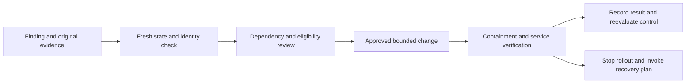

# Quarantine Noncompliant Resources Without Causing an Outage

Author: [nawazdhandala](https://www.github.com/nawazdhandala)

Tags: Compliance, AWS, Reliability

Description: Design guarded remediation with fresh-state checks, narrow targets, dependency review, controlled rollout, and verification of both containment and service health.

A rule identifies a publicly reachable resource. Automation removes its network access. The finding becomes green, but so does the monitoring gap: the same action also removed access to the logging endpoint and interrupted a shared service.

A compliance finding is an observation to evaluate, not a complete change plan. Before quarantining a resource, define the unsafe capability you intend to remove, the capabilities that must remain, and the evidence that will prove the change worked.

This article uses AWS networking examples and read-only inspection commands checked with AWS CLI 2.38.1. It does not deploy quarantine rules or claim to have tested a live remediation rollout.

## Choose the smallest effective action

“Quarantine” can mean removing a public listener, restricting a workload's egress, detaching it from a load balancer, or isolating its network interfaces. Those actions have different effects and different reversibility.

For a routine configuration deviation, a narrow correction may be safer than isolation. For an active compromise, containment urgency can justify disrupting service under the incident-response plan. Do not merge those two decision paths into one unconditional rule.

Write a short action contract:

| Question | Example answer to establish before execution |
| --- | --- |
| What behavior must stop? | New public connections to an unintended management port |
| What must continue? | Approved response access, telemetry and required dependency traffic |
| Which resource is changing? | One specific interface or one reviewed shared policy |
| How will success be observed? | Unauthorized probe fails; required health checks remain successful |
| Who can stop or recover the action? | Named resource owner and on-call operator |

The example answers are placeholders for a reviewed runbook. They are not a universal quarantine policy.

## Recheck the finding immediately before the change

A queued finding can be stale. Someone may have repaired the resource, replaced it, changed its ownership, or moved it into a maintenance window since the original evaluation.

AWS explicitly warns that Config auto remediation can run against a now-compliant resource because the initiation process uses a previous compliance snapshot. A remediation must therefore verify current state rather than trusting the old result indefinitely. [AWS Config auto-remediation behavior](https://docs.aws.amazon.com/config/latest/developerguide/setup-autoremediation.html)

Revalidate identity, current configuration, eligibility, approved exceptions, and the relevant dependency state. If any of those differ from the approved plan, stop or regenerate the plan. A resource tag can help select candidates, but the authority to set that tag must also be controlled.

Make the action idempotent: if the required safe state already exists, record that result and avoid unnecessary mutation. Before retrying, inspect the result of the previous attempt; a timeout can leave the outcome uncertain rather than proving that nothing happened.



The recovery branch is a planned decision, not an instruction to restore dangerous access automatically.

## Inspect shared dependencies before network quarantine

A security group can be attached to many network interfaces. Changing one group's rules can affect all associated resources. AWS security-group rules are allow rules, and permissions from multiple associated groups are combined. Adding an empty group beside a permissive group does not negate the permissive rules. [AWS security-group rules](https://docs.aws.amazon.com/vpc/latest/userguide/security-group-rules.html)

Before proposing a change to a group, list the interfaces using it. Replace the sample group ID, profile, and Region; the profile requires `ec2:DescribeNetworkInterfaces`.

```bash
aws ec2 describe-network-interfaces \
  --profile remediation-review \
  --region us-east-1 \
  --filters Name=group-id,Values=sg-0123456789abcdef0 \
  --query 'NetworkInterfaces[].{Id:NetworkInterfaceId,Instance:Attachment.InstanceId,Groups:Groups[].GroupId}' \
  --output json \
  --no-cli-pager
```

This read-only query lists interface IDs, attached instance IDs where present, and group memberships. A missing instance ID can indicate a different attachment model; it is not permission to ignore the interface. Keep automatic pagination enabled. Review resource ownership and service-specific constraints before choosing targets. [AWS CLI network-interface reference](https://docs.aws.amazon.com/cli/latest/reference/ec2/describe-network-interfaces.html)

The result is a dependency input, not a complete application map. Check load balancers, clustered state, autoscaling behavior, management channels, logging, name resolution, and private service endpoints. Inspect IPv4 and IPv6 exposure separately.

Do not assume changing security-group rules immediately terminates every connection. Tracked connections can continue until timeout, while untracked flows behave differently. Security groups also do not filter traffic to the Amazon-provided DNS resolver in the same way as ordinary destination traffic. Define containment tests around the actual mechanisms involved. [EC2 connection tracking](https://docs.aws.amazon.com/AWSEC2/latest/UserGuide/security-group-connection-tracking.html)

If the objective requires immediate termination of existing traffic, use a separately reviewed containment design. A subnet-wide control introduced in a hurry can affect unrelated workloads.

## Bound the rollout and its failure budget

Start with a staging representative, then an approved canary target. A canary is a small initial change used to observe behavior before proceeding. Confirm that it represents the dependencies and access paths of the later targets.

Set a maximum target count and a concurrency limit. Group targets by actual failure domain so the automation does not isolate every member of a database cluster or service at once. A percentage alone can behave unexpectedly as the target inventory grows.

AWS Systems Manager Automation supports concurrency and error thresholds. Reaching an error threshold stops further dispatch, but already-running executions can continue. These controls limit rollout behavior; they are not a transaction that undoes successful changes. [Systems Manager rate controls](https://docs.aws.amazon.com/systems-manager/latest/userguide/running-automations-scale-controls.html)

Add service-health stop conditions separately. An API call can succeed while error rates rise or telemetry disappears. Stop expansion when the agreed health signal fails, when the intended containment test fails, or when the resource state no longer matches the plan.

Preserve an independent management and observation path. Monitoring the rollout solely through a channel the quarantine removes can turn a failed action into an apparent disappearance of the problem.

## Keep the execution record and the service result separate

For Config-managed remediations, this read-only command retrieves execution status for a named rule:

```bash
aws configservice describe-remediation-execution-status \
  --profile remediation-review \
  --region us-east-1 \
  --config-rule-name approved-management-port-rule \
  --output json \
  --no-cli-pager
```

Replace the rule name and use a profile authorized for `config:DescribeRemediationExecutionStatus`. Review step state, timestamps, and error messages. The call reports remediation execution details; it does not prove that the application remains healthy or that the original exposure is gone. [AWS CLI remediation-status reference](https://docs.aws.amazon.com/cli/latest/reference/configservice/describe-remediation-execution-status.html)

Retain the observed before-state, approved action, target identity, execution identifier, after-state, containment result, and health result. Do not close the finding on execution success alone. Request or await a fresh control evaluation and confirm the same resource and policy were assessed.

## Recover deliberately and learn from the stop

Store the intended recovery procedure before rollout. Reapplying an old snapshot blindly can overwrite legitimate changes made during the incident or restore the original exposure. Compare current state, identify the specific changes owned by the remediation, and obtain the required recovery decision.

An unquarantine operation deserves the same identity and state checks as quarantine. Confirm that the underlying issue is resolved, the owner accepts the service return, and new traffic behaves as expected before expanding access.

Promote automation gradually based on evidence from staging and bounded production runs. The useful success measure is not how many findings the automation clears: it is whether it removes the intended risk while preserving the agreed service behavior and leaving a verifiable record of what changed.
