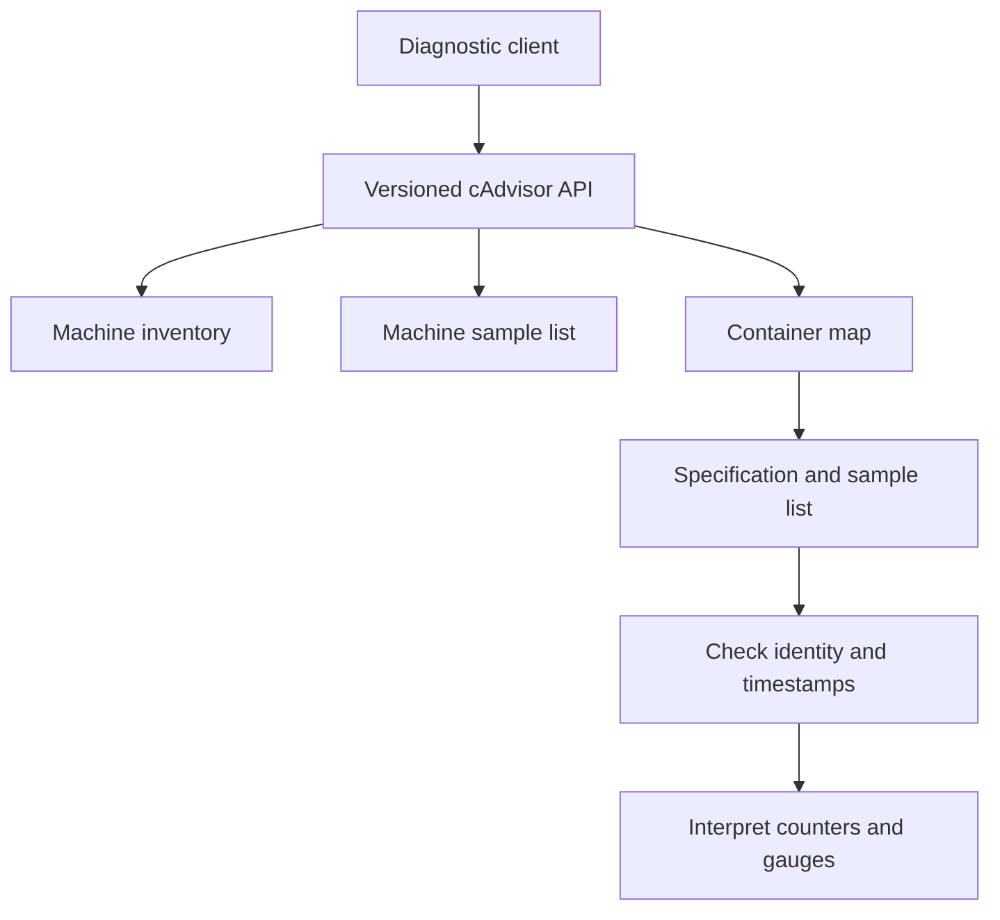

# Query cAdvisor's REST API for Container and Machine Statistics

Author: [nawazdhandala](https://www.github.com/nawazdhandala)

Tags: Docker, Linux, Monitoring, Troubleshooting

Description: Query cAdvisor's versioned JSON API, distinguish machine and container statistics, and interpret bounded samples without confusing missing data with zero.

A Prometheus graph shows the result of collection, scraping, labeling, and querying. When that graph looks wrong, cAdvisor's REST API gives you another place to inspect the data. REST here means ordinary HTTP requests returning structured JSON. You can ask what cAdvisor knows about one container before investigating the rest of the monitoring pipeline.

The important detail is the API version. This walkthrough targets **cAdvisor 0.55.1** and uses **API v2.1**. The software release and API version are separate numbers. The examples are source-verified; the parsing example was exercised with local fixtures, not a running container host.

## Choose the right response before writing a parser

The tagged [API implementation](https://github.com/google/cadvisor/blob/v0.55.1/cmd/internal/api/versions.go) distinguishes these requests:

| Request | What to expect |
|---|---|
| `/api/v2.1/version` | cAdvisor version as a JSON string |
| `/api/v2.1/machine` | Machine inventory and capacity |
| `/api/v2.1/machinestats?count=2` | Recent machine samples as a list |
| `/api/v2.1/stats/?recursive=true&count=1` | Map of non-root cgroups to objects containing specification and samples |
| `/api/v2.1/spec/?recursive=true` | Container specifications keyed by name |

A **cgroup** is a Linux resource-accounting group. Some groups represent application containers; others represent parents in the hierarchy. Do not assume every returned key is a separate billable workload.

API v2.0's stats response maps names directly to sample lists. API v2.1 wraps each container's samples with its specification and excludes the root group from that endpoint. Use `machinestats` for root statistics. Mixing those formats is a common reason a seemingly valid JSON parser returns nothing.



This is an inspection path. It does not turn cAdvisor into a durable historical database.

## Start with a small, protected request

Run these commands in Bash with curl and Python 3 installed. The example assumes you already have authorized access to cAdvisor through a **local-only listener or approved tunnel** on port 8080. It does not publish a port or change the deployment. For remote access, use your protected HTTPS endpoint with its normal authentication and trusted CA certificate; do not disable certificate verification.

Create a fresh directory so you do not overwrite an earlier investigation:

```bash
umask 077
capture_dir=$(mktemp -d)
cd "$capture_dir" || exit 1
CADVISOR_URL='http://127.0.0.1:8080'
curl --fail --silent --show-error --max-time 10 \
  "$CADVISOR_URL/api/v2.1/version" -o version.json
python3 -m json.tool version.json
```

For the pinned release, expect a JSON string identifying version 0.55.1. curl's `--fail` makes HTTP errors fail the command, and `--max-time` bounds the request duration. Only parse a file after its request succeeds; a failed download can leave an incomplete file. These switches are documented in the [curl manual](https://curl.se/docs/manpage.html).

Capture inventory separately:

```bash
curl --fail --silent --show-error --max-time 10 \
  "$CADVISOR_URL/api/v2.1/machine" -o machine.json
python3 -m json.tool machine.json
```

Inventory includes fields such as `num_cores` and `memory_capacity`. The latter is bytes, not current consumption. Compare the returned machine identity with the host you intended to inspect before explaining any surprising numbers. The exact fields are defined in [MachineInfo](https://github.com/google/cadvisor/blob/v0.55.1/info/v1/machine.go).

Treat captures as operational data: container specifications can reveal names, labels, and selected environment metadata. Keep them access-controlled and redact them before attaching them to a public issue.

## Discover once, then narrow the request

On a staging host or a host with a manageable number of groups, request one sample per group:

```bash
curl --fail --silent --show-error --max-time 10 \
  "$CADVISOR_URL/api/v2.1/stats/?type=name&recursive=true&count=1" \
  -o containers.json
python3 -c 'import json; print("\n".join(sorted(json.load(open("containers.json")))))'
```

The output lists exact cgroup names. `count=1` limits samples **per returned group**, not the number of groups. Recursive discovery can still be large. If you already know the correct path, skip discovery and query it directly. The [API guide](https://github.com/google/cadvisor/blob/v0.55.1/docs/api_v2.md) explains name-based selection and recursive requests, although its examples describe v2.0.

Replace the placeholder below with one exact key from your response. Encoding preserves path separators while safely quoting other characters:

```bash
CGROUP='/REPLACE_WITH_EXACT_CGROUP_PATH'
encoded=$(python3 -c 'import sys, urllib.parse; print(urllib.parse.quote(sys.argv[1], safe="/"))' "$CGROUP")
curl --fail --silent --show-error --max-time 10 \
  "$CADVISOR_URL/api/v2.1/stats$encoded?type=name&recursive=false&count=2" \
  -o container.json
```

Two samples let you compare timestamps and cumulative counters. They do not guarantee a particular time window. Newly discovered containers may have fewer samples. Capture the exact request, response time, release, and selected name alongside your evidence.

## Read values without manufacturing zeroes

Save this as `show-container.py` in the capture directory and run `python3 show-container.py container.json`:

```python
import json
import sys

with open(sys.argv[1], encoding="utf-8") as source:
    containers = json.load(source)

for name, info in sorted(containers.items()):
    print("container:", name)
    samples = info.get("stats") or []
    if not samples:
        print("  no samples")
    for sample in samples:
        cpu = sample.get("cpu") or {}
        memory = sample.get("memory") or {}
        total = (cpu.get("usage") or {}).get("total")
        working_set = memory.get("working_set")
        print(" ", sample.get("timestamp", "missing timestamp"),
              "cpu_ns=", total, "working_set_bytes=", working_set)
```

`None` means the requested value was absent. It must not become a measured zero. The [v2 container types](https://github.com/google/cadvisor/blob/v0.55.1/info/v2/container.go) make several resource sections optional; inspect the specification's capability fields and collection configuration when a section is missing.

CPU usage is a cumulative count of nanoseconds. For example, an increase of 3,000,000,000 nanoseconds over two seconds represents an average of 1.5 CPU cores. It is not 1.5 percent. Memory working set is a point-in-time byte measurement. The underlying [CPU and memory definitions](https://github.com/google/cadvisor/blob/v0.55.1/info/v1/container.go) specify those units.

Only calculate a CPU difference across the same container incarnation, with increasing timestamps and a nondecreasing counter. Reject a negative difference or zero elapsed time instead of displaying a plausible-looking rate. For longer investigations, retain the samples externally or use your normal time-series monitoring system.

## Separate access, shape, and collection problems

If a request fails, retain the status and inspect the response through your approved diagnostic process. A proxy denying the API path is different from cAdvisor rejecting an identifier. The [HTTP handler](https://github.com/google/cadvisor/blob/v0.55.1/cmd/internal/api/handler.go) also uses error responses to report unsupported versions and request types; do not assume every failure is a missing route.

If JSON parsing succeeds but a field is absent, first confirm v2.0 versus v2.1 response shape. If the container map is empty, check your requested scope and whether you accidentally asked only for the root through v2.1 `stats`. If timestamps stop advancing, investigate collection and the container's lifecycle rather than repeatedly polling faster.

A useful evidence set is small: version, machine identity, one exact container specification, and a few timestamped samples. That is enough to decide whether the problem begins in cAdvisor or farther along the monitoring pipeline without dumping every container's history on every request.
