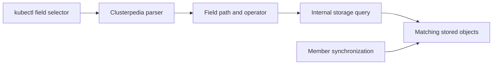

# Query Nested Status and Annotation Fields with Clusterpedia

Author: [nawazdhandala](https://www.github.com/nawazdhandala)

Tags: Kubernetes, Multi-Cluster, Troubleshooting

Description: Filter Clusterpedia objects by nested status and annotation fields, quote complex keys correctly, and understand missing-field and array limitations.

An incident query often needs information that is not a label: a Pod's phase, a controller's status field, or an annotation added by an internal deployment system. Downloading every object and filtering locally works for small investigations, but it can move much more data than the question requires.

Clusterpedia offers enhanced field selectors for searching stored object content. The important details are where the request goes, how a dotted annotation key is written, and which operations the storage backend actually supports.

This tutorial targets **Clusterpedia v0.9.0's internal storage backend**, using **kubectl1.34.0** command syntax. Parser examples were checked against the tagged API source locally. Database queries and live Kubernetes requests were not executed.

## Send the query to Clusterpedia

The examples assume an existing `clusterpedia-search.yaml` kubeconfig that points to the Clusterpedia resource API. Replace the illustrative member `member-a`, namespace `payments`, and annotation key with values from your environment. Pods must already be synchronized.

Do not assume these commands work unchanged against an ordinary Kubernetes member API. Native field selectors support resource-specific fields and equality operators; arbitrary annotation paths and set-based field selectors are not their general interface. The [Kubernetes field-selector documentation](https://kubernetes.io/docs/concepts/overview/working-with-objects/field-selectors/) lists that distinction.



A correct selector cannot compensate for stale or missing synchronization. Treat the results as a stored view and verify a representative object against the member when timing matters.

## Start with a simple nested status field

A field path such as `status.phase` follows nested keys in the object's JSON representation:

```bash
kubectl --kubeconfig clusterpedia-search.yaml get pods -n payments \
  -l 'search.clusterpedia.io/clusters=member-a' \
  --field-selector='status.phase=Pending'
```

The ordinary `-l` option carries Clusterpedia's member-selection control, while `--field-selector` inspects the object field. Expect only matching stored Pods from the chosen member and namespace.

To include two phases, use a set:

```bash
kubectl --kubeconfig clusterpedia-search.yaml get pods -n payments \
  -l 'search.clusterpedia.io/clusters=member-a' \
  --field-selector='status.phase in (Pending,Unknown)'
```

The quotes keep the spaces and parentheses together as one shell argument. This is a question about Pod phase, not Pod readiness. A Running Pod may still be unready, and a Pending Pod may be waiting for scheduling or another prerequisite. Choose the field that actually answers the operational question.

Clusterpedia documents nested field paths and set operators in its [multi-cluster search guide](https://clusterpedia.io/docs/usage/search/multi-cluster/#field-selector). Verify that your selected storage backend supports the particular operation rather than relying only on successful parsing.

## Quote annotation keys as single path segments

Consider this illustrative object fragment:

```yaml
metadata:
  annotations:
    ops.example.com/tier: critical
```

The annotation key contains dots and a slash. Writing `metadata.annotations.ops.example.com/tier` treats dots as path separators, which does not represent the intended map key. Wrap the complete key inside quoted brackets:

```bash
kubectl --kubeconfig clusterpedia-search.yaml get pods -n payments \
  -l 'search.clusterpedia.io/clusters=member-a' \
  --field-selector="metadata.annotations['ops.example.com/tier']=critical"
```

Here, the outer double quotes belong to the shell. The inner single quotes remain part of the selector and tell Clusterpedia to keep `ops.example.com/tier` as one segment. The path is exactly three keys: `metadata`, `annotations`, and `ops.example.com/tier`.

The [v0.9.0 field parser and selector implementation](https://github.com/clusterpedia-io/clusterpedia/blob/v0.9.0/staging/src/github.com/clusterpedia-io/api/clusterpedia/fields/selector.go) represent these segments explicitly. Local tests for this article confirmed that the full annotation key survives parsing without being split.

Do not add extra backslashes to the annotation key merely because it contains a dot. The quoted bracket syntax already communicates the boundary. When an annotation is absent, inspect the actual stored Pod rather than assuming an annotation on its controller was copied to the Pod.

## Combine conditions and handle missing fields

To find Pending or Unknown Pods specifically marked critical, join the requirements with a comma:

```bash
kubectl --kubeconfig clusterpedia-search.yaml get pods -n payments \
  -l 'search.clusterpedia.io/clusters=member-a' \
  --field-selector="status.phase in (Pending,Unknown),metadata.annotations['ops.example.com/tier']=critical"
```

Both requirements must match. The comma inside the phase set separates alternatives; the comma after its closing parenthesis separates requirements.

Negation deserves extra care. In the pinned internal-storage implementation, inequality and `notin` include missing/null field cases. Therefore, "tier is not critical" can include a Pod with no tier annotation. The [backend's query-generation tests](https://github.com/clusterpedia-io/clusterpedia/blob/v0.9.0/pkg/storage/internalstorage/util_test.go) show this behavior for PostgreSQL and MySQL expressions.

If your intent is "tier exists and is not critical," require presence too:

```bash
kubectl --kubeconfig clusterpedia-search.yaml get pods -n payments \
  -l 'search.clusterpedia.io/clusters=member-a' \
  --field-selector="metadata.annotations['ops.example.com/tier'],metadata.annotations['ops.example.com/tier']!=critical"
```

The bare field path is an existence requirement. For this annotation example, presence means a non-null stored value; an empty string is a separate case and should be included in your acceptance fixtures if your application writes one.

Before automating the query, test a small known set: one critical annotation, one different value, and one absent annotation. Confirm which objects belong in the report. This catches an operational misunderstanding that a syntax check cannot detect.

## Know where nested querying stops

Arrays are not ordinary nested maps. Pod readiness appears within `status.conditions`, a list of condition objects. It is tempting to write a selector such as `status.conditions[].type=Ready`, but v0.9.0's internal-storage path rejects list fields. Some syntax can pass the parser and still fail at storage translation. The [tagged query builder](https://github.com/clusterpedia-io/clusterpedia/blob/v0.9.0/pkg/storage/internalstorage/util.go) explicitly checks for this limitation.

For a bounded diagnostic query, retrieve the relevant objects as JSON and inspect the condition array client-side. Do not replace a precise readiness question with `status.phase=Running` just because that scalar query is simpler. Also avoid assuming that a field name accepted by a parser establishes support for numeric comparisons, arbitrary expressions, or JSONPath functions.

| Observation | First check |
| --- | --- |
| Parse error | Shell quoting, brackets, and set parentheses |
| Query succeeds but finds nothing | Exact field path, stored value, member, and namespace |
| Negative query includes unexpected Pods | Missing-field semantics |
| Array expression is rejected | Backend support rather than only parser grammar |
| Correct object has an old status | Synchronization health and freshness |

## Keep searches bounded and reviewable

Begin with one member and namespace, confirm the field on a known object, and only then widen scope. Arbitrary nested JSON predicates do not come with a promise that your database has a useful index for them. Measure latency and load before placing a broad query on a frequent dashboard refresh.

Save the selector, scope, expected fixture identities, and observed result together. For repeated reports, also handle pagination and request errors explicitly. A partial response or failed request should not become a clean-looking empty report.

The reliable pattern is to separate three checks: the selector parses into the intended path, the storage backend supports its operation, and the selected objects satisfy the business meaning of the report. All three are necessary before an elegant nested query becomes a dependable operational tool.
