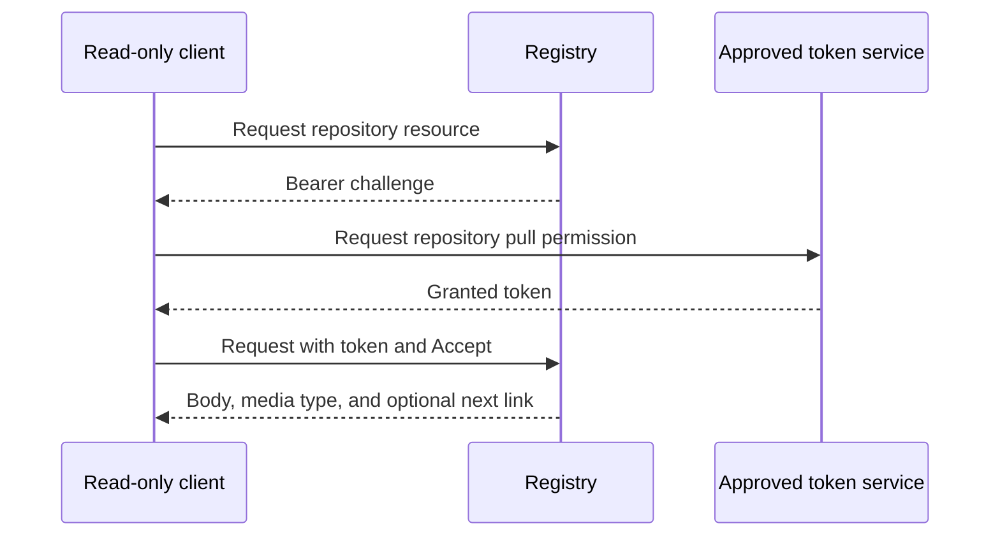

# Query the OCI Registry API: Tokens, Media Types, and Pagination

Author: [nawazdhandala](https://www.github.com/nawazdhandala)

Tags: Container Registry, API, Authentication

Description: Make read-only registry API requests, handle bearer authentication, negotiate image manifests, and enumerate tags without silently missing pages.

A registry API request can succeed at HTTP level while answering the wrong operational question. A tag listing might contain only its first page. A manifest request might negotiate a different representation than the client expects. A token might be valid for another repository.

This walkthrough uses the **OCI Distribution specification v1.1.1**, the Distribution bearer-token protocol, and command examples checked with **curl 8.7.1** and **jq 1.6**. It performs only reads. Use an approved repository, replace the example hostnames and paths, and keep response files in a private working directory.

## Separate the endpoints

The base registry URL, repository name, and token service are different identifiers:

| Value | Example | Meaning |
|---|---|---|
| Registry origin | `https://registry.example.internal` | Where registry API requests go |
| Repository name | `team/api` | Namespace inside that registry |
| Manifest reference | Release tag or `sha256:...` | Object requested within the repository |
| Token realm | `https://auth.example.internal/token` | Approved authorization endpoint |
| Token service | `registry.example.internal` | Audience requested in the token exchange |

The API path for a manifest is `/v2/<repository>/manifests/<reference>`. A repository name can contain slashes; do not collapse it to its last component. Tags and digests are different reference forms, and a tag can change while an investigation is underway. [OCI manifest endpoints](https://github.com/opencontainers/distribution-spec/blob/v1.1.1/spec.md#pulling-manifests).



## Obtain a token without confusing the two hosts

Start in a new directory and capture the challenge without credentials:

```bash
umask 077
mkdir registry-review
curl --silent --show-error \
  --cacert /protected/registry-ca.pem \
  --dump-header registry-review/challenge.headers \
  --output registry-review/challenge.body \
  https://registry.example.internal/v2/team/api/manifests/release-1
```

Inspect the status and `WWW-Authenticate` header. A `401` with a Bearer challenge is a normal invitation to authenticate. Review its realm, service, and scope against the registry's configuration. Do not automatically send a password to an arbitrary realm copied from a response.

If the approved token service accepts username/password authentication, this example requests read permission and prompts for the password:

```bash
curl --fail --silent --show-error --get \
  --cacert /protected/auth-ca.pem \
  --user registry-reader \
  --data-urlencode 'service=registry.example.internal' \
  --data-urlencode 'scope=repository:team/api:pull' \
  --output registry-review/token.json \
  https://auth.example.internal/token
```

Substitute the actual challenge values. Some providers require another login mechanism; use their documented client flow instead. A token-service success does not prove that all requested actions were granted. [Distribution token protocol](https://distribution.github.io/distribution/spec/auth/token/).

Create a protected header file without displaying the token:

```bash
jq -er '
  (.token // .access_token) |
  if type != "string" then error("token must be a string")
  elif length == 0 or test("[\\r\\n]") then error("invalid token")
  else "Authorization: Bearer " + . end
' registry-review/token.json > registry-review/auth.header
```

Continue only if the command succeeds. Keep these files out of source control and diagnostic attachments; remove them according to your credential-handling policy when finished. Passing `--header @file` keeps the token itself out of command arguments. Curl documents this file-input form and the options used here. [curl manual](https://curl.se/docs/manpage.html).

## Ask for the manifest formats you understand

The `Accept` request header lists representations your client can process. For inspecting modern OCI and Docker image manifests and indexes, use:

```bash
accept='application/vnd.oci.image.index.v1+json, application/vnd.oci.image.manifest.v1+json, application/vnd.docker.distribution.manifest.list.v2+json, application/vnd.docker.distribution.manifest.v2+json'
curl --fail --silent --show-error \
  --cacert /protected/registry-ca.pem \
  --header @registry-review/auth.header \
  --header "Accept: $accept" \
  --dump-header registry-review/manifest.headers \
  --output registry-review/manifest.json \
  https://registry.example.internal/v2/team/api/manifests/release-1
```

Review the actual HTTP status and response `Content-Type` before interpreting the JSON. An index contains child descriptors in `manifests`; an image manifest normally contains `config` and `layers`. Do not run a parser that assumes every successful response is a runnable image.

If you need stable evidence, record the digest and repeat the request by digest. Verify the returned bytes against the expected digest using a digest-aware client or approved verification routine. Pretty-printing JSON changes its bytes, so hash the original response rather than a formatted copy. Content negotiation and digest handling are specified separately from the UI's tag display. [OCI manifest request and digest requirements](https://github.com/opencontainers/distribution-spec/blob/v1.1.1/spec.md#pulling-manifests).

These examples do not follow redirects automatically. Review unexpected `3xx` responses and destination hosts before forwarding credentials. Curl's `--fail` rejects HTTP error responses; it is not a guarantee that the final status was `200` or that a body conforms to the expected schema.

## Enumerate tags without stopping too soon

Request a deliberately small page while learning the behavior:

```bash
curl --fail --silent --show-error --get \
  --cacert /protected/registry-ca.pem \
  --header @registry-review/auth.header \
  --data-urlencode 'n=2' \
  --dump-header registry-review/tags-1.headers \
  --output registry-review/tags-1.json \
  https://registry.example.internal/v2/team/api/tags/list
jq '.name, .tags' registry-review/tags-1.json
```

A response might contain a header like this:

```text
Link: </v2/team/api/tags/list?n=2&last=release-2>; rel="next"
```

Follow the next-link target, resolving a relative URL against the current request URL. Preserve the server's query parameters. Before reusing the authorization header, verify that the resolved URL remains HTTPS on the approved registry origin and still addresses the expected repository's tag-list endpoint. Reject unexpected hosts, user-info components, fragments, or redirects rather than forwarding the credential.

For this manually reviewed example, the next request URL is:

```text
https://registry.example.internal/v2/team/api/tags/list?n=2&last=release-2
```

Use the same curl options and save the result under a new page number. Inspect every page's headers. A short page does **not** mean completion when a next link is present.

If the registry omits next links, the specification also supports `last=<last-tag-value>` with `n`. The cursor is a tag string, not an offset or page number. Advance from the last returned tag and continue until an empty page; detect repeated cursors and stop with an error instead of looping forever. Prefer supplied next links when available. [OCI tag pagination rules](https://github.com/opencontainers/distribution-spec/blob/v1.1.1/spec.md#listing-tags).

Automation should parse Link headers with a standards-aware parser, retain all pages, bound retries, and fail visibly on incomplete enumeration. Tags can change during traversal; a listing is not a transactional release snapshot. Record resolved digests separately when creating an inventory for deployment or retention decisions.

## Preserve enough evidence to diagnose failures

For each read, retain the request URL without credentials, HTTP status, relevant response headers, timestamp, and protected raw body. Associate each page with the URL that produced it. Avoid verbose traces that expose authorization headers.

Distinguish a token-service rejection, registry `401`, missing manifest `404`, unsupported representation, and pagination failure before changing permissions. Do not grant push or delete access to troubleshoot a read-only query.

The token filter was tested with synthetic valid and invalid responses. Local owned HTTP fixtures checked header-file authentication, the manifest Accept header, and a two-page tag listing. These checks exercised curl behavior, not a production authorization server, TLS setup, or registry implementation. The examples require separate verification against your approved endpoint and its access policy.
