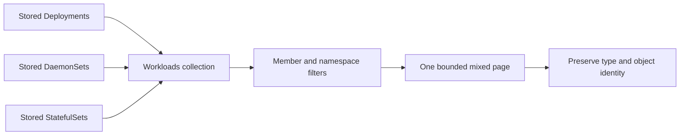

# Query Workload Types Together with Clusterpedia Collections

Author: [nawazdhandala](https://www.github.com/nawazdhandala)

Tags: Kubernetes, Multi-Cluster, Observability

Description: Search Deployments, DaemonSets, and StatefulSets together with a bounded Clusterpedia collection query while preserving type and member identity.

A workload inventory often needs more than Deployments. Node agents may run as DaemonSets, and databases may use StatefulSets. Running three separate searches is possible, but a collection query can return those types through one interface.

The challenge is interpreting that mixed response correctly. Every item retains its own Kind, status fields differ across types, and the pagination envelope is not an ordinary Kubernetes List. This guide uses **Clusterpedia v0.9.0 with internal storage**. Local checks cover the response type and JSON extraction; no live collection query was executed.

## Discover the collection before querying its items

Clusterpedia's built-in `workloads` collection combines Deployments, DaemonSets, and StatefulSets. It does not mean every Kubernetes object that a team might call a workload: Jobs, CronJobs, ReplicaSets, and Pods are outside that named collection. The [tagged collection definitions](https://github.com/clusterpedia-io/clusterpedia/blob/v0.9.0/pkg/storage/internalstorage/collectionresource.go) specify its resource membership.

Use the ordinary hosting Kubernetes context for this discovery request:

```bash
kubectl --context HOST_CONTEXT get collectionresources.clusterpedia.io
```

Replace `HOST_CONTEXT` with the context that exposes Clusterpedia's aggregated API. The output lists available collections, which depend on the installed storage implementation. Confirm that `workloads` exists rather than assuming another backend has identical predefined collections.

The [collection concept documentation](https://clusterpedia.io/docs/concepts/collection-resource/) distinguishes the named collections from the special `any` collection. This walkthrough uses the existing `workloads` collection and does not create a custom CollectionResource manifest.



A collection changes how you search stored data. It does not enable synchronization of missing types. Review the imported members' effective resource selection and permissions before interpreting an absent StatefulSet as evidence that none exists.

## Request one bounded mixed page

For two imported members and one namespace:

```bash
set -euo pipefail
umask 077
mkdir workload-review
kubectl --context HOST_CONTEXT get \
  --raw='/apis/clusterpedia.io/v1beta1/collectionresources/workloads?clusters=member-a,member-b&namespaces=payments&limit=20&withContinue=true' \
  > workload-review/page-1.json
```

Replace the example member and namespace names. The new protected directory avoids overwriting earlier evidence. The URL uses `/collectionresources/workloads`, not the `/resources/...` path used for a single resource type.

The limit applies to the combined page. It is not twenty Deployments plus twenty DaemonSets plus twenty StatefulSets. A page can contain only one type even though the collection supports all three.

Use raw requests for these controls. A positional `kubectl get collectionresources workloads` is a GET of the collection object, and ordinary list flags are not a dependable way to pass its search and pagination options. The [collection search guide](https://clusterpedia.io/docs/usage/search/collection-resource/) recommends the URL approach and bounded pages.

## Read the collection envelope correctly

Inspect the page without dumping every workload specification:

```bash
jq '{kind, declaredTypes: .resourceTypes,
     pageItems: ((.items // []) | length),
     next: (.continue // ""),
     remaining: .remainingItemCount}' workload-review/page-1.json
```

Expect `kind: CollectionResource`. In v0.9.0, `continue` and `remainingItemCount` are **top-level fields**, not fields inside `metadata`. The [versioned API type](https://github.com/clusterpedia-io/clusterpedia/blob/v0.9.0/staging/src/github.com/clusterpedia-io/api/clusterpedia/v1beta1/types.go) defines that layout.

Read `.continue` when requesting a later page with the same filters and a `continue` query parameter. Code copied from a normal PodList reader that only checks `.metadata.continue` can stop too early.

Do not treat `resourceTypes` or a single page's contents as a completeness audit of your fleet. The [collection storage implementation](https://github.com/clusterpedia-io/clusterpedia/blob/v0.9.0/pkg/storage/internalstorage/collectionresource_storage.go) builds returned objects and type information from stored results. Establish coverage separately with known objects of each required type and member.

A full page with a continuation value can still be followed by an empty page. If you automate the traversal, retain the response fields, handle errors explicitly, and detect a repeated continuation value. Offset-based navigation over changing data is not a transactional snapshot.

## Use metadata-only output for an inventory

If the report needs identities rather than status or specification, request metadata only:

```bash
kubectl --context HOST_CONTEXT get \
  --raw='/apis/clusterpedia.io/v1beta1/collectionresources/workloads?clusters=member-a,member-b&namespaces=payments&limit=20&withContinue=true&onlyMetadata=true' \
  > workload-review/metadata-page.json
```

Run this in the protected directory workflow above. It is a new query, not a continuation of the first one. `onlyMetadata=true` reduces the object content returned; it does not change which types are selected or make pagination unnecessary.

Metadata can still contain sensitive labels and annotations. Choose it because those fields satisfy the report, not because metadata is inherently safe to publish.

This projection keeps the member annotation, type, namespace, name, and UID together:

```bash
jq '(.items // []) | map({
  cluster: .metadata.annotations["shadow.clusterpedia.io/cluster-name"],
  apiVersion, kind,
  namespace: .metadata.namespace,
  name: .metadata.name,
  uid: .metadata.uid
})' workload-review/metadata-page.json
```

Inspect any missing identity field instead of silently collapsing it into a shared empty value. The cluster annotation is shown in the official metadata-only example. A Deployment and a StatefulSet may share a namespace and name; retaining Kind and API version prevents those records from overwriting each other in a downstream report.

## Keep status interpretation type-specific

If you need readiness information, request full objects and branch by Kind. A generic "ready replicas divided by spec.replicas" calculation is not valid for every workload type.

| Type | Example fields to inspect | Interpretation caution |
| --- | --- | --- |
| Deployment | `status.readyReplicas`, `status.availableReplicas`, `spec.replicas` | Availability and readiness are different questions |
| StatefulSet | `status.readyReplicas`, `status.currentRevision`, `status.updateRevision` | Readiness alone does not prove a rollout reached the new revision |
| DaemonSet | `status.numberReady`, `status.desiredNumberScheduled` | Desired placement is node-based, not `spec.replicas` |

Use the [Kubernetes apps/v1 type definitions](https://github.com/kubernetes/api/blob/v0.34.0/apps/v1/types.go) to design any health calculation, and account for missing fields and controller observation lag. A collection gives you heterogeneous objects; it does not normalize their operational meaning.

The collection API also does not provide owner-based search or a single object's member/type-addressed GET through this mixed endpoint. Use the ordinary typed resource route when drilling into a specific object or following ownership. Keeping inventory and detailed investigation separate makes the result easier to explain.

## Validate the report with known coverage

Before using the query in a dashboard, select one known Deployment, DaemonSet, and StatefulSet in the intended members. Confirm that they are synchronized and appear after all required pages are read. Include same-name objects of different types in your test data so a name-only deduplication bug becomes visible.

The local projection fixture for this article retained three types with the same name as separate records and read a top-level continuation value. That tests the reporting logic, not live collection completeness. In staging, compare those identities and relevant fields with the member APIs and record synchronization delay.

A reliable combined inventory preserves the differences that matter: member, type, object identity, page boundary, and observation time. The collection saves separate queries without hiding those distinctions.
