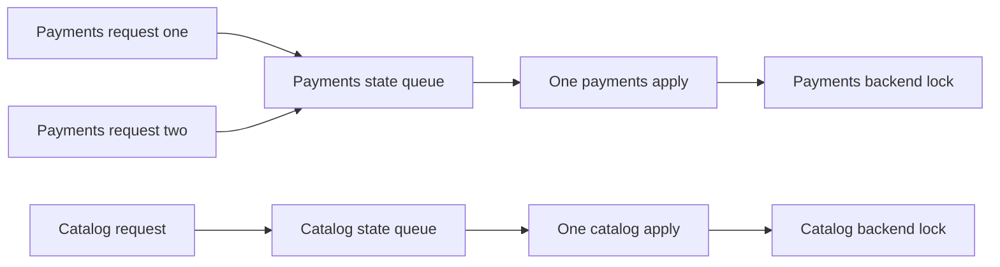

# Queue Terraform Applies per State Without Blocking Every Environment

Author: [nawazdhandala](https://www.github.com/nawazdhandala)

Tags: Terraform, CI/CD, Cloud Automation

Description: Give each Terraform state its own apply queue, keep backend locking enabled, and avoid canceling active deployments or replaying stale plans.

A single deployment queue prevents two Terraform jobs from writing simultaneously, but it also makes an unrelated catalog update wait for a slow payments deployment. Removing the queue entirely replaces that delay with lock failures and racing plans.

The useful boundary is the state being changed. Jobs targeting the same state wait together. Jobs targeting independent states can run concurrently, subject to any real infrastructure dependencies between them.

This example uses one GitHub.com repository, two existing Terraform roots, and the standard AWS S3 backend. It is a queueing pattern for reviewed automation, not a complete infrastructure project.

## Choose a state identity, not a branch name

A concurrency key must identify the backend object. A branch name, workflow name, or run ID does not do that: two branches can deploy to one production state, and two workflows can update the same environment.

For an S3 backend using Terraform's `default` workspace, the bucket and key identify the state object within the intended AWS partition. Other workspaces change the effective path. This example deliberately uses only `default`; adapt the identity calculation before supporting additional workspaces or custom S3-compatible endpoints. [S3 backend state paths](https://developer.hashicorp.com/terraform/language/backend/s3).



The two queues can progress independently. If both roots manage the same real resource, separate state files do not make concurrent changes safe. Fix shared ownership or model the dependency explicitly.

## Know what your CI queue actually preserves

GitHub's current concurrency settings distinguish `queue: single`, which replaces an existing pending request, from `queue: max`, which allows up to 100 pending requests per group. Additional requests are canceled when that queue is full. `queue: max` cannot be combined with `cancel-in-progress: true`.

Waiting jobs are processed by the time they began waiting on the group, not guaranteed workflow-dispatch order. Group names are case insensitive and scoped to the repository. Confirm support on your installation, especially GitHub Enterprise Server, before using the example. [GitHub concurrency syntax](https://docs.github.com/en/actions/reference/workflows-and-actions/workflow-syntax#jobsjob_idconcurrency).

Do not use active-run cancellation as a deployment optimization. Interrupting an apply can leave cloud operations or state reconciliation unfinished. If older pending releases should be superseded, make that a deliberate release policy; ordered migrations may require every intermediate operation.

## Resolve the backend and group from one registry

Save the following Python 3.11 script as `.ci/resolve_state.py`. Replace the state-bucket placeholder with your existing bucket. The two Terraform directories must already contain reviewed configuration and committed provider lockfiles.

```python
import hashlib
import json
import os
from pathlib import Path

TARGETS = {
    'payments-prod': ('infra/payments-prod', 'payments/production.tfstate'),
    'catalog-prod': ('infra/catalog-prod', 'catalog/production.tfstate'),
}

def resolve(target, bucket):
    directory, key = TARGETS[target]  # Unknown targets fail closed.
    backend = {'bucket': bucket, 'key': key, 'region': 'eu-west-1',
               'encrypt': True, 'use_lockfile': True}
    identity = json.dumps(['s3', 'aws', bucket, key], separators=(',', ':'))
    group = 'tf-state-' + hashlib.sha256(identity.encode()).hexdigest()
    return directory, backend, group

if __name__ == '__main__':
    directory, backend, group = resolve(
        os.environ['TARGET'], 'REPLACE_WITH_YOUR_STATE_BUCKET')
    Path('backend.generated.json').write_text(json.dumps(backend))
    print('directory=' + directory)
    print('group=' + group)
```

The script writes non-secret backend settings and emits a directory plus concurrency group. The group is a SHA-256 digest of the actual state identity, preserving case-sensitive object keys while producing a lowercase group name. Different labels resolving to the same bucket/key produce the same group. Changing a label does not accidentally create a second writer lane.

Keep this registry under review. All workflows that can write these states must use the same resolver and identity rules. A hash does not discover hidden aliases or repair an incorrect mapping; it only makes a consistent mapping convenient to use.

Both roots need an S3 backend declaration, with connection settings supplied by the resolver. For this concrete example, pin Terraform 1.11.4:

```hcl
terraform {
  required_version = "= 1.11.4"
  backend "s3" {}
}
```

The resolver enables S3 lockfiles with `use_lockfile`. Provision the bucket, versioning, and appropriate state/lockfile permissions separately. Do not create or migrate the backend as an incidental part of a queued production apply.

## Hold the queue slot through the whole deployment

Create protected GitHub environments named `payments-prod` and `catalog-prod`, each restricted to the release branch and configured with its intended approval rules. Configure AWS OIDC trust for those environment identities and set environment variables `AWS_ROLE_ARN` and `AWS_ACCOUNT_ID`. Those are configuration variables, not stored AWS keys.

The workflow below accepts only known targets and routes dispatches from `main`. It uses checkout 4.2.2, setup-terraform 3.1.2, and AWS credentials 5.1.0 pinned to their verified commits. The setup action's [documented inputs](https://raw.githubusercontent.com/hashicorp/setup-terraform/v3.1.2/action.yml) select Terraform 1.11.4 and disable its command wrapper. AWS sign-in requires the previously configured [OIDC trust](https://github.com/aws-actions/configure-aws-credentials/tree/v5.1.0).

```yaml
name: Apply one state
on:
  workflow_dispatch:
    inputs:
      target:
        type: choice
        required: true
        options: [payments-prod, catalog-prod]
permissions:
  contents: read
jobs:
  route:
    if: github.ref == 'refs/heads/main'
    runs-on: ubuntu-24.04
    outputs:
      group: ${{ steps.state.outputs.group }}
      directory: ${{ steps.state.outputs.directory }}
    steps:
      - uses: actions/checkout@11bd71901bbe5b1630ceea73d27597364c9af683
        with:
          persist-credentials: false
      - id: state
        env:
          TARGET: ${{ inputs.target }}
        run: python3 .ci/resolve_state.py >> "$GITHUB_OUTPUT"
  apply:
    needs: route
    runs-on: ubuntu-24.04
    environment: ${{ inputs.target }}
    concurrency:
      group: ${{ needs.route.outputs.group }}
      queue: max
      cancel-in-progress: false
    permissions:
      contents: read
      id-token: write
    env:
      TARGET: ${{ inputs.target }}
      TF_ROOT: ${{ needs.route.outputs.directory }}
      TF_WORKSPACE: default
      TF_IN_AUTOMATION: 'true'
    steps:
      - uses: actions/checkout@11bd71901bbe5b1630ceea73d27597364c9af683
        with:
          persist-credentials: false
      - uses: hashicorp/setup-terraform@b9cd54a3c349d3f38e8881555d616ced269862dd
        with:
          terraform_version: 1.11.4
          terraform_wrapper: false
      - uses: aws-actions/configure-aws-credentials@00943011d9042930efac3dcd3a170e4273319bc8
        with:
          role-to-assume: ${{ vars.AWS_ROLE_ARN }}
          aws-region: eu-west-1
          allowed-account-ids: ${{ vars.AWS_ACCOUNT_ID }}
          unset-current-credentials: true
      - name: Resolve and initialize
        run: |
          python3 .ci/resolve_state.py
          terraform -chdir="$TF_ROOT" init -input=false -lockfile=readonly \
            -backend-config="$GITHUB_WORKSPACE/backend.generated.json"
          test "$(terraform -chdir="$TF_ROOT" workspace show)" = default
      - name: Plan and apply authorized change
        run: |
          terraform -chdir="$TF_ROOT" plan -input=false -lock-timeout=60s -out=tfplan
          terraform -chdir="$TF_ROOT" apply -input=false -lock-timeout=60s tfplan
```

The routing job has no cloud identity. Its outputs choose the apply job's group before that job executes. The apply job checks out the same run commit, reconstructs the backend settings, authenticates, and keeps its queue slot through both plan and apply.

This example automatically applies the plan after the environment gate has authorized the job. That gate approves execution before the plan exists; it is not approval of the exact generated plan. If your process requires plan-specific review, add that review or a policy decision inside a coordinated deployment process, preserving the state reservation and verifying the plan's provenance. Do not silently weaken your approval model to fit this example.

`init -lockfile=readonly` uses the committed provider dependency selections; it is unrelated to the remote state lock. The initialization settings are documented in the [init reference](https://developer.hashicorp.com/terraform/cli/commands/init). Required Terraform variables must already be supplied through reviewed variable files or the job's approved configuration.

## Keep Terraform locking as the final guard

CI concurrency coordinates these jobs within this repository. It cannot prevent an engineer's local CLI or another repository from writing the same state. Backend locking still matters. Keep it enabled and route every production writer through one owner where practical. [Terraform state locking](https://developer.hashicorp.com/terraform/language/state/locking).

The `-lock-timeout=60s` option waits briefly for another backend lock; it does not remove one. A timeout is a signal to investigate another writer or insufficient coordination. Never add automatic force-unlock to the queue consumer.

Creating the plan after acquiring the CI slot reduces avoidable stale plans. Passing a saved plan to `apply` executes that plan without an interactive approval prompt. If Terraform rejects it because state changed, produce a new plan and repeat the required review; do not bypass the mismatch. [Plan options](https://developer.hashicorp.com/terraform/cli/commands/plan), [saved-plan apply](https://developer.hashicorp.com/terraform/cli/commands/apply).

## Test scheduling separately from infrastructure changes

Before enabling real applies, use a harmless substitute job that records its target, group, start time, and end time. Submit two payments requests and one catalog request. The payments intervals must not overlap; catalog should be able to run independently when runner capacity permits.

Then test cancellation, a failed deployment, queue capacity, and two different workflow files targeting the same state. Confirm that every request has a final disposition rather than assuming a pending job will eventually run. If strict business ordering is required, use an authoritative sequence or durable deployment queue; scheduler wait order is insufficient.

Monitor wait time and apply duration per state. A consistently long queue can indicate slow provider operations, overly large state boundaries, or too many redundant release requests. Split state only along real ownership boundaries, with reviewed migration, rather than simply to increase parallelism.

The resolver passed eight local checks covering distinct states, aliases, case-sensitive keys, invalid targets, and locking settings. Workflow YAML, action inputs, shell syntax, and the backend declaration were checked locally. GitHub scheduling, AWS authentication, and cloud applies were not executed.
