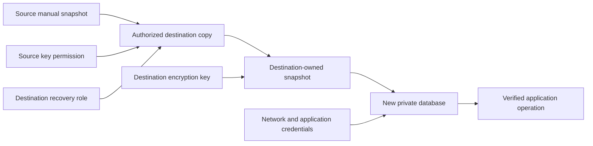

# Make RDS Cross-Account Restores Work Beyond the Backup Job

Author: [nawazdhandala](https://www.github.com/nawazdhandala)

Tags: AWS, PostgreSQL, Disaster Recovery

Description: Prepare RDS snapshot ownership, KMS access, recovery roles, private networking, credentials, and endpoint changes for a usable cross-account restore.

A successful backup job proves that a backup was created. It does not prove that a recovery operator in another account can decrypt it, create a database, or connect an application to the result.

Cross-account disaster recovery needs a chain of usable dependencies. The most useful test starts with the identity that will perform recovery and ends with a correct application operation in the recovery environment.

This walkthrough covers an encrypted **RDS PostgreSQL DB instance snapshot**, copied into another AWS account in the same Region. The example assumes PostgreSQL 17-compatible settings and AWS CLI 2.38.1. Aurora cluster snapshots, AWS Backup vault workflows, and cross-Region recovery need their own procedures; this is not a universal command sequence for all managed backups.

## Separate backup ownership from permission to view it

RDS can share manual DB snapshots. To share an automated snapshot, first copy it to a manual snapshot. A shared encrypted snapshot cannot be restored directly: the receiving account must copy it and restore from that copy. [RDS snapshot sharing rules](https://docs.aws.amazon.com/AmazonRDS/latest/UserGuide/USER_ShareSnapshot.html).

That distinction changes the recovery plan. A snapshot visible under “shared with me” still depends on source-side access. Prefer a completed, destination-owned copy encrypted with a destination-controlled key before the incident begins.



Maintain an inventory with source snapshot identity, destination snapshot identity, encryption key identity, recovery point, and last successful restore test. An inventory of copy requests is insufficient; confirm copies actually finished.

## Prepare both sides of encryption access

AWS Key Management Service, or KMS, controls the keys used to encrypt snapshots. An encrypted snapshot using the source account's default RDS KMS key cannot be shared. AWS documents copying it under a customer-managed key, sharing that copy with the target account, and then copying it under a target-account key. [Encrypted snapshot procedure](https://docs.aws.amazon.com/AmazonRDS/latest/UserGuide/share-encrypted-snapshot.html).

Snapshot sharing and key access are separate permissions. For cross-account KMS access, the source key policy and the destination identity's IAM permissions must both authorize the intended use. IAM is AWS's identity and access management system. A destination administrator's broad local permissions do not override a missing source key policy. [Cross-account KMS authorization](https://docs.aws.amazon.com/kms/latest/developerguide/key-policy-modifying-external-accounts.html).

Give the recovery role the RDS and KMS operations required by the chosen workflow, scoped to the intended resources. Review grant-related requirements for service use as part of that policy design. Do not paste a broad wildcard policy into production just to get the first test working.

Protect the destination key's lifecycle too. A destination-owned snapshot is not useful if its encryption key is unavailable. Exercise the recovery role independently from the source account's administrator and document any remaining source dependency.

## Copy into the recovery account ahead of time

The following command creates a snapshot copy and can incur charges. Run it only in an approved recovery exercise after confirming the destination profile's account identity. Every account ID, key ID, and snapshot name is illustrative; replace them with reviewed values. The source snapshot must already be shared, encrypted under an accessible customer-managed key, and available.

```bash
aws rds copy-db-snapshot \
  --profile recovery-drill --region us-east-1 \
  --source-db-snapshot-identifier arn:aws:rds:us-east-1:111122223333:snapshot:approved-share-copy \
  --target-db-snapshot-identifier drill-owned-copy \
  --kms-key-id arn:aws:kms:us-east-1:444455556666:key/00000000-0000-0000-0000-000000000000 \
  --no-cli-pager
```

The source identifier is the shared snapshot's full Amazon Resource Name, or ARN. The key ARN belongs to the destination account. The returned copy request is not completion evidence. Check the destination snapshot until its status is `available`, and verify its key and ownership before proceeding. [CopyDBSnapshot reference](https://docs.aws.amazon.com/cli/latest/reference/rds/copy-db-snapshot.html), [snapshot inspection reference](https://docs.aws.amazon.com/cli/latest/reference/rds/describe-db-snapshots.html).

For cross-Region copies, destination key selection and Region-specific options differ. Keep that as a separately tested path rather than changing only `--region` in this example. [RDS copying considerations](https://docs.aws.amazon.com/AmazonRDS/latest/UserGuide/USER_CopySnapshot.html).

## Build the destination environment before the emergency

A snapshot does not provision the application's recovery network. Prepare the destination virtual private cloud, database subnet group, security groups, routing, and DNS access. Test the route from the recovery application to the database port, including return traffic. A private database still needs correctly configured network access. [RDS networking requirements](https://docs.aws.amazon.com/AmazonRDS/latest/UserGuide/USER_VPC.WorkingWithRDSInstanceinaVPC.html).

Prepare compatible parameter groups, required extensions, instance capacity, monitoring, and recovery credentials. Database roles stored in the snapshot and application secrets stored elsewhere can be from different points in time. Check that the intended application login works without casually changing the original production credentials.

Run the recovery application's workers with external effects disabled or redirected to test systems. Restoring old job queues can otherwise replay emails, payments, or scheduled operations that already happened.

## Restore into a new, explicit target

RDS snapshot restore creates a new DB instance; it does not overwrite an existing one. The following creates a private, Single-AZ **drill** instance from the completed destination copy. It is not a production high-availability configuration. Replace the example instance class with a supported choice for your engine, Region, and recovery objective. The subnet, security group, and PostgreSQL 17 parameter group must already exist in the destination account.

```bash
aws rds restore-db-instance-from-db-snapshot \
  --profile recovery-drill --region us-east-1 \
  --db-instance-identifier drill-restored-postgres \
  --db-snapshot-identifier drill-owned-copy \
  --db-instance-class db.m6g.large \
  --db-subnet-group-name drill-private-subnets \
  --vpc-security-group-ids sg-0123456789abcdef0 \
  --db-parameter-group-name drill-postgres17 \
  --no-publicly-accessible --no-multi-az --no-cli-pager
```

Explicit network and parameter choices prevent reliance on defaults that may not suit the application. Review the completed instance's configuration as well as its status. [RestoreDBInstanceFromDBSnapshot reference](https://docs.aws.amazon.com/cli/latest/reference/rds/restore-db-instance-from-db-snapshot.html).

A restored instance can be available while data continues loading in the background. Measure representative query and application performance before declaring the recovery target achieved. [RDS restore behavior](https://docs.aws.amazon.com/AmazonRDS/latest/UserGuide/USER_RestoreFromSnapshot.html).

## Treat endpoint changes as an application change

The new instance has a new endpoint. Update the recovery application's configuration through a controlled mechanism, including its credential reference and certificate trust. Do not replace the source application's endpoint during a rehearsal.

Check DNS resolution from the actual recovery workload. If you use a private alias, test the client's hostname-verification behavior: a convenient alias is not automatically a name covered by the database server certificate. PostgreSQL's `verify-full` validates both trust and the requested hostname. Preserve verification rather than disabling it to make the alias work. [PostgreSQL TLS verification](https://www.postgresql.org/docs/17/libpq-ssl.html).

For a real cutover, account for cached names and existing connection pools. Establish which database is authoritative and stop old writers before enabling normal writes to the recovered system. A DNS update alone does not prevent two application populations from writing to different databases.

## Measure a usable recovery

Record the time to access the destination copy, create the database, establish verified connections, and complete controlled business operations. Compare recovered data with the chosen recovery point, including known records and application-specific invariants. State the accepted data-loss window explicitly.

A stronger rehearsal starts with a pre-positioned destination copy and avoids relying on the source environment for normal recovery steps. Keep destructive source-access experiments out of production; validate independence with a planned exercise and reviewed permissions.

The pass condition is a usable, correctly scoped recovery environment with measured data freshness and application behavior. Keep the evidence and remaining dependencies beside the backup schedule so the next green backup status is supported by an actual restore result.
