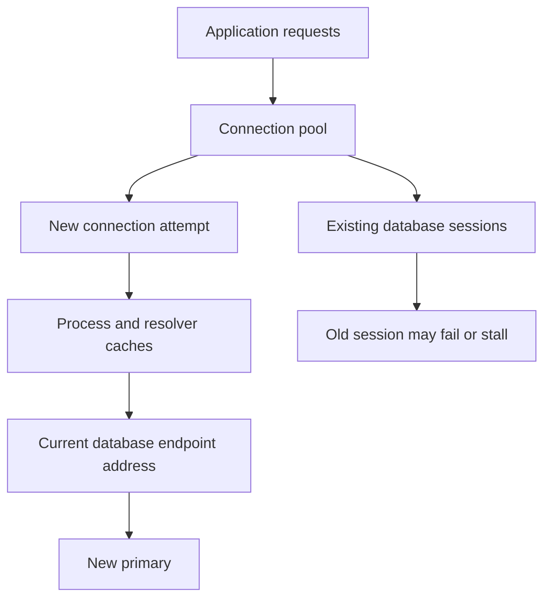

# RDS Failover Finished but Your Application Still Cannot Connect

Author: [nawazdhandala](https://www.github.com/nawazdhandala)

Tags: AWS, PostgreSQL, Troubleshooting

Description: Separate DNS caching, stale database connections, and retry overload when an RDS failover completes but application requests still fail.

A database failover event says the service has switched database hosts. Your checkout API may still be returning errors. Those observations can both be correct: the application has its own name caches, open connections, and waiting requests to recover.

This walkthrough targets PostgreSQL on an Amazon RDS **Multi-AZ DB instance** with applications connecting directly to its database endpoint. Aurora, Multi-AZ DB clusters, and database proxies have different routing behavior; use their specific recovery documentation. The commands below are read-only diagnostics, not instructions to trigger another failover.

## Follow three separate recovery paths

For this RDS deployment, failover changes the endpoint's DNS record and clients must establish connections to the new primary. DNS, the Domain Name System, translates that endpoint name into an address. A time to live, or TTL, tells a cache how long an answer can be retained. AWS recommends a JVM DNS cache TTL of 60 seconds or less for Java applications using these endpoints. Check the actual runtime setting rather than assuming the operating system's cache controls Java. [RDS failover documentation](https://docs.aws.amazon.com/AmazonRDS/latest/UserGuide/Concepts.MultiAZ.Failover.html).

An existing connection does not move when the name resolves differently. Meanwhile, failed requests may create additional work through retries. Treat these as separate paths:



Record the database event time, first successful fresh connection, and first sustained application recovery separately. A single “database available” timestamp hides which part is still broken.

## Collect evidence before changing settings

Start with one affected application instance and one working instance, if any. Record their deployment version, database endpoint name, driver and pool versions, and the failure stage. Remove credentials from captured connection strings.

| Observation | Useful next check | What it does not establish |
|---|---|---|
| Pool acquisition times out | Active connections, idle connections, waiting requests | Whether a new network connection would work |
| New connections time out | Address resolution and network path | That PostgreSQL rejected authentication |
| TLS verification fails | Endpoint hostname and trusted CA bundle | That disabling verification is an acceptable repair |
| Fresh connections work but old workers fail | Runtime DNS cache and existing pool sessions | That every application instance needs restarting |
| Connections work but requests remain slow | Database load, locks, queue depth, retry volume | That the endpoint is still wrong |

Capture the original driver error as well as the top-level HTTP failure. “Database unavailable” is often an application wrapper around several very different problems.

## Compare DNS from the affected network

Run the following in an approved diagnostic environment using the same DNS resolver path as the affected workload. Replace the example name with the actual RDS endpoint. The options are documented for BIND 9.18.33's `dig`:

```bash
dig +noall +answer REPLACE_WITH_RDS_ENDPOINT
```

The answer section shows returned records and their TTLs. Save a timestamp alongside the output and repeat at a controlled interval if the incident is ongoing. An empty answer section needs investigation of the full DNS response; it is not proof that the database has disappeared. [BIND dig manual](https://bind9.readthedocs.io/en/v9.18.33/manpages.html#dig-dns-lookup-utility).

This examines the resolver's answer, not the hostname already cached inside a long-running application. A fresh diagnostic process can succeed while an older Java process keeps trying an obsolete address. Inspect the application's runtime DNS configuration and connection-attempt diagnostics to distinguish them.

Keep using the service endpoint hostname. Pinning its current address in a connection string or hosts file creates another stale mapping for the next failover and can also change certificate verification behavior. Correct the relevant caching layer through a tested configuration change; do not blindly flush every resolver in the network.

## Test a fresh, verified PostgreSQL connection

Use a PostgreSQL 17 `psql` client, an approved probe account, and the correct RDS certificate authority bundle. The certificate authority, or CA, is the trust anchor used to authenticate the server. Run from the affected network path. Replace the endpoint, database, user, and CA file path below.

Supply authentication through an approved mechanism. For password authentication, provision a protected password file rather than placing a password in the command. PostgreSQL documents the file format and requires restrictive permissions on Unix. [Password file documentation](https://www.postgresql.org/docs/17/libpq-pgpass.html).

```bash
DB_PROBE_DSN='host=REPLACE_WITH_RDS_ENDPOINT port=5432 dbname=app user=probe sslmode=verify-full sslrootcert=/path/to/rds-ca.pem connect_timeout=5'

PGOPTIONS='-c statement_timeout=5000' psql -X -w -v ON_ERROR_STOP=1 "$DB_PROBE_DSN" \
  -c "SELECT pg_catalog.inet_server_addr() AS server_ip,
             pg_catalog.pg_is_in_recovery() AS recovering,
             pg_catalog.current_setting('transaction_read_only') AS read_only;"
```

The client skips startup customization with `-X`, avoids an interactive password prompt with `-w`, and reports SQL failures through `ON_ERROR_STOP`. The connection timeout limits connection attempts; it is not an overall application-request deadline. The session's statement timeout bounds this query. [psql options](https://www.postgresql.org/docs/17/app-psql.html), [connection parameters](https://www.postgresql.org/docs/17/libpq-connect.html).

`verify-full` checks both certificate trust and the requested hostname. Keep that protection enabled while diagnosing recovery. [PostgreSQL TLS verification](https://www.postgresql.org/docs/17/libpq-ssl.html).

A writer candidate should report `recovering = f` and `read_only = off`. The address identifies the server for this connection; the other fields describe recovery and the session's transaction setting. They do not prove that your application account can perform its business operation. [Session information functions](https://www.postgresql.org/docs/17/functions-info.html), [administration functions](https://www.postgresql.org/docs/17/functions-admin.html).

## Separate stale sessions from an exhausted pool

If the fresh probe succeeds, examine the failing application's pool before increasing its size. A pool holds reusable connections; a request waiting for one may never have attempted a new connection at all.

Look for connections held by stalled operations, acquisition waiters, and repeated failures on reused sessions. Compare those observations with successful new application connections. A successful `psql` probe narrows the problem, but uses a different driver and process from the application.

Pool lifetime settings are not instant failover controls. For example, HikariCP's 6.3.0 tagged documentation explains that `maxLifetime` does not retire an in-use connection until it is returned. Reducing that setting does not forcibly release a stuck operation. [HikariCP configuration](https://github.com/brettwooldridge/HikariCP/blob/HikariCP-6.3.0/README.md#gear-configuration-knobs-baby).

Use the pool's supported recovery procedure or a controlled application-instance recycle after confirming that fresh application connections work. Start with a small cohort and observe database connection creation and request latency. Replacing every instance together can convert stale sessions into a simultaneous connection surge.

## Reduce retries before increasing traffic

A timeout does not establish that a transaction failed to commit. Retrying a payment or inventory change blindly can duplicate its effect. Use application-level idempotency, meaning repeated attempts represent the same operation, or reconcile the operation's outcome before replaying it.

Bound the number of attempts and the total request deadline. Apply backoff with jitter, a randomized delay, so clients do not reconnect on the same schedule. Inspect retries across service layers: independent retries in an API, worker, and driver can multiply database work. [AWS guidance on timeouts and retries](https://aws.amazon.com/builders-library/timeouts-retries-and-backoff-with-jitter/).

Restore normal admission gradually while checking successful business operations, waiting requests, connection churn, and database load. A falling error rate accompanied by a growing queue is not stable recovery.

Close the incident only after a defined observation window shows normal application behavior at the intended load. Preserve which intervention changed which signal. That evidence lets the next rehearsal test the actual failure path rather than merely repeat an endpoint switchover.
