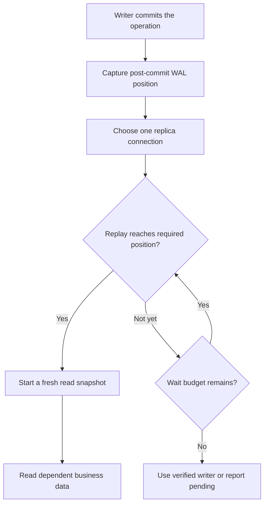

# Gate PostgreSQL Replica Reads on Replay Position

Author: [nawazdhandala](https://www.github.com/nawazdhandala)

Tags: PostgreSQL, Replication, Reliability

Description: Use a post-commit PostgreSQL WAL position to gate replica reads, with bounded waiting, fresh snapshots, and explicit handling of topology changes.

A customer saves a new shipping address and immediately reloads the page. The save succeeds, but the old address returns. The read replica is reachable and its health check passes; it simply has not applied the write yet.

This is a read-after-write requirement: a request that depends on a completed write must observe that write, or a later valid change. An ordinary availability check cannot establish it. Sending every read to the writer is one solution. When you need replica capacity, a position-based gate can direct dependent reads more carefully.

The examples below target PostgreSQL 17 physical streaming replication with a known writer and a specific replica. They are not a generic recipe for logical replication, unrelated databases, or provider-specific replica implementations. RDS for PostgreSQL DB instance read replicas use PostgreSQL's native replication mechanisms, but verify permissions and topology for your deployment. [RDS PostgreSQL read replicas](https://docs.aws.amazon.com/AmazonRDS/latest/UserGuide/USER_PostgreSQL.Replication.ReadReplicas.html).

## A healthy replica can still be behind

PostgreSQL records changes in its write-ahead log, usually shortened to WAL. A physical standby receives these records and replays them to reproduce database changes. Receipt and replay are different stages: a record can have arrived without its effects being available to queries. [PostgreSQL streaming replication](https://www.postgresql.org/docs/17/warm-standby.html#STREAMING-REPLICATION).

An LSN, or log sequence number, identifies a byte position in that log. PostgreSQL's `pg_lsn` type supports ordered comparisons. Treat it as a typed position, not a timestamp or ordinary text string. [The pg_lsn type](https://www.postgresql.org/docs/17/datatype-pg-lsn.html).

The intended rule is simple: a read that depends on a write may use a particular replica only after that replica has replayed through a suitable post-commit position from the same replication history.



The position is a lower bound on required visibility. It does not lock the row against subsequent changes or promise a historical version of the data.

## Capture the token after the commit succeeds

First complete the application's write transaction and receive its commit acknowledgment. Then, while still bound to the same known writer and topology generation, issue this separate SQL statement:

```sql
SELECT pg_catalog.pg_current_wal_insert_lsn()::text AS required_lsn;
```

The returned value is a conservative upper bound on that completed transaction's WAL position. Concurrent work may move it farther ahead, causing extra waiting, which is safe for visibility. The insertion position is used deliberately: it is distinct from the write and durable-flush positions. [PostgreSQL WAL position functions](https://www.postgresql.org/docs/17/functions-admin.html#FUNCTIONS-ADMIN-BACKUP).

Do not capture the token inside the write transaction before committing. At that point, the required commit record is not yet covered. Do not obtain it from a randomly chosen reader either.

If the commit succeeds but token capture fails, preserve the operation's identity and known success. Do not replay the write just to get another token. Route the dependent read to a verified writer or use the application's outcome-reconciliation path.

Associate the token with your application's database identity and topology generation. The generation is an application-controlled identifier changed when the replication history becomes uncertain; it is not a PostgreSQL feature invented by this example. Carry the token with the user's dependent operation rather than applying it to every unrelated read.

## Check the actual replica that will serve the read

The following diagnostic SQL uses an illustrative LSN. Replace it with the token returned after your own committed write. Application code should bind the value as a parameter, not concatenate client-supplied SQL.

```sql
SELECT pg_catalog.pg_is_in_recovery() AS is_standby,
       pg_catalog.pg_last_wal_replay_lsn() AS replay_lsn,
       COALESCE(
           pg_catalog.pg_is_in_recovery()
           AND pg_catalog.pg_last_wal_replay_lsn()
               >= '0/16B6C50'::pg_lsn,
           false
       ) AS may_read;
```

Proceed only on a true `may_read` result and a valid topology association. A null replay position does not mean caught up. A server that has been promoted is not silently accepted as the original standby. These checks supplement, rather than replace, your routing system's knowledge of server identity. [Recovery information functions](https://www.postgresql.org/docs/17/functions-admin.html#FUNCTIONS-RECOVERY-INFO).

Hold the same backend connection for the gate and subsequent read. Checking replica A and then querying a load-balanced endpoint that chooses replica B defeats the guarantee. With a proxy, verify whether its pooling mode preserves backend affinity across these statements; holding a client connection may not be enough.

Poll within a small, explicit request budget using bounded query timeouts and a delay between checks. Release the connection when the budget expires. Do not turn every web request into an unlimited loop occupying a pool slot.

## Start the business query with a fresh snapshot

After the gate succeeds, execute the dependent business query as a **separate statement with a fresh snapshot** on that same replica. In PostgreSQL's Read Committed isolation level, each statement sees a snapshot taken at its start. Repeatable Read retains an earlier transaction snapshot, which can remain stale even after replay advances. [Transaction isolation behavior](https://www.postgresql.org/docs/17/transaction-iso.html).

For a straightforward implementation, use autocommit for each gate check and for the later read, with verified backend affinity. Alternatively, design an explicit Read Committed transaction around the sequence and verify the proxy's behavior. Do not reuse a preexisting Repeatable Read transaction for this purpose.

Avoid combining a waiting expression and the business read into one clever SQL statement. Its data snapshot can be established before the waiting finishes. The operational sequence matters: observe replay success, then start the dependent query.

The business query must still apply normal tenant filters and authorization. A replay token is evidence about replication progress, not permission to access a record.

## Make fallback behavior explicit

Choose what happens when the replica cannot catch up within the budget:

| Condition | Suitable policy |
|---|---|
| Replica behind, writer healthy | Read through the verified writer with a fresh snapshot |
| Replica unavailable | Skip waiting and use the defined fallback |
| Writer unavailable and consistency required | Return a pending or retryable result rather than an apparently authoritative old value |
| Read explicitly tolerates staleness | Use the separate eventual-consistency path |
| Database or topology generation changed | Reject the old routing token and reconcile through the current authoritative system |

A writer fallback needs its own capacity budget. If all dependent reads suddenly move there, unrestricted fallback can worsen the incident. Measure fallback volume and bound concurrent work.

Treat tokens received from clients as untrusted. Validate their format, database association, and lifetime. A forged far-future LSN must not cause indefinite waiting. Keep authentication and tenant isolation independent from this mechanism.

## Revalidate the design across promotion and restore

LSNs are meaningful within a replication history. PostgreSQL uses timelines to distinguish histories after recovery and promotion. A numerically larger position on an unrelated or diverged history does not prove that a specific old transaction exists there. [PostgreSQL timelines](https://www.postgresql.org/docs/17/continuous-archiving.html#BACKUP-TIMELINES).

Conservatively invalidate outstanding routing tokens when failover, restore, or promotion makes their lineage uncertain. Reconcile the business operation on the current authoritative database before accepting a dependent read. A replay gate does not guarantee that asynchronously replicated data survived a failover.

Test the gate with a deliberately delayed staging replica, a replica switch between checks, a held Repeatable Read snapshot, and an expired wait budget. Record correctness and fallback load, not just query latency. The useful outcome is that a dependent read either observes the committed change through a valid path or clearly reports that the consistency requirement cannot yet be met.
