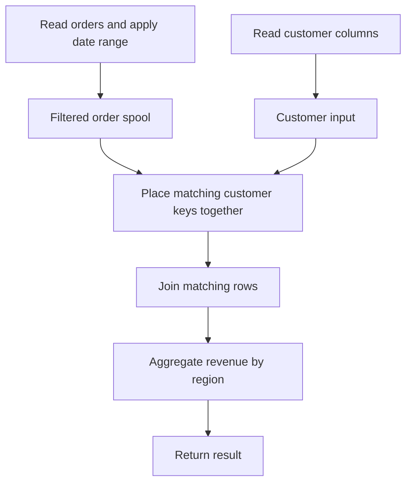

# Read Teradata EXPLAIN Plans: Scans, Movement and Confidence

Author: [nawazdhandala](https://www.github.com/nawazdhandala)

Tags: Database, SQL, Performance

Description: Read a Teradata EXPLAIN plan as a flow of rows, distinguish scans from data movement, and turn confidence and spool estimates into testable tuning questions.

Teradata's `EXPLAIN` output can be several pages long, but you do not need to understand every phrase before finding the important questions. Follow the rows: where they originate, which filters reduce them, how they move, where they join, and when intermediate results stop being needed.

This guide uses Vantage 17.20 terminology and a small reporting query. The query and interpretations are based on official documentation. No Teradata server was used to generate a plan, so the diagram below is explicitly a possible teaching flow, not captured optimizer output.

## Capture the right query and context

Use the actual predicates and relevant parameter values. A narrow date range and a full year can justify different plans. Also record the database release, session context, table definitions and available statistics before comparing plans across environments.

A static explanation describes the optimizer's planned steps. Dynamic explanation can partially execute a request to gather information for incremental planning. Teradata documents that distinction in [DYNAMIC EXPLAIN](https://docs.teradata.com/r/Enterprise_IntelliFlex_VMware/SQL-Request-and-Transaction-Processing/Interpreting-EXPLAIN-Output/DYNAMIC-EXPLAIN). Use static explanation for this initial reading exercise; do not substitute a dynamic request without considering its execution cost.

Assume approved lab tables with these columns: `orders(customer_id, order_date, order_total)` and `customers(customer_id, region_code)`. The intended business model has one customer row per identifier. With the necessary access, this requests a static plan for November revenue:

```sql
STATIC EXPLAIN
SELECT c.region_code,
       SUM(o.order_total) AS Revenue
FROM lab.orders AS o
JOIN lab.customers AS c
  ON o.customer_id = c.customer_id
WHERE o.order_date >= DATE '2026-11-01'
  AND o.order_date < DATE '2026-12-01'
GROUP BY c.region_code;
```

The expected response is explanatory text, not the revenue result. Replace the lab identifiers with your reviewed objects. The [EXPLAIN request reference](https://docs.teradata.com/r/Enterprise_IntelliFlex_VMware/SQL-Request-and-Transaction-Processing/Interpreting-EXPLAIN-Output/EXPLAIN-Request-Modifier) describes its role and notes that parameter peeking can affect the displayed plan.

## Read the plan as a row pipeline

Start at the table reads and annotate every intermediate spool with its source, estimated rows, estimated bytes, confidence and next consumer. A spool is an intermediate working result. Do not confuse its number with a severity ranking or its identifier with a durable table name.

For teaching purposes, one possible flow is:



The actual optimizer might use different access methods, move a different input, or perform aggregation at another point. Use the diagram's questions, not its exact shape, when annotating your own output.

The first useful question is whether the selected rows match the business request. If a supposedly narrow date predicate leaves nearly the entire input, investigate the estimate and predicate before focusing on the final aggregation.

## Separate AMP scope from access method

An AMP is an Access Module Processor, one of the parallel units doing the database work. An all-AMP step means that the work involves the relevant AMP population. It does not, by itself, mean that every stored row is read or that the plan is wrong.

Read the rest of the phrase: the access method, partitions and residual conditions matter. A broad analytical report can reasonably use many AMPs. A tactical lookup that should return one known key has different expectations. Teradata discusses that workload distinction in [all-AMP tactical queries](https://docs.teradata.com/r/Enterprise_IntelliFlex_VMware/Database-Design/Design-Issues-for-Tactical-Queries/All-AMP-Tactical-Queries-and-Partitioned-Tables).

For the revenue example, ask how much of the orders table November represents. A distributed scan might be sensible for a substantial fraction of the data. Demanding a single-AMP access path without considering the query's coverage can trade useful parallelism for concentrated work.

## Follow redistribution and duplication

Teradata's [EXPLAIN terminology reference](https://docs.teradata.com/r/Enterprise_IntelliFlex_VMware/SQL-Request-and-Transaction-Processing/Interpreting-EXPLAIN-Output/EXPLAIN-Request-Modifier-Phrase-Terminology) explains the movement phrases. Read them together with the input size:

| Plan concept | Question to ask |
|---|---|
| Redistribution by hash | Which expressions determine where the rows move? |
| Duplication to AMPs | How large is the copied input, and how many destinations need it? |
| Local processing | Are matching rows already placed together? |
| Last use of a spool | Which intermediate result becomes unnecessary after this consumer? |

Redistribution commonly places matching join keys together. A frequent key can concentrate work even when the original table was balanced. Duplication can be a sensible choice for a small input because it avoids moving a much larger one. The word itself is not an optimization failure.

For our example, a compact customer input might be inexpensive to duplicate. If the optimizer estimates that input as tiny but it is actually huge, the decision deserves investigation. The useful finding is the mismatch between estimated and actual input, not simply the presence of duplication.

## Treat confidence as evidence about estimates

Cardinality means the number of rows. The confidence label expresses the optimizer's confidence in a cardinality estimate given its available information; it is not a measured accuracy percentage.

The official [confidence guide](https://docs.teradata.com/r/Lake-Working-with-SQL/SQL-Reference/SQL-Request-and-Transaction-Processing/Interpreting-EXPLAIN-Output/EXPLAIN-Confidence-Levels?contentId=TNaartsZcnjtyHEocBJf8g) explains why no confidence does not automatically imply a bad plan, and high confidence can coexist with stale statistics. Check the inputs and statistics that support an estimate rather than trying to make every label read high.

Suppose the customer join is expected to preserve one output row for every matched order. If observed output is several times larger, verify uniqueness and business semantics before collecting more statistics. Better estimates cannot repair an accidental many-to-many join.

## Use spool and time estimates carefully

Look for the first substantial expansion in estimated rows or bytes. That is often a better investigation point than the final step with the largest number. Wide projected rows, repeated matches and deferred filtering can all increase the amount of intermediate work your query asks the engine to perform.

Do not sum every spool estimate and call that peak simultaneous usage. Intermediate results have different lifetimes, and some steps can overlap. Likewise, estimated step times are planning estimates, not measured request latency under the current workload. The [parallel-step explanation](https://docs.teradata.com/r/Lake-Working-with-SQL/SQL-Reference/SQL-Request-and-Transaction-Processing/Interpreting-EXPLAIN-Output/EXPLAIN-Request-Modifier-and-Parallel-Steps) is useful when reading which operations can proceed together.

Finish the review with a short hypothesis: the input estimate is stale, the join expands rows unexpectedly, or a particular redistribution key is concentrated. Test one change at a time with equivalent data and parameters. Compare result correctness, actual runtime, spool and per-AMP work. Preserve both plans so the improvement is tied to a specific change rather than to a favorable-looking phrase.
