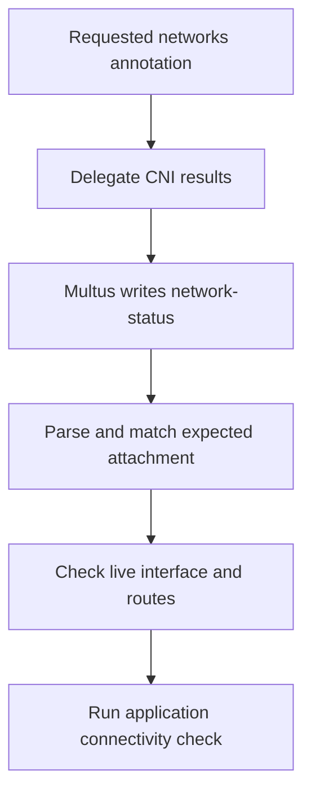

# Read and Validate Multus Network-Status Annotations

Author: [nawazdhandala](https://www.github.com/nawazdhandala)

Tags: Multus, Kubernetes, Troubleshooting

Description: Parse Multus network-status safely, match the intended attachment and interface, and distinguish reported CNI results from live connectivity and routing.

A Pod with several networks needs more than one address check. Kubernetes' `status.podIP` does not describe every secondary interface, and an application can be Running while its expected secondary connection is unusable.

Multus records attachment results in `k8s.v1.cni.cncf.io/network-status`. Reading that annotation is useful for inventory and deployment checks, provided you treat it as reported network setup information rather than a continuous connectivity probe.

This guide references **Multus v4.3.1** and the **network-attachment-definition-client v1.7.6** dependency it uses. The Python checker below was executed against local fixtures. No live Pod, interface, or network traffic was tested.

## Separate the request from the result

Two similarly named annotations have different jobs:

| Annotation | Meaning |
| --- | --- |
| `k8s.v1.cni.cncf.io/networks` | Requested secondary attachments and optional selection parameters |
| `k8s.v1.cni.cncf.io/network-status` | Network setup results reported by Multus |

The request can ask for a particular interface or address. The status helps you check what was reported after delegate execution. Do not copy the request into the status annotation or edit status manually to make a deployment check pass.

Multus builds status entries from delegate CNI results and updates the Pod annotation. Its update path checks Pod identity. That explains why a status inspection should retain the Pod UID: a later Pod with the same name is a different object. [Multus result collection](https://github.com/k8snetworkplumbingwg/multus-cni/blob/v4.3.1/pkg/multus/multus.go), [annotation update](https://github.com/k8snetworkplumbingwg/multus-cni/blob/v4.3.1/pkg/k8sclient/k8sclient.go).



Each step adds evidence. The annotation alone covers only part of the chain.

## Read the JSON string as JSON

The annotation value is a string containing a JSON array. This is JSON nested inside the Pod's JSON object, not a YAML list or a comma-separated address string.

For a quick inspection, escape the dots in the annotation key used by kubectl JSONPath:

```bash
kubectl --context REPLACE_CONTEXT -n REPLACE_NAMESPACE \
  get pod REPLACE_POD \
  -o 'jsonpath={.metadata.annotations.k8s\.v1\.cni\.cncf\.io/network-status}{"\n"}'
```

For repeatable validation, save the full Pod so the UID and namespace remain alongside the result:

```bash
kubectl --context REPLACE_CONTEXT -n REPLACE_NAMESPACE \
  get pod REPLACE_POD -o json > pod.json
```

Keep this file in a restricted workspace because Pod specifications can contain operational details. These commands only read the object. [kubectl JSONPath syntax](https://kubernetes.io/docs/reference/kubectl/jsonpath/).

A simplified secondary entry might look like this:

```json
[
  {
    "name": "payments/telemetry-net",
    "interface": "metrics0",
    "ips": ["192.0.2.50"],
    "mac": "02:00:00:00:00:50",
    "dns": {}
  }
]
```

The example is illustrative, not captured output. Do not assume every entry has all these fields or that a secondary network is always array element one.

## Interpret fields without adding assumptions

The pinned status schema includes `name`, optional `interface`, `ips`, `mac`, `mtu`, `default`, `dns`, `device-info`, and `gateway`. Which values are populated depends on the delegate result and conversion path. [Status schema](https://github.com/k8snetworkplumbingwg/network-attachment-definition-client/blob/v1.7.6/pkg/apis/k8s.cni.cncf.io/v1/types.go).

Several details matter for automation. Reported IPs are address strings; the conversion uses the IP itself rather than preserving the CIDR prefix. An address-only result cannot prove the interface's subnet mask. A network can also have multiple addresses, including different families, so do not assume `ips[0]` is the only useful value.

The `default` flag is derived using the delegate's default-network role and result handling. It is not a live query of every route and policy rule inside the Pod. Likewise, reported DNS data does not prove that the application's resolver file uses it. Inspect routes and resolver configuration when those properties matter. [Status conversion](https://github.com/k8snetworkplumbingwg/network-attachment-definition-client/blob/v1.7.6/pkg/utils/net-attach-def.go).

## Check one expected attachment explicitly

Save this original helper as `check_status.py`. It requires Python 3 and the `pod.json` snapshot. Supply the exact expected status name, interface, and approved IPv4 subnet as arguments; the documentation subnet below must be replaced.

```python
import ipaddress
import json
import sys

expected_name, expected_interface, subnet = sys.argv[1:]
network = ipaddress.ip_network(subnet)
if network.version != 4:
    raise ValueError('This check expects an IPv4 subnet')
with open('pod.json') as source:
    pod = json.load(source)
metadata = pod['metadata']
raw = metadata.get('annotations', {}).get(
    'k8s.v1.cni.cncf.io/network-status')
if not isinstance(raw, str) or not raw:
    raise ValueError('Network status is absent; inspect Pod setup')
entries = json.loads(raw)
if not isinstance(entries, list) or not all(
        isinstance(entry, dict) for entry in entries):
    raise ValueError('Expected an array of status objects')
matches = [entry for entry in entries
           if entry.get('name') == expected_name
           and entry.get('interface') == expected_interface]
if len(matches) != 1:
    raise ValueError('Expected exactly one matching attachment/interface')
values = matches[0].get('ips', [])
if not isinstance(values, list) or not all(
        isinstance(value, str) for value in values):
    raise ValueError('Expected an IP address array')
addresses = [ipaddress.ip_address(value) for value in values]
if not any(address.version == 4 and address in network
           for address in addresses):
    raise ValueError('No reported IPv4 address in the approved subnet')
print('PASS reported attachment:', expected_name, expected_interface,
      'Pod UID:', metadata['uid'])
```

Run it against the saved snapshot:

```bash
python3 check_status.py payments/telemetry-net metrics0 192.0.2.0/24
```

A passing result establishes one matching reported attachment with at least one IPv4 address in the approved subnet. It does not require IPv6 to be absent, reject every extra attachment, verify MAC ownership, or prove that all reported addresses are permitted. Extend the policy deliberately if those are requirements.

Matching by both name and interface avoids confusing repeated attachments or differently named interfaces. The helper rejects ambiguity instead of selecting whichever array element appears first. It is a narrow acceptance check, not a complete schema validator.

## Finish with live and lifecycle checks

If the annotation is missing, inspect Pod events and Multus logs. Setup may still be pending, a delegate may have failed, or the annotation update may have failed. Missing status is a reason to investigate, not proof that no interface exists.

When status passes, inspect the actual interface's name, address, prefix, and MAC from an approved diagnostic container. Check the selected route to the intended dependency and run the application protocol. This catches a valid-looking status entry whose upstream network or destination is unavailable.

For automated rollout gates, bind observations to the Pod UID and use a bounded wait with an explicit timeout. Fetch a fresh snapshot after recreation rather than reusing a saved file. Keep annotation validation, live interface inspection, and connectivity results separate in the evidence so an operator can see exactly which layer passed and which still needs attention.
