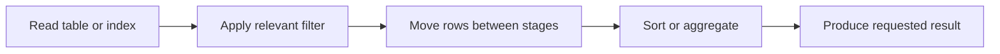

# Read a YDB Query Plan for Full Scans, Fan-Out, and Missing Indexes

Author: [nawazdhandala](https://www.github.com/nawazdhandala)

Tags: Database, SQL, Performance, Troubleshooting

Description: Read YDB plans from data access through distributed stages, distinguish explanation from execution, and compare an index candidate safely.

A query returning twenty rows can still read a large table, distribute work across many shards, and sort far more data than the application displays. The result size tells you little about the work required to produce it.

A YDB query plan makes that work visible. Read it as a path from data access through filtering, data movement, and result construction. Then compare the planned structure with execution statistics when it is safe to run the query. Avoid deciding that a plan is good or bad from one operator name alone.

## Explain first; execute deliberately

This guide uses YDB CLI **2.35.0** options checked against the installed binary's help. Its `sql --explain` command requests a logical plan without executing the query:

```bash
ydb -p REPLACE_WITH_PROFILE sql --explain -f baseline.sql
```

The profile must connect to the intended database, and the query's referenced objects must exist. This command still contacts the database to plan the query; it is not an offline SQL parser.

By contrast, `--explain-analyze` executes the query and reports its plan while ignoring result rows. An input file containing writes can therefore change data. The official [SQL CLI reference](https://ydb.tech/docs/en/reference/ydb-cli/sql) describes this distinction. Review the complete file before choosing an execution mode.

For an approved read-only staging query, collect detailed statistics separately:

```bash
ydb -p REPLACE_WITH_PROFILE sql --stats full -f baseline.sql
```

This second command executes the query. Keep an appropriate job timeout and workload budget; a read-only query can still be expensive.

## Establish the query's intended access path

The accompanying [schema.sql](./schema.sql) defines a fresh staging table with `ticket_id` as its primary key and a covering secondary index on `assignee`. The example targets the index syntax documented in YDB **26.2.1.16**. Creating the lab schema is a separate, explicit setup action.

The [baseline query](./baseline.sql) asks for one user's first twenty ticket IDs:

```sql
SELECT ticket_id, status, summary
FROM tickets_plan_lab
WHERE assignee = 'demo-user'
ORDER BY ticket_id
LIMIT 20;
```

Its filter is not on the base table's primary key. That is the first access-path question to investigate. The existence of an index somewhere in the schema does not establish that this query uses it.

The reviewed release's [secondary-index guide](https://github.com/ydb-platform/ydb/blob/26.2.1.16/ydb/docs/en/core/dev/secondary-indexes.md) documents explicit selection with `VIEW`. The [candidate query](./candidate.sql) changes only that access path:

```sql
SELECT ticket_id, status, summary
FROM tickets_plan_lab VIEW by_assignee
WHERE assignee = 'demo-user'
ORDER BY ticket_id
LIMIT 20;
```

Explain both files and inspect the actual table or index named in each plan. No captured plan is shown here; the example describes what to look for, not a fabricated optimizer result.

## Read data-access operators first

The tagged [plan structure reference](https://github.com/ydb-platform/ydb/blob/26.2.1.16/ydb/docs/en/core/yql/query_plans.md) describes the common operators:

| Operator | Initial question |
|---|---|
| `TableFullScan` | Is reading the full table necessary for this request? |
| `TableRangeScan` | How broad is the primary-key range? |
| `TablePointLookup` | Which concrete key values are being requested? |

Inspect `Table`, `ReadColumns`, and any range or limit attributes. A lookup into an index table is different from a lookup into the base table. A narrow range can be efficient; a range covering nearly all keys can still be expensive.

Operator labels and display details can vary by plan representation and release. Use the actual range and table attributes as evidence rather than assuming every operator with “lookup” in its name reads exactly one row.

A full scan can be the correct strategy for an aggregate over nearly all rows. The problem is an unnecessary scan for a selective lookup, not the mere presence of the word “scan.”

## Follow filters and limits through the plan

A filter can reduce results after the input has already been read. Look for the relationship between the read and filter operators, and compare rows read with rows emitted where execution statistics are available.

Likewise, a `LIMIT 20` at the result end does not guarantee that only twenty rows were read. An ordering requirement may require inspecting or sorting a much larger candidate set before the limit can be satisfied.

For this ticket example, the index includes the fields needed by the selected result. That creates an opportunity to avoid fetching extra base-table columns. Verify that the actual plan realizes the opportunity. Adding an unused wide payload to the select list can change the required work.

## Inspect distributed data movement

YDB plans contain stages and connections between them. A stage may run in multiple tasks; a connection describes how rows move between those tasks. The [plan structure documentation](https://ydb.tech/docs/en/yql/query_plans) includes `Broadcast`, `HashShuffle`, `Merge`, and `UnionAll` connections.

Broadcast sends an input to multiple recipients. Hash shuffle redistributes rows by a key. These operations can be necessary for joins and aggregates, but their cost depends on the amount of data moved and the number of tasks involved.



This is an illustrative inspection path, not a real YDB plan. Some operations can share a stage or appear in a different arrangement. The point is to ask where large row counts enter the graph and how long they remain large.

Fan-out is not automatically a defect: parallel work can be necessary and useful. It becomes suspicious when a supposedly selective point operation spreads across many partitions or transfers large intermediate results.

## Compare evidence rather than screenshots alone

Keep the data, parameters, consistency mode, and client concurrency comparable between baseline and candidate. Record the plan, rows and bytes read, participating shards, CPU time, and elapsed latency. A warm cache on one run and a cold cache on another can obscure the effect you intended to measure.

First verify that both queries return the same ordered result. A faster query that silently changes pagination or filters is not an optimization. Then identify which planned work actually decreased.

Do not add an index solely because an operator looks expensive. Include the index's write, storage, and maintenance costs in the decision. For a read-heavy endpoint it may be worthwhile; for a frequently updated table serving a rare report, another approach may be better.

During review, an adapted SQLite fixture confirmed the two query forms' filtering, ordering, and twenty-row result after removing YDB's `VIEW` syntax. CLI help and official plan documentation were checked. No YDB schema, optimizer plan, execution statistics, or speedup was tested. The next step in deployment is to run this comparison on representative staging data and record the actual plan evidence.
