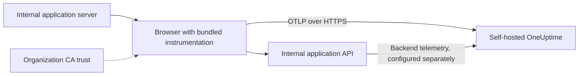

# Real User Monitoring for Internal Applications Without Cloud Services

Author: [nawazdhandala](https://www.github.com/nawazdhandala)

Tags: Air-Gapped, OpenTelemetry, JavaScript, Monitoring

Description: Bundle browser telemetry locally and send it to self-hosted OneUptime, with Browser keys, internal certificate trust, origin controls, and a practical acceptance test.

Real user monitoring, or RUM, measures what happens in users' browsers: page loads, requests, and other application activity. It complements a synthetic check, which runs a predetermined journey. Neither requires a cloud service when the application assets, telemetry destination, and supporting infrastructure are available internally.

This walkthrough starts with page-load and fetch traces sent directly to self-hosted OneUptime. A trace contains spans, which describe individual operations and their duration. Logs, Core Web Vitals, and session replay are additional capabilities to configure separately; installing a trace exporter does not automatically enable them all.

## Choose a browser-reachable ingestion path

Assume the application is served at `https://operations.internal.example` and OneUptime at `https://monitoring.internal.example`. Replace both names with yours. The user's workstation must resolve and reach the monitoring hostname, not merely the application server or Kubernetes cluster.



OTLP is OpenTelemetry's export protocol. For the browser, use its HTTP endpoint rather than a native gRPC client. OneUptime's [browser setup documentation](https://oneuptime.com/docs/en/rum/browser-setup) specifies `/otlp/v1/traces` and the `x-oneuptime-token` header. Confirm your deployed OneUptime release supports the documented Browser ingestion keys before rollout; older installations may need a reviewed upgrade.

## Create a key intended for browser code

In OneUptime, open **Project Settings → Telemetry & APM → Ingestion Keys**, create a **Browser** key, and list the application's exact allowed origin, including scheme and any non-default port. Pin its service name to `operations-web` and choose an appropriate request limit and expiry.

The token will be visible in downloaded JavaScript and browser requests. That is expected for this key type. Do not substitute a Server ingestion key or an administrative API credential. Origin checks constrain ingestion but do not make a browser token a secret or authenticate individual users. Treat incoming browser data as untrusted and keep rate limits and retention controls in place.

These controls are described in OneUptime's [version-pinned browser documentation](https://github.com/OneUptime/oneuptime/blob/0de2d9ceac0a2404f5df7ad1f9ab1e22c56bea7e/packages/App/FeatureSet/Docs/Content/en/rum/browser-setup.md).

## Pin and bundle the instrumentation

Prepare dependencies in your connected build environment or through an approved internal npm mirror. The following is the package set used for this article's local compilation check. It uses the OpenTelemetry 3.x tracing API; do not mix it with older examples importing `WebTracerProvider`.

```bash
npm install --save-exact \
  @opentelemetry/api@1.10.0 \
  @opentelemetry/sdk-trace@3.1.1 \
  @opentelemetry/resources@3.1.1 \
  @opentelemetry/core@3.1.1 \
  @opentelemetry/context-zone@3.1.1 \
  @opentelemetry/exporter-trace-otlp-http@0.301.2 \
  @opentelemetry/instrumentation@0.301.2 \
  @opentelemetry/instrumentation-fetch@0.301.2 \
  @opentelemetry/instrumentation-document-load@0.70.1
```

Keep the generated lockfile. Bundle the dependencies into your normal application assets and transfer the built release through your approved process. Do not add a script tag that loads the SDK from a public CDN. If builds themselves happen offline, mirror the complete locked dependency tree and the build toolchain first.

The [OpenTelemetry browser guide](https://opentelemetry.io/docs/languages/js/getting-started/browser/) explains browser instrumentation. The [3.x tracing SDK source](https://github.com/open-telemetry/opentelemetry-js/tree/ee0bd33cac8bb245a3d83fc2b8ba0b07534b8efd/packages/sdk-trace) defines the API used below.

Save this as `src/telemetry.ts`, replace the endpoint and Browser key placeholder, and import it before application requests begin:

```typescript
import { context, propagation, trace } from '@opentelemetry/api';
import { TracerProvider, BatchSpanProcessor } from '@opentelemetry/sdk-trace';
import { resourceFromAttributes } from '@opentelemetry/resources';
import { W3CTraceContextPropagator } from '@opentelemetry/core';
import { ZoneContextManager } from '@opentelemetry/context-zone';
import { OTLPTraceExporter } from '@opentelemetry/exporter-trace-otlp-http';
import { registerInstrumentations } from '@opentelemetry/instrumentation';
import { DocumentLoadInstrumentation } from '@opentelemetry/instrumentation-document-load';
import { FetchInstrumentation } from '@opentelemetry/instrumentation-fetch';

const endpoint = 'https://monitoring.internal.example/otlp/v1/traces';
const provider = new TracerProvider({
  resource: resourceFromAttributes({
    'service.name': 'operations-web',
    'browser.language': navigator.language,
  }),
  spanProcessors: [new BatchSpanProcessor({ exporter: new OTLPTraceExporter({
    url: endpoint,
    headers: { 'x-oneuptime-token': 'REPLACE_WITH_BROWSER_INGESTION_KEY' },
  }) })],
});
context.setGlobalContextManager(new ZoneContextManager().enable());
propagation.setGlobalPropagator(new W3CTraceContextPropagator());
trace.setGlobalTracerProvider(provider);
registerInstrumentations({
  instrumentations: [
    new DocumentLoadInstrumentation(),
    new FetchInstrumentation({
      ignoreUrls: [endpoint],
      propagateTraceHeaderCorsUrls: [/^https:\/\/api\.internal\.example(?:\/|$)/],
    }),
  ],
});
```

The resource identifies the application. `browser.language` marks this as browser telemetry for OneUptime's RUM classification. The batch processor groups spans for export, and the instrumentations collect document-load and fetch activity. The exporter URL is excluded from fetch instrumentation to avoid treating telemetry uploads as application requests.

The context manager keeps related operations associated across asynchronous callbacks. This example assumes your application does not already supply Zone.js; applications such as Angular need the compatible peer-dependency approach described by [OpenTelemetry's Zone context manager](https://github.com/open-telemetry/opentelemetry-js/blob/ee0bd33cac8bb245a3d83fc2b8ba0b07534b8efd/packages/opentelemetry-context-zone/README.md). Initialize instrumentation once, including during development reloads.

The propagation pattern matches only the named API origin and its paths. It allows a trace header to connect browser requests to separately instrumented backend services. Replace it deliberately; do not broaden it to every destination. Your API must allow the tracing header through its cross-origin policy. XMLHttpRequest calls and client-side route changes need their own instrumentation.

## Keep three different trust checks clear

A successful connection depends on three independent controls:

| Control | What to configure | What failure looks like |
| --- | --- | --- |
| TLS certificate trust | Browser trusts the internal CA; certificate names match the endpoint | Certificate or connection error |
| Cross-Origin Resource Sharing, or CORS | Ingestion path and proxies permit the application's cross-origin export | Preflight or response blocked by browser |
| Content Security Policy, or CSP | Application permits telemetry connections to the internal monitoring origin | Browser console reports a policy violation |

CORS is a browser rule governing cross-origin requests, not a substitute for the Browser key's server-side allowed-origin check. Custom headers can cause an `OPTIONS` preflight request before the telemetry upload. Inspect both requests rather than concluding that a successful curl command proves browser access. Mozilla explains the mechanism in its [CORS guide](https://developer.mozilla.org/en-US/docs/Web/HTTP/Guides/CORS).

Merge the internal destination into your existing CSP `connect-src` directive, preserving other required destinations:

```text
connect-src 'self' https://monitoring.internal.example;
```

This is a policy fragment, not a complete security policy. The [`connect-src` reference](https://developer.mozilla.org/en-US/docs/Web/HTTP/Reference/Headers/Content-Security-Policy/connect-src) lists the browser connections it governs. Keep HTTPS verification enabled; JavaScript cannot repair a workstation's missing CA trust.

## Prove one signal before adding more

Deploy to an internal staging application. Use a fresh browser session on the same network as your users, with public egress blocked through your approved test controls and internal dependencies available.

First, confirm that application scripts and instrumentation arrive from internal hosts. Then make a recognizable read-only application request. In browser developer tools, inspect the export to `/otlp/v1/traces`: its destination, preflight behavior, response, and resource attributes should match the intended configuration.

For an unambiguous rehearsal marker, temporarily add this after initialization in the staging telemetry module. Change the run identifier for each test:

```typescript
const check = provider.getTracer('offline-acceptance').startSpan('rum-offline-check');
check.setAttribute('test.run_id', 'staging-2026-11-20-01');
check.end();
void provider.forceFlush().catch(() => console.warn('RUM acceptance export failed'));
```

Find that exact span under the intended RUM application. Remove the marker afterward. A successful HTTP response alone does not prove the data was classified, stored, and made searchable correctly. If the data appears under backend Services, inspect the browser resource attributes; OneUptime's [RUM troubleshooting guide](https://oneuptime.com/docs/en/rum/troubleshooting) covers this distinction.

Test an unapproved staging origin as well and confirm the Browser key rejects it. Repeat from the browser families your organization supports. Check that telemetry failures do not prevent the business application from loading when the monitoring destination is unavailable.

## Expand with explicit limits

Review captured URLs and attributes before enabling production traffic. Internal URLs can still contain customer identifiers, access tokens, or employee information. Establish redaction, sampling, retention, and access rules before collecting broadly; an isolated network does not make sensitive data harmless.

Core Web Vitals measure aspects of loading, responsiveness, and visual stability. They require metric instrumentation and export, described in OneUptime's [Web Vitals guide](https://oneuptime.com/docs/en/rum/web-vitals). Add error reporting and session replay only with their own collection and privacy review.

Finally, monitor the ingestion path itself. RUM cannot report a page that never loaded its JavaScript, and a lack of browser telemetry could mean either low traffic or a broken export path. Keep synthetic checks and server-side monitoring alongside RUM so those gaps remain visible.
