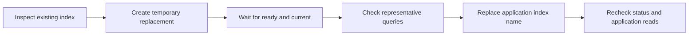

# Rebuild RethinkDB Indexes After an Upgrade and Verify Readiness

Author: [nawazdhandala](https://www.github.com/nawazdhandala)

Tags: RethinkDB, Database, Reliability

Description: Inspect outdated RethinkDB indexes, build replacements without dropping the active names first, and verify readiness and query results before completing an upgrade.

Your RethinkDB nodes have restarted on the new version, but that does not finish every upgrade task. Secondary indexes may still use an older representation. Rebuilding them requires more care than dropping every index and letting application startup create replacements.

A secondary index is a separate lookup structure derived from table documents. Removing it can break queries that explicitly name it, even while the table itself remains readable. The practical sequence is to inspect, build a replacement, wait, verify, and only then replace the application-facing index name.

This guide uses the Python driver 2.4.10.post1 for query construction. Its examples were checked locally with Python 3.11.13; no database upgrade or live index rebuild was performed. Rehearse against your exact source and target server versions before scheduling production work.

## Decide whether a rebuild is necessary

The [migration guide](https://rethinkdb.com/docs/migration/) directs operators to rebuild outdated indexes after relevant upgrades and consult release notes. It does not say every patch release requires a rebuild. Preserve a tested backup and the index definitions before the upgrade, and establish a separate rollback plan: starting an older binary against upgraded data is not a universal recovery method.

Use an approved connection named `conn`, with credentials and TLS trust supplied by your existing connection setup. These read-only statements inspect one example table; replace `app`, `orders`, and subsequent index names with your reviewed target:

```python
from rethinkdb import RethinkDB

r = RethinkDB()
table = r.db("app").table("orders")
for status in table.index_status().run(conn):
    print({key: status.get(key) for key in
           ("index", "ready", "outdated", "progress", "multi", "geo")})
```

Two fields answer different questions. `ready` indicates whether construction has finished. `outdated` indicates whether the index needs rebuilding for the current server version. Treat missing fields as insufficient evidence, not as a successful result. Progress is useful during construction, but readiness is the completion gate. The [index_status reference](https://rethinkdb.com/api/python/index_status/) defines these fields and the opaque binary definition returned as `function`.

Record the database, table, index name, original definition, flags, and initial status. Keep one migration owner for that table so another process cannot rename or recreate indexes while this procedure is running.



## Choose the utility or an explicit migration

RethinkDB provides an `index-rebuild` utility. The migration guide documents table selection with `-r DB.TABLE` and concurrency with `-n NUM`. The [driver's tagged implementation](https://github.com/rethinkdb/rethinkdb-python/blob/v2.4.10.post1/rethinkdb/_index_rebuild.py) creates temporary indexes from existing definitions, checks readiness, and renames replacements over the originals. Its default concurrency is one.

That utility is appropriate when your recovery toolchain has already been validated. Check its startup separately: successful Python import is not proof the command-line parser works. With driver 2.4.10.post1 and Python 3.11.13, a local restore help check failed inside the shared option parser. Do not imply a successful utility run from source inspection alone.

The following explicit ReQL procedure makes each review point visible. It also avoids changing every outdated index in the cluster at once. It is an operator-controlled migration, not a general resumable migration framework.

## Create one replacement from the original definition

These statements modify index metadata and start background construction. Run them first on a staging copy with representative data and enough spare disk capacity:

```python
original = "customer_id"
replacement = "customer_id_rebuild_20261120"

statuses = table.index_status().run(conn)
by_name = {row["index"]: row for row in statuses}
if original not in by_name:
    raise RuntimeError("Original index is missing")
if replacement in by_name:
    raise RuntimeError("Inspect the existing replacement before resuming")
if by_name[original].get("outdated") is not True:
    raise RuntimeError("This procedure expects an outdated original index")

definition = by_name[original]["function"]
result = table.index_create(replacement, definition).run(conn)
if result.get("created") != 1:
    raise RuntimeError("Replacement creation was not confirmed")
```

The temporary name is deliberately distinct from the field name. Passing the original binary definition preserves the index expression instead of guessing that a name such as `customer_id` always represents a simple field index. The [index_create documentation](https://rethinkdb.com/api/python/index_create/) supports definitions obtained from `index_status` and warns that creation does not immediately make an index available.

Do not print the opaque definition and then manually reconstruct it from a string. Preserve it through the driver's supported representation. Compare returned `multi` and `geo` flags with the original, and include compound or unusual expressions in rehearsal coverage.

## Wait for the named replacement

Use the documented [index_wait operation](https://rethinkdb.com/api/python/index_wait/) for the exact replacement, then validate its result:

```python
def require_ready(rows, name):
    matches = [row for row in rows if row.get("index") == name]
    if len(matches) != 1:
        raise RuntimeError("Expected exactly one index status")
    row = matches[0]
    if row.get("ready") is not True or row.get("outdated") is not False:
        raise RuntimeError("Index is not ready and current")
    return row

ready = table.index_wait(replacement).run(conn)
require_ready(ready, replacement)
```

This waits for server-reported readiness rather than guessing a fixed sleep duration. The documented call has no timeout parameter; do not invent one. Run it under an operational time budget with a separate observer. If your connection fails or the supervising job stops, inspect the existing temporary index before deciding how to resume. Stopping the client does not establish that background construction was cancelled.

Watch disk headroom, application latency, and index-construction jobs. The [system jobs table](https://rethinkdb.com/docs/system-jobs/) provides job type, progress, and related metadata. A stalled rebuild needs investigation, not repeated create attempts under fresh names that consume still more storage.

## Verify meaning before replacing the name

Run representative reads against the temporary index. For this simple customer lookup example:

```python
cursor = table.get_all("fixture_customer", index=replacement).limit(10).run(conn)
try:
    sample = list(cursor)
finally:
    cursor.close()
print([document["id"] for document in sample])
```

Use a known staging customer and compare the returned identifiers with fixture expectations. A ten-row sample is only a smoke check; it is not a complete equivalence test. Cover empty results, duplicates, boundary values, and the application's actual query shapes. For multi or geospatial indexes, use queries appropriate to those index types instead of copying this simple lookup unchanged.

Once those checks pass, the following explicit cutover replaces the old index:

```python
require_ready(table.index_status(replacement).run(conn), replacement)
result = table.index_rename(replacement, original, overwrite=True).run(conn)
if result.get("renamed") != 1:
    raise RuntimeError("Index replacement was not confirmed")
require_ready(table.index_status(original).run(conn), original)
```

The [index_rename reference](https://rethinkdb.com/api/python/index_rename/) states that `overwrite=True` deletes an existing destination index. This is the deliberate replacement step, not a harmless label change. Keep the saved definition and recovery plan; the old physical index is not retained as an instant rollback copy.

## Close the upgrade with evidence

After replacement, run the application's indexed queries again using the original name and check error rates and latency. Reinspect all required indexes, verifying both readiness and absence of outdated flags. Retain the before-and-after inventory, migration results, representative query checks, and any remaining temporary names.

If a connection drops during rename, inspect both names before retrying. The operation might have completed despite the lost response. Never delete an unexplained temporary index just because its name looks like a leftover. Complete one reviewed rebuild, confirm its result, and then proceed to the next index within the capacity budget established by rehearsal.
