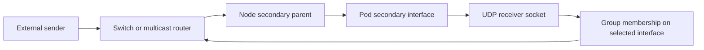

# Receive External Multicast Through a Multus Secondary Network

Author: [nawazdhandala](https://www.github.com/nawazdhandala)

Tags: Multus, Kubernetes, Networking

Description: Join an IPv4 multicast group on a Multus secondary interface, verify the external delivery path, and separate application membership from switch and interface filtering.

A Pod receives ordinary unicast traffic on its secondary interface but misses an external multicast stream. Adding a default route or switching every interface into promiscuous mode is unlikely to explain the real failure. Multicast delivery depends on both the network forwarding the group and the application joining it on the intended interface.

Multus supplies additional attachments; it does not automatically make an external network multicast-capable. This guide assumes an existing secondary attachment with a known IPv4 address and a controlled external sender. It uses Linux socket behavior, Python 3, and iproute2 examples. Code structure and mocked socket behavior were checked locally; no live multicast network was tested.

## Draw the multicast path first

Record the sender address, multicast group, UDP destination port, VLAN or physical network, receiver interface, and whether any router separates sender and receiver. Use a group approved by the network owner. The example `239.192.0.10` is an administratively scoped address, not a reservation for your application. [Administrative multicast scope](https://www.rfc-editor.org/rfc/rfc2365).



A multicast-enabled switch can use IGMP, the Internet Group Management Protocol, to learn where receivers are interested in a group. Across routed boundaries, multicast forwarding and scope must also be configured. Neither a Pod annotation nor an ordinary unicast route creates that upstream configuration. [IGMP snooping considerations](https://www.rfc-editor.org/rfc/rfc4541).

## Confirm the attachment can carry multicast

Inside the receiving Pod, inspect the intended interface:

```bash
ip -d link show dev REPLACE_SECONDARY_INTERFACE
ip -4 address show dev REPLACE_SECONDARY_INTERFACE
ip maddress show dev REPLACE_SECONDARY_INTERFACE
```

Record its IPv4 address, link state, and observed memberships. The address will select the interface for the receiver below. Do not use the Pod's primary address merely because it appears first in an API response.

Delegate mode matters. Linux IPvlan L3 interfaces do not receive multicast or broadcast traffic; choosing that mode and then debugging only application code will not solve delivery. Evaluate an appropriate L2 design with your platform owner. Macvlan uses distinct MAC addresses, which can encounter restrictions in virtual switches or cloud networks. [Linux IPvlan modes](https://docs.kernel.org/networking/ipvlan.html), [CNI macvlan behavior](https://www.cni.dev/plugins/current/main/macvlan/).

The `MULTICAST` interface flag indicates a capability, not membership in a particular application group. Also, `ip maddress add` manages link-layer addresses; it does not join an IP multicast group on behalf of an application. [ip-maddress reference](https://man7.org/linux/man-pages/man8/ip-maddress.8.html).

## Join the group on the secondary address

Save this as `receive_multicast.py` in an approved diagnostic container with Python 3. Run one receiver per test port. It listens for at most thirty seconds, prints at most ten datagrams, and closes its socket when finished.

```python
import ipaddress
import socket
import sys
import time

if len(sys.argv) != 4:
    raise SystemExit("usage: receive_multicast.py GROUP PORT LOCAL_IPV4")
group = ipaddress.IPv4Address(sys.argv[1])
port = int(sys.argv[2])
local = ipaddress.IPv4Address(sys.argv[3])
if not group.is_multicast or not 1024 <= port <= 65535:
    raise SystemExit("use an approved IPv4 multicast group and unprivileged port")
if local.is_multicast or local.is_unspecified:
    raise SystemExit("LOCAL_IPV4 must be the assigned secondary address")

membership = socket.inet_aton(str(group)) + socket.inet_aton(str(local))
with socket.socket(socket.AF_INET, socket.SOCK_DGRAM, socket.IPPROTO_UDP) as sock:
    sock.bind(("", port))
    sock.setsockopt(socket.IPPROTO_IP, socket.IP_ADD_MEMBERSHIP, membership)
    deadline = time.monotonic() + 30
    received = 0
    while received < 10:
        remaining = deadline - time.monotonic()
        if remaining <= 0:
            break
        sock.settimeout(remaining)
        try:
            data, peer = sock.recvfrom(65535)
        except socket.timeout:
            break
        print(f"source={peer} bytes={len(data)} sample={data[:64]!r}", flush=True)
        received += 1
    print(f"received={received}", flush=True)
```

For example, replace the documentation address with the actual secondary IPv4 address:

```bash
python3 receive_multicast.py 239.192.0.10 5000 REPLACE_SECONDARY_IPV4
```

The membership request contains the group address followed by the selected local interface address. Binding an unprivileged UDP port does not itself join the group; `IP_ADD_MEMBERSHIP` performs that step. A missing or incorrect local address should be corrected rather than replaced with an unspecified interface choice. [Linux IPv4 multicast socket options](https://man7.org/linux/man-pages/man7/ip.7.html), [Python socket API](https://docs.python.org/3/library/socket.html).

The wildcard bind is convenient for this diagnostic but is not a source-authentication or destination-filtering mechanism. Use a dedicated test port, a recognizable test payload, and packet evidence to confirm which stream arrived. Production receivers need their own validation, source filtering where required, and handling for duplicate, lost, or reordered UDP datagrams.

## Observe the receiver and the fabric together

Start the receiver before asking the external sender to transmit a low-rate test stream. Have the sender use the agreed group, port, payload marker, and appropriate multicast scope and hop limit. A packet that never reaches the node cannot be fixed by changing the Pod's socket options.

With approved capture permissions, inspect only the relevant traffic on the node's secondary parent and, separately, inside the Pod:

```bash
tcpdump -p -n -i REPLACE_INTERFACE -s 128 -c 30 \
  'igmp or (udp and dst host 239.192.0.10 and dst port 5000)'
```

Stop the capture manually if the packet count is not reached. The filter includes membership-control traffic and the selected data stream. `-p` avoids requesting promiscuous mode, which could change the behavior you are trying to observe. The small snapshot length limits captured content but does not guarantee that payload data is absent. [tcpdump options](https://github.com/the-tcpdump-group/tcpdump/blob/tcpdump-4.99.5/tcpdump.1.in).

| Evidence | Next investigation |
| --- | --- |
| No group traffic on the node parent | Sender, VLAN, switch membership, router, or scope |
| Parent sees data, Pod interface does not | Delegate mode, virtual-switch filtering, or interface mapping |
| Pod capture sees data, receiver stays silent | Group join, port, socket binding, namespace, or local filtering |
| Reception starts then stops | Membership maintenance, querier behavior, link changes, or receiver lifecycle |
| Only same-node tests work | External fabric path has not been demonstrated |

IGMP snooping needs appropriate membership maintenance and querier behavior for the network design. Ask the network owner to inspect the group-to-port state rather than disabling snooping everywhere as a first response.

## Turn the experiment into an acceptance test

Repeat with a new Pod on another eligible node, then restart the receiver and confirm membership is re-established. Test the actual application after the diagnostic script succeeds; applications may choose interfaces differently or use source-specific multicast semantics that this simple any-source receiver does not implement.

Keep the test record small and concrete: sender, group, port, node, Pod interface and address, payload marker, observed counts, and capture locations. Multicast troubleshooting becomes much easier when you can distinguish “the sender transmitted,” “the node received,” and “the application consumed” as separate facts.
