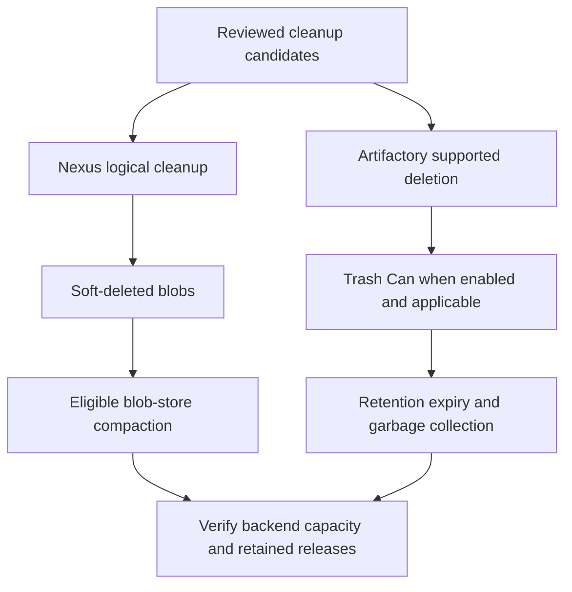

# Reclaim Nexus and Artifactory Disk Space Safely

Author: [nawazdhandala](https://www.github.com/nawazdhandala)

Tags: Artifact Management, Artifact Repository, Storage, DevOps

Description: Separate logical cleanup from physical reclamation, follow Nexus and Artifactory workflows, and verify space savings without deleting storage files.

You delete hundreds of old builds, refresh the storage dashboard, and see almost no change. That does not necessarily mean cleanup failed. The repository may have removed names while retaining recoverable content, or other artifacts may still reference the same binary.

The dangerous response is to open the storage directory and delete files manually. Repository metadata, shared binaries, and recovery mechanisms must remain consistent. Use the product's supported cleanup path and measure each stage separately.

This guide covers self-managed Nexus Repository and Artifactory. Managed services can own these maintenance operations themselves. Check the installed release and storage backend before applying settings: file storage, object storage, and database storage do not reclaim capacity in identical ways.

## First establish which storage is actually full

Record the affected instance, node, volume or bucket, storage backend, and current free capacity. Separate artifact content from databases, transaction logs, application logs, caches, backups, and temporary uploads. Removing old packages will not solve a full database volume caused by something else.

Keep three measurements distinct:

| Measurement | What it tells you | What it cannot establish |
|---|---|---|
| Repository artifact count or logical size | What users see through repository metadata | Unique physical bytes that can be reclaimed |
| Binary or blob-store usage | Content retained by the storage system | Free space on every application volume |
| Filesystem or object-store usage | Capacity consumed at the backend | Which artifacts are safe to remove |

Capture a baseline before changing policy. Also record current ingestion rates. A maintenance run can reclaim space successfully while new uploads consume it just as quickly.

If capacity is critically low, stabilize the service with the documented capacity-expansion or incident procedure before starting a large cleanup. Do not assume a full volume leaves enough working space for normal maintenance or database operations.

## Understand the two product paths



This is a conceptual sequence, not an instruction to run every available maintenance task. Format-specific relationships and configured retention delays still apply.

## Nexus: cleanup first, compaction afterward

Nexus [cleanup policies](https://help.sonatype.com/en/cleanup-policies.html) mark components for deletion. These soft-deleted components disappear from normal repository views but can continue consuming storage. The `Admin - Compact blob store` task performs physical removal for eligible blobs.

For a file-based blob store, use a small, reviewed policy scope first. Preview the candidates, confirm that deployed releases and rollback targets are excluded, run the associated cleanup, and inspect its result. Only then run or schedule compaction for the intended blob store. A repository and a blob store are different scopes; several repositories can share storage.

Starting with Nexus 3.80.0, the documented compaction settings include `Blobs Older Than`, with a default of zero days. This can preserve soft-deleted blobs for a chosen period before hard deletion. Review the configured value rather than assuming every installation has a recovery delay. Compaction makes removal permanent; preserve a verified backup and a supported recovery plan before relying on that final stage.

Object-store behavior needs separate review. The same [cleanup documentation](https://help.sonatype.com/en/cleanup-policies.html) describes a change to S3 handling in 3.80.0 and Azure-side deletion behavior. Do not copy an older S3 lifecycle recipe onto a newer deployment without checking which mechanism now owns removal.

## Nexus Docker repositories need an extra check

Container tags, manifests, and layers are separate objects. Nexus's [task reference](https://help.sonatype.com/en/tasks.html) describes `Docker - Delete unused manifests and images`, which removes unreferenced Docker content. It warns specifically about content used by digest without a protecting tag.

Deploying by digest is useful for reproducibility, but the cleanup engine does not learn your deployment intentions from a cluster. Before enabling Docker cleanup, ensure required images have a retained tag and that the tag itself survives the cleanup policy. Include rollback images and every platform you still support.

Do not run the Docker task merely because the repository has a large size. Review incomplete-upload cleanup, component policy cleanup, and orphaned-content handling in the order documented for your release. Verify a representative retained image can still be fetched after the logical cleanup and again after physical reclamation.

Shared layers also explain surprising savings. Sonatype's [repository concepts](https://help.sonatype.com/en/repository-manager-concepts.html) explain why summing image sizes overstates storage requirements when images share layers. Removing ten image tags does not imply that ten complete image-sized allocations become free.

## Artifactory: references, Trash Can, and garbage collection

Artifactory uses checksum-based storage. Different repository paths can point to one stored binary. Deleting one path leaves the binary in place when another path still needs it. Its [maintenance documentation](https://docs.jfrog.com/administration/docs/regular-maintenance-operations) explains that garbage collection removes eligible unused binaries.

The [Trash Can](https://docs.jfrog.com/artifactory/docs/trash-can) can retain deleted local-repository content when enabled. Check whether the chosen cleanup operation uses it and what retention period applies. Do not bypass this recovery window just to make a storage graph fall sooner.

Artifactory distinguishes faster cleanup of expired Trash Can content from full garbage collection of unreferenced binaries. A manual maintenance invocation does not justify assuming every possible orphan was immediately reclaimed. Inspect the configured cycle and completed operation logs. Garbage collection consumes resources; repeatedly starting it can add load without fixing an unmet eligibility condition.

Use the supported maintenance interface for the installed version. A platform administrator should review the intended operation and schedule it around normal workload needs. Avoid changing undocumented storage properties or editing binary files to force the result.

## Capture a read-only Artifactory storage snapshot

The [storage summary API](https://docs.jfrog.com/artifactory/reference/getstoragesummaryinfo) returns information about binaries, the file store, and repositories. It requires suitable authentication, documented as administrator access or a scoped token with `system:info/storage:r`.

With curl 8.7.1, an approved HTTPS Artifactory base URL, and a protected curl configuration containing the required authentication, run:

```bash
set -euo pipefail
: "${ARTIFACTORY_URL:?Set the HTTPS base URL ending in /artifactory}"
: "${ARTIFACTORY_CURL_CONFIG:?Set the protected curl configuration path}"
: "${STORAGE_REPORT:?Set a new output filename for this snapshot}"

curl --config "$ARTIFACTORY_CURL_CONFIG" \
  --fail-with-body --silent --show-error \
  --connect-timeout 10 --max-time 60 \
  "$ARTIFACTORY_URL/api/storageinfo" \
  --output "$STORAGE_REPORT"
python3 -m json.tool "$STORAGE_REPORT" >/dev/null
```

Use a base URL without a trailing slash and a different report filename for each observation. Protect the configuration file with restrictive permissions and keep credentials out of command history. A successful result means the HTTP request succeeded and the response parses as JSON. It does not prove that garbage collection ran, that the statistics are freshly calculated, or that capacity increased.

The API also has a separate [summary refresh operation](https://docs.jfrog.com/artifactory/reference/refreshStorageSummaryInfo). Treat that as an explicit administrative action when needed; do not confuse a summary refresh with deleting binaries.

## Close the maintenance window with evidence

Record policy and task identifiers, start and end times, candidate counts, errors, and before-and-after storage measurements. Check actual backend capacity alongside application summaries. For object storage, examine the provider's retention, versioning, and reporting behavior before promising immediate billing reductions.

Finally, retrieve a current release and an approved rollback artifact from a clean client. If logical usage fell but physical usage did not, inspect references, recovery retention, compaction or collection completion, and storage-backend behavior in that order. Escalate unexplained discrepancies with the captured evidence instead of deleting files directly.

The read-only request was checked against a local HTTP fixture, including failure handling and JSON parsing. No Nexus cleanup, Artifactory garbage collection, or production storage operation was executed for this article.
