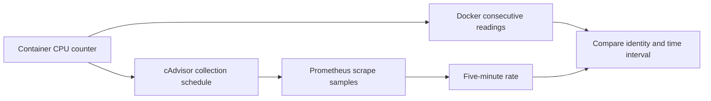

# Reconcile cAdvisor and Docker Stats CPU Percent on Multi-Core Hosts

Author: [nawazdhandala](https://www.github.com/nawazdhandala)

Tags: Docker, Linux, Prometheus, Monitoring

Description: Compare Docker and cAdvisor CPU readings using the same container, denominator, and time window, with tested examples for multi-core hosts.

Docker reports 150% CPU while a Grafana panel reports 18.75%. On an eight-CPU Linux host, both numbers can describe the same workload: it consumed the equivalent of 1.5 CPUs. The difference is what each percentage calls 100%.

Before changing an exporter, establish three things: which container is being measured, what the percentage is divided by, and how long the measurement covers. Most confusing comparisons differ in at least one of those details.

This walkthrough examines Linux behavior in Docker CLI 28.0.0, cAdvisor 0.55.1, and Prometheus 3.7.3. Windows CPU accounting follows a different Docker code path and is outside this example.

## Name the denominator

CPU time accumulates across the processors running a container's threads. Consuming 90 CPU-seconds during 60 seconds of elapsed time means an average of 1.5 CPUs. It does not mean the clock ran faster; multiple threads can execute simultaneously.

For a container consuming 1.5 CPUs on an eight-CPU host with a two-CPU quota:

| Display | Calculation | Result |
|---|---|---|
| CPU cores used | CPU-seconds / elapsed seconds | 1.5 |
| One CPU equals 100% | 1.5 × 100 | 150% |
| Fraction of the eight-CPU host | 1.5 / 8 × 100 | 18.75% |
| Fraction of a two-CPU quota | 1.5 / 2 × 100 | 75% |

Give these panels distinct names. A generic label such as “CPU %” invites comparisons between different denominators.

Docker's Linux percentage calculation uses the change in container CPU time divided by the change in system CPU time, multiplied by the number of online CPUs and by 100. When online CPU count is unavailable, that implementation falls back to the length of the per-CPU usage array. See the [versioned Docker CLI calculation](https://github.com/docker/cli/blob/v28.0.0/cli/command/container/stats_helpers.go).

This explains why the Docker display can exceed 100%. Its CPU percentage is not automatically normalized to the container's configured quota.

## Confirm the same container and host

Names can be reused after recreation. Capture the actual container ID, then ensure the cAdvisor series belongs to that container on the same host. Run these read-only commands against the correct Docker context, replacing `app-container`:

```bash
docker container inspect app-container --format '{{.Id}} {{.Name}}'
docker container stats --no-stream --no-trunc \
  --format '{{.ID}} {{.Name}} {{.CPUPerc}}' app-container
```

The first command identifies the container. The second prints one Docker stats sample with its full ID. The [stats CLI reference](https://docs.docker.com/reference/cli/docker/container/stats/) documents the formatting fields and snapshot option; [inspect](https://docs.docker.com/reference/cli/docker/container/inspect/) documents formatted metadata output.

Find the matching raw cAdvisor sample before aggregating. Depending on the runtime and cgroup driver, `id` may be a filesystem-style cgroup path rather than just the Docker ID. Do not assume a universal `/docker/ID` layout. Preserve `job`, `instance`, and `id` while inspecting the series, and avoid comparing a pod parent with an individual Docker container.

## Express cAdvisor CPU in Docker-style units

The cAdvisor counter `container_cpu_usage_seconds_total` records accumulated CPU time. A rate converts that counter into CPU-seconds per elapsed second. Its [metric implementation](https://github.com/google/cadvisor/blob/v0.55.1/metrics/prometheus.go) supports total or per-CPU samples according to the available statistics and enabled collection.

Use this template for one verified identity. Replace the three uppercase placeholders with observed label values:

```promql
100 * sum by (job, instance, id) (
  rate(container_cpu_usage_seconds_total{
    job="JOB",
    instance="INSTANCE",
    id="CGROUP_ID"
  }[5m])
)
```

A result of 150 means an average of 1.5 CPUs over the selected window. Apply `rate` before summing so each counter's reset can be handled separately. Confirm you are not ingesting the same counter twice. Also inspect any `cpu` dimension: adding a total series to its component per-CPU series would count the same work twice if your collection pipeline supplies both.

Prometheus's [rate documentation](https://prometheus.io/docs/prometheus/latest/querying/functions/#rate) explains reset handling and extrapolation. The five-minute range is intentional smoothing, not a claim that Docker uses that same window.

## Make timing differences visible

A Docker snapshot and a five-minute Prometheus average are different observations. A workload can spend most of five minutes idle, burst just before Docker samples it, and produce a high Docker reading alongside a low averaged graph.



For a controlled comparison, observe a stable workload for longer than the query window. Record timestamps and sample intervals. Avoid changing production load merely to make two displays agree.

A shorter Prometheus range may follow bursts more closely, but it needs enough real samples. Scraping faster than cAdvisor updates does not create new underlying measurements. `irate` uses the last two samples and can be useful for inspecting a changing rate, but switching to it does not align collection clocks automatically.

Check restarts and missing scrapes before interpreting sharp differences. A replaced container introduces a new identity; a restarted counter can reset. Neither should be treated as a negative amount of CPU consumption.

## Keep host share and quota share separate

Once the Docker-style rate is understood, use a different denominator only for a clearly named question. Dividing by eight is appropriate for the illustrative eight-CPU host; hard-coding eight across a mixed fleet is not. A production denominator must describe the same host at the relevant time and join without duplicating series.

A quota describes scheduled CPU time, while a CPU set restricts which CPUs a workload can run on. Shares or weights describe relative scheduling priority under contention. They are not interchangeable capacity measurements. Docker explains these controls in its [CPU resource constraints documentation](https://docs.docker.com/engine/containers/resource_constraints/#cpu).

For example, 75% of a two-CPU quota and 150% in Docker can be consistent. Dividing Docker's number by the quota again while calling the result “Docker CPU” changes the meaning. If no quota is configured, a quota-utilization panel should indicate that absence rather than manufacture a limit.

## Use disagreements as diagnostic clues

A steady factor-of-eight difference on an eight-CPU host strongly suggests host normalization. Brief disagreements during bursts suggest sampling windows. A roughly doubled value suggests overlapping counters or duplicate ingestion. A mismatch only after recreation suggests identity selection.

Those are hypotheses to test, not automatic diagnoses. Preserve the original query, check raw counters and labels, and change one assumption at a time. Local synthetic checks for this article confirmed a 1.5-core counter becomes 150% with the published query and that separate per-CPU counters sum correctly. No live Docker workload comparison was performed.

The final panel should state its units and averaging window, such as “CPU, 100% per core, five-minute average.” That small naming change makes future comparisons much easier to interpret.
