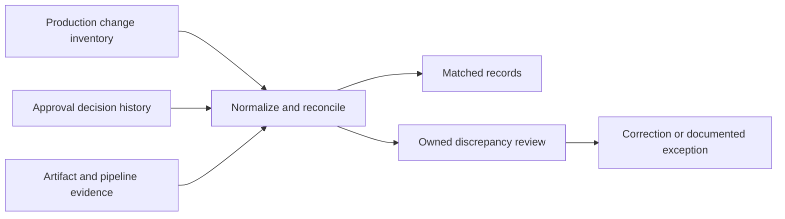

# Reconcile Production Deployments with Approved Changes

Author: [nawazdhandala](https://www.github.com/nawazdhandala)

Tags: Compliance, CI/CD, GitHub

Description: Match production deployment evidence to the right approval, artifact, environment, and time window, then investigate unmatched releases without hiding collection gaps.

A deployment log containing `CHG-42` does not prove that change 42 authorized the release. The ticket may cover staging, refer to another artifact, or have been approved after production already changed.

Reconciliation compares what actually reached production with what was authorized. It should produce a reviewable explanation for each release: matched, mismatched, missing evidence, or an explicitly handled emergency path. An unmatched release is a reason to investigate, not automatic proof of misconduct.

This article uses a small Python 3.11.13 example with synthetic normalized records. It does not query GitHub, deploy software, or certify an organization's change-management process.

## Start from deployments, not just approved tickets

If you begin with the approval system and look for matching deployments, you can miss releases that never referenced an approval. Start with the authoritative deployment inventory for each production target and period, then join approvals to it.

Retain unsuccessful attempts too. A failed rollout can still change some replicas or apply a migration. Decide which events count as production changes and distinguish an attempted deployment from its observed result.

GitHub's deployment API represents requests to deploy a ref. Deployment statuses describe progression and outcomes supplied by the deployment tooling. Neither record alone is a measurement of what every production instance is running. [GitHub deployment API](https://docs.github.com/en/rest/deployments/deployments), [deployment statuses](https://docs.github.com/en/rest/deployments/statuses)

Correlate the pipeline record with the deployment controller or runtime inventory. If someone deploys manually, that path needs to appear in the production-side inventory even when there is no corresponding pipeline run.

## Use identifiers that survive renaming and rebuilding

A useful normalized deployment record contains the deployment identifier, source repository identifier, target environment identifier, artifact digest, start time, outcome, actor, and explicit approval reference. Retain the original source records behind those normalized fields.

Use stable repository and environment identifiers where available. If a source only supplies names, maintain a controlled mapping rather than guessing that `prod`, `production`, and `live` mean the same thing.

For container releases, preserve the exact artifact digest and its relationship to the source commit. A mutable tag such as `stable` is not sufficient identity. A digest identifies content, while a tag can be reassigned. For multi-platform images, record whether the approved digest identifies an image index or a platform-specific manifest and preserve the relationship. [Docker image digest documentation](https://docs.docker.com/dhi/explore/security-concepts/digests/)

A commit can produce different artifacts when dependencies or build inputs change. Reconcile the authorized artifact or approved release manifest, not just the branch name or commit message.

## Define what an approval actually authorizes

Record the approval's scope, decision, approved artifact, applicable environment, authorized time window, approver identity, and policy version. Preserve the decision as it existed at deployment time, including revocation or replacement history.

GitHub environment protection rules can require review before jobs referencing an environment proceed. Their availability depends on repository visibility and plan, and the job must reference the intended environment. Inspect the configured protection and review history rather than assuming that a successful workflow implies approval. [GitHub environment protection](https://docs.github.com/en/actions/reference/workflows-and-actions/deployments-and-environments)

A required-reviewer list does not necessarily mean every listed reviewer must approve. Verify the actual approval semantics, self-review settings, and bypass settings against your policy. Preserve any bypass event as its own authorization path rather than disguising it as a normal review. [Reviewing deployments](https://docs.github.com/en/actions/how-tos/deploy/configure-and-manage-deployments/review-deployments)



The reconciliation job should be read-only against these sources. It must not modify approvals to make the historical comparison pass.

## Run an exact-match example

The following fields form a custom teaching schema, not GitHub's API response. Assume the input adapter has already validated nonempty fields, unique approval IDs, canonical identities, and the approval decision applicable at deployment time. All timestamps must include a timezone.

```python
from datetime import datetime


def timestamp(value):
    result = datetime.fromisoformat(value.replace("Z", "+00:00"))
    if result.tzinfo is None:
        raise ValueError("timezone required")
    return result


def reconcile(deployment, approvals):
    approval = approvals.get(deployment["approval_id"])
    if approval is None:
        return "missing-approval"
    if approval["decision"] != "approved":
        return "not-approved"
    for field in ("repository", "environment", "artifact_digest"):
        if deployment[field] != approval[field]:
            return f"mismatch:{field}"
    started = timestamp(deployment["started_at"])
    if not (timestamp(approval["approved_at"]) <= started
            < timestamp(approval["expires_at"])):
        return "outside-approval-window"
    return "matched"


approval = {
    "decision": "approved",
    "repository": "example/payments",
    "environment": "production",
    "artifact_digest": "sha256:" + "a" * 64,
    "approved_at": "2026-11-20T10:00:00Z",
    "expires_at": "2026-11-20T12:00:00Z",
}
deployment = {
    "approval_id": "CHG-42",
    "repository": "example/payments",
    "environment": "production",
    "artifact_digest": "sha256:" + "a" * 64,
    "started_at": "2026-11-20T10:15:00Z",
}
print(reconcile(deployment, {"CHG-42": approval}))
```

The result is `matched`. The digest is synthetic and does not identify a real image. The interval includes the approval time and excludes the expiry time; choose and document those boundary semantics for your system.

Changing the deployment digest returns an artifact mismatch. Moving deployment time before approval returns an out-of-window result. Missing or malformed inputs must enter a separate data-quality queue; an exception or parse error must never be converted to `matched`.

This function checks only the fields shown. It does not validate approver authority, separation of duties, signatures, single-use approvals, rollout outcome, or whether the artifact actually ran. Add those checks according to the collection contract rather than presenting this small join as a complete compliance engine.

## Preserve history before it disappears

Collect all pages and record collection boundaries. GitHub paginates many REST responses and exposes subsequent pages through the `Link` header; a successful first response does not establish complete coverage. [GitHub pagination](https://docs.github.com/en/rest/using-the-rest-api/using-pagination-in-the-rest-api)

Retain deployment status history promptly. GitHub's current documentation states that previous deployment statuses are retained for 90 days, while the current status remains available. A later current status cannot reconstruct every earlier transition. [Deployment status retention](https://docs.github.com/en/rest/deployments/statuses)

Use overlapping collection windows with deduplication by immutable event identity to handle late-arriving records. Record both source time and collection time. If one source is unavailable, report the affected interval as incomplete and rerun after recovery; do not report zero unmatched releases as success.

## Investigate discrepancies without rewriting the release

Send each discrepancy to a named owner with the deployment reference, comparison result, evidence links, and affected target. Group duplicate observations of the same release while preserving all attempts and status transitions.

An emergency release may have a valid separate process. Link its emergency authorization and required follow-up review explicitly. A later review does not turn a retrospective decision into approval that existed before deployment.

Treat a rollback as another production change with its own artifact and execution evidence. If a preapproved rollback policy applies, retain the policy version and prove that this rollback met its conditions. Do not assume that returning to an older digest makes the action exempt from review.

Finally, reconcile deployed state against recorded releases to find manual or out-of-band changes. The result should be an explainable inventory: which releases matched their authorization, which need investigation, and which periods lack sufficient evidence to decide. That is more useful than a dashboard that turns every unmatched record into either an accusation or an ignored warning.
