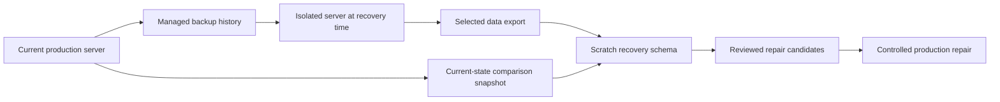

# Recover One Azure MySQL Table from a Full-Server Restore

Author: [nawazdhandala](https://www.github.com/nawazdhandala)

Tags: Azure, MySQL, Backup, Disaster Recovery

Description: Recover a selected Azure MySQL table or database through an isolated full-server restore, then reconcile recovered records without erasing newer work.

Someone deletes rows from an orders table at 14:05. By 14:20, the rest of the application has created new orders, recorded payments, and updated shipping details. Restoring the whole production server to 14:04 would recover the deleted rows but also remove those later changes.

Use the full-server restore as a source of recovery data instead. Azure MySQL point-in-time restore creates a separate server; it does not directly restore one selected table into the running source. Microsoft recommends restoring the server and extracting the required databases or tables for selective recovery. [Backup and restore scope](https://learn.microsoft.com/en-us/azure/mysql/flexible-server/concepts-backup-restore)

The difficult part is usually deciding which recovered values belong in today's database. A successful restore provides historical evidence, not permission to overwrite newer records.

## Establish the recovery boundary

First stop the cause of damage. That might mean disabling a faulty job or pausing the affected write path. Preserve the incident timeline, application logs, current database state, and any transaction identifiers available.

Choose a restore point before the damaging transaction committed. Translate application timestamps into UTC and account for uncertainty; a user noticing an error at 14:05 does not prove the bad transaction committed then. Confirm that the point is inside the available retention window.

Define the requested recovery precisely:

| Incident | Recovery question |
|---|---|
| Rows deleted | Which missing records are legitimate to reintroduce? |
| Values overwritten | Which columns should return to an earlier value? |
| Table dropped | Which related tables, constraints, and objects must accompany it? |
| Entire schema damaged | Can the schema be recovered without breaking cross-schema dependencies? |

For an orders table, related payments and order lines may matter more than the table's row count. Review foreign keys, triggers, routines, events, and external business identifiers. A technically valid row can still be the wrong business state.

## Restore to an isolated server

In the Azure portal, open the source server's restore workflow, select a custom restore point, and give the restored server a new name. Verify the chosen time before creating it. The fastest full-backup restore option is a different choice; select it only if that backup's time meets the recovery requirement. [Portal restore procedure](https://learn.microsoft.com/en-us/azure/mysql/flexible-server/how-to-restore-server-portal)

Keep the restored server away from normal application routing. Review its network access, scheduled events, credentials, and monitoring before using it. Restoring old data can also restore old executable objects, so prevent background work from producing real side effects.



Once restored, verify server identity and inspect known records around the incident boundary. Do not assume that “restore completed” proves the selected time contains the desired data. Record the recovered table's definition and relevant object definitions before exporting anything.

## Export data without a production replacement script

This example uses the **MySQL 8.0.46** `mysqldump` command shape for one InnoDB table, `appdb.orders`. Use a compatible client for your actual source version. You need read access to the restored table, verified TLS connectivity, and a protected empty working directory. Freeze schema changes on the restored server during export.

Run in Bash after replacing the host, username, and certificate path:

```bash
set -euo pipefail
umask 077
RESTORED_HOST='REPLACE_WITH_RESTORED_SERVER.mysql.database.azure.com'
CA_FILE='/REPLACE_WITH_APPROVED_CA_BUNDLE.pem'

mysqldump \
  --host="$RESTORED_HOST" --user=recovery_reader --password \
  --ssl-mode=VERIFY_IDENTITY --ssl-ca="$CA_FILE" \
  --single-transaction --no-tablespaces \
  --set-gtid-purged=OFF \
  --no-create-info --skip-triggers \
  --skip-add-locks --skip-disable-keys \
  --complete-insert --hex-blob \
  appdb orders > orders-data.sql
```

The command prompts for a password and writes a **data-only** export. It omits table creation and trigger definitions. Complete inserts name columns explicitly; binary values use hexadecimal notation. `--set-gtid-purged=OFF` avoids transferring the restored server's global transaction history or adding the associated instruction to disable binary logging during reload. [MySQL dump options](https://dev.mysql.com/doc/refman/8.0/en/mysqldump.html)

The pinned source defines the selected options, including the explicit exclusion of reload-time locks and key-disable statements. A nonzero exit means the output file may be partial and must not be used. [8.0.46 dump implementation](https://github.com/mysql/mysql-server/blob/mysql-8.0.46/client/mysqldump.cc)

No `--databases` option is used: that option adds database-selection statements which could override the scratch database selected during loading. Still inspect the resulting SQL, including session settings, before running it. Do not classify an arbitrary SQL file as safe merely because its name says “data.” [SQL-format dump behavior](https://dev.mysql.com/doc/refman/8.0/en/mysqldump-sql-format.html)

## Load into a separate recovery schema

On an isolated scratch server, create a new schema such as `recovery_case_20261120` and an empty `orders` table from the reviewed historical definition. Preserve data types, generated-column behavior, character sets, and collations. Review foreign keys deliberately: include the needed dependency set and validate relationships after loading. MySQL dump files can temporarily disable foreign-key checks through session statements, so a successful load does not prove referential integrity.

Do not install production triggers or enable scheduled events in this scratch workflow. Its purpose is to inspect historical data without firing business actions.

After confirming the scratch hostname and empty target table, load the reviewed export:

```bash
SCRATCH_HOST='REPLACE_WITH_SCRATCH_SERVER.mysql.database.azure.com'

mysql \
  --host="$SCRATCH_HOST" --user=recovery_loader --password \
  --ssl-mode=VERIFY_IDENTITY --ssl-ca="$CA_FILE" \
  --database=recovery_case_20261120 < orders-data.sql
```

This command writes to the scratch database. Do not substitute the production hostname. The MySQL client reads the SQL file and executes it; selecting a database does not neutralize explicit schema references inside the file. [Reloading SQL backups](https://dev.mysql.com/doc/refman/8.0/en/reloading-sql-format-dumps.html)

For a whole-database recovery, inventory and export all required objects, including stored code and grants managed outside table data. Review cross-schema references before loading under a different name. Renaming a schema does not automatically rewrite every reference inside a view or routine.

## Compare historical and current states

Load a separately captured, documented current-state snapshot into another schema on the **same scratch server**, for example `current_snapshot`. This is an explicit prerequisite for the query below; MySQL does not automatically join tables on two different servers.

For a table whose non-null primary key is `id`, the following read-only query finds historical IDs absent from the comparison snapshot:

```sql
SELECT recovered.id
FROM recovery_case_20261120.orders AS recovered
LEFT JOIN current_snapshot.orders AS current_row
  ON current_row.id = recovered.id
WHERE current_row.id IS NULL
ORDER BY recovered.id;
```

This list contains **candidates**, not automatically approved inserts. Some records may have been legitimately deleted, replaced, or anonymized after the recovery point. Existing IDs can also contain damaged columns, which this missing-row query intentionally does not detect. [MySQL join semantics](https://dev.mysql.com/doc/refman/8.0/en/join.html)

Compare business identifiers and important aggregates as well as primary keys. For overwritten fields, build a reviewed field-level comparison and preserve newer unrelated values. Avoid `REPLACE` or blanket upserts as a generic recovery shortcut: they can overwrite valid current data and activate application-side effects.

## Apply a narrow repair and verify it

Before production repair, pause or coordinate the affected writers, capture the current values being changed, and revalidate candidates against the live database. A snapshot comparison becomes stale while production continues accepting writes.

Use a separately reviewed repair transaction or application-level recovery operation with explicit rows, columns, expected preconditions, and a compensation plan. Account for triggers and external actions. If a precondition no longer matches, stop and investigate rather than forcing the historical value through.

Allow controlled verification traffic first, then resume normal writers gradually. Check the repaired records, related tables, application behavior, and audit evidence. Retain the restored server and exports until the incident owner accepts the result, then remove temporary resources through the normal cleanup process.

The recovery is complete when the intended business data is correct and newer legitimate work is preserved. The full-server restore supplies the history; the reviewed reconciliation determines how that history safely returns to production.
