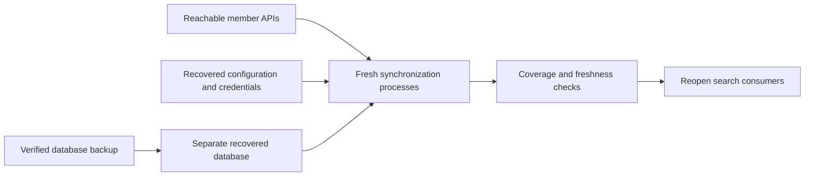

# Recover Clusterpedia Storage: Restore a Backup or Rebuild the Index

Author: [nawazdhandala](https://www.github.com/nawazdhandala)

Tags: Kubernetes, Multi-Cluster, Backup

Description: Choose between restoring Clusterpedia's database and rebuilding its current inventory, then verify member coverage before reopening search traffic.

Clusterpedia's database is unavailable, and dashboards suddenly show missing workloads. There are two recovery paths: restore a usable database backup, or build a new search inventory from the member Kubernetes APIs. Neither path is complete when the database merely starts accepting connections.

The choice depends on what survived, which member clusters remain reachable, and how long a full synchronization will take. This guide follows **Clusterpedia v0.9.0** internal-storage behavior. Database inspection examples refer to PostgreSQL17 tooling; they are not instructions to overwrite a running database.

## Separate the three kinds of state

The member clusters hold the live Kubernetes objects. Clusterpedia's database stores synchronized copies used for search. The hosting Kubernetes cluster holds configuration such as PediaCluster objects, import policies, credentials, and deployment settings.

A database backup does not replace the hosting cluster's configuration backup. Conversely, retaining Helm values and container images does not preserve synchronized database rows. The [PediaCluster documentation](https://clusterpedia.io/docs/concepts/pediacluster/) identifies its authentication and synchronization-selection responsibilities.



Rebuilding from members recovers the objects they currently expose. It cannot recreate a deleted object or expired event that exists only in an older backup. Clusterpedia should not be treated as a complete historical audit archive merely because a backup contains an earlier inventory.

## Choose a path using evidence

| Situation | Practical starting point |
| --- | --- |
| Recent backup with a rehearsed restore procedure | Restore into a separate target, then reconcile with members |
| Backup missing or unusable; all required members reachable | Rebuild a fresh inventory with controlled synchronization |
| Some members unavailable | Restore may preserve their last saved inventory, explicitly marked stale |
| Hosting configuration also lost | Recover configuration and credentials before either path can synchronize |
| Cause of corruption or loss unknown | Preserve evidence and fix the cause before reconnecting writers |

Estimate both recovery time and acceptable data loss. A small database restore may be faster than listing millions of objects across slow links. An old backup may take substantial reconciliation work. Measure these alternatives in rehearsal rather than assuming a rebuild is always inexpensive.

## Establish a maintenance boundary

Stop search consumers from interpreting partial results as authoritative absence. Pause automated decisions based on inventory, or put the application into a clearly degraded state.

Use your deployment controls to stop all Clusterpedia processes that might write to the target database during recovery. Account for synchronization workers, controllers, and startup initialization. In this release, [internal-storage initialization calls AutoMigrate](https://github.com/clusterpedia-io/clusterpedia/blob/v0.9.0/pkg/storage/internalstorage/register.go), so a seemingly read-oriented component can still initialize schema when it starts.

Preserve the failed database volume or a snapshot where feasible. Record the old endpoint and deployment revision. Recover into a separate target; do not experiment by dropping tables in the damaged original. Prevent old processes from reconnecting accidentally while the new target is being prepared.

## Restore only a backup you can explain

For a PostgreSQL custom-format archive, inspect its contents with a compatible PostgreSQL17 `pg_restore` client:

```bash
pg_restore --version
pg_restore --list /protected/backups/clusterpedia.dump
```

The second command lists archive contents without restoring them. It does not prove that the archive can be fully restored or that the application will work afterward. Plain SQL dumps use a different restoration path. Follow the [PostgreSQL17 pg_restore reference](https://www.postgresql.org/docs/17/app-pgrestore.html) for the archive format actually retained.

Rehearse restoration into an isolated database with the required ownership, roles, extensions, and permissions. Confirm the backup's creation time and integrity through the backup system. A PostgreSQL dump represents a database snapshot; it does not automatically capture a coordinated snapshot of hosting-cluster resources. See the [SQL dump documentation](https://www.postgresql.org/docs/17/backup-dump.html).

Start with the same Clusterpedia release and compatible database setup that produced the backup. Separate recovery from an application upgrade. Keep the restored target closed to ordinary consumers until reconciliation and acceptance checks finish.

## Rebuild with fresh synchronization state

For an empty replacement database, restore the reviewed configuration, member identities, CA trust, and resource selection. Verify that the identities still have the required discovery, list, and watch permissions. Expired credentials cannot be repaired by repeatedly restarting the database.

Start fresh Clusterpedia processes against the prepared target. The [v0.9.0 cluster constructor](https://github.com/clusterpedia-io/clusterpedia/blob/v0.9.0/pkg/synchromanager/clustersynchro/cluster_synchro.go) reads stored resource versions when creating a cluster synchronizer. The [resource synchronizer](https://github.com/clusterpedia-io/clusterpedia/blob/v0.9.0/pkg/synchromanager/clustersynchro/default_resource_synchro.go) also keeps version state in memory. Do not erase storage underneath a running manager and assume its memory automatically becomes an empty-database rebuild plan.

Reintroduce synchronization in controlled groups where your deployment design supports it. Observe member API latency, database writes, connection usage, and resource-specific errors. Changing selection to reduce load can also change the desired inventory, so retain the original selection and document any temporary restriction.

A healthy member condition only establishes a health request outcome. It does not establish that every selected resource has finished its initial synchronization.

## Verify a quiet scope before opening traffic

Choose one known, nonempty namespace with relatively quiet Pods. Using an approved direct member context and a hosting context, capture complete lists into a new protected directory:

```bash
umask 077
mkdir recovery-review
kubectl --context MEMBER_CONTEXT get pods -n payments -o json \
  > recovery-review/member.json
kubectl --context HOST_CONTEXT get --raw='/apis/clusterpedia.io/v1beta1/resources/api/v1/pods?clusters=member-a&namespaces=payments&limit=500&withContinue=true' \
  > recovery-review/search.json
```

Replace contexts and the imported member name. The raw request retrieves one page. If its continuation field is nonempty, collect all remaining pages before comparing; do not mistake the first500 items for the complete result.

This Python3 check deliberately refuses incomplete or empty baseline captures:

```python
import json
from pathlib import Path


def inventory(filename):
    document = json.loads(Path(filename).read_text())
    if document.get("metadata", {}).get("continue"):
        raise ValueError("Capture is incomplete; collect every page first")
    result = {}
    for item in document["items"]:
        metadata = item["metadata"]
        uid, version = metadata["uid"], metadata["resourceVersion"]
        if not uid or not version or uid in result:
            raise ValueError("Missing identity/version or duplicate UID")
        result[uid] = version
    return result


source = inventory("recovery-review/member.json")
search = inventory("recovery-review/search.json")
if not source:
    raise ValueError("Use a known nonempty baseline")
print({
    "missing": sorted(source.keys() - search.keys()),
    "unexpected": sorted(search.keys() - source.keys()),
    "different_versions": sorted(
        uid for uid in source.keys() & search.keys()
        if source[uid] != search[uid]
    ),
})
```

An empty result in all three categories is useful evidence for that scope and capture window. Version differences may reflect ordinary updates between captures; investigate and repeat. Kubernetes resource versions should be treated as opaque values, not numerically ranked across clusters. See [Kubernetes API concepts](https://kubernetes.io/docs/reference/using-api/api-concepts/).

Repeat acceptance across required clusters and resource types. Include a controlled create/update/delete exercise in staging and observe propagation. Restore search consumers gradually only after coverage, freshness, and load meet the agreed criteria. Keep unavailable members visibly stale rather than presenting their restored rows as current.

Local validation here exercises the comparison helper on synthetic lists. It does not claim a database restore or a successful live resynchronization.
