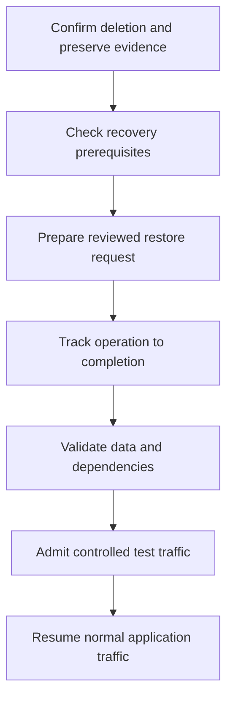

# Recover a Deleted Azure MySQL Flexible Server

Author: [nawazdhandala](https://www.github.com/nawazdhandala)

Tags: Azure, MySQL, Backup, Disaster Recovery

Description: Collect deletion evidence, prepare the documented Azure MySQL recovery request, and validate the restored server before allowing application traffic.

A deleted database server presents a different emergency from a damaged table. The resource may have disappeared from the portal, the application endpoint may fail, and ordinary scripts may no longer find a source server to inspect. The first useful action is to preserve the deletion evidence and stop automation from changing the situation again.

Microsoft documents recovery of a deleted Azure Database for MySQL Flexible Server within **up to five days**, provided its backup still exists. Recovery uses the original subscription. This is a conditional recovery opportunity, not a guaranteed five-day backup reservation. Start promptly rather than treating the deadline as a maintenance window. See the [deleted-server recovery procedure](https://learn.microsoft.com/en-us/azure/mysql/flexible-server/how-to-restore-dropped-server).

## Contain the incident and collect the exact identity

Pause deployment, cleanup, and infrastructure automation that could recreate or delete the server. Put affected applications into their established outage mode and stop uncontrolled retries. Assign one operator to submit the recovery request so several responders do not compete to create the same resource.

Open Azure Monitor's Activity Log for the original subscription. Filter for resource type `Microsoft.DBforMySQL/flexibleServers` and operation `Microsoft.DBforMySQL/flexibleServers/delete`. Inspect the event JSON and preserve the complete resource ID, `submissionTimestamp`, status, and correlation ID.

The Activity Log records administrative operations and their outcomes. Confirm that you have the successful deletion event rather than an attempted deletion that failed. Its `eventTimestamp` and `submissionTimestamp` have different meanings, so do not silently substitute one for the other. The [Activity Log schema](https://learn.microsoft.com/en-us/azure/azure-monitor/fundamentals/activity-log-schema) defines these fields.

Keep the evidence in a restricted incident record. Include the original Azure region from configuration records, the resource group, the application owner, and the last independently confirmed successful transaction. Do not use a similar-looking server name from a different subscription.

## Check whether the documented recovery path applies

The original resource group must exist. If it was deleted too, Microsoft recommends recreating it with the same name before recovery. Its recreation does not recreate the networks, permissions, or other resources that were inside it.

The documented deleted-server procedure uses the deleted server's name in the request path and recommends a restore timestamp **15 minutes before `submissionTimestamp`**. Record the potential data gap this creates. Do not describe that timestamp as the last committed transaction or promise zero data loss.

Normal backup retention and deleted-resource recovery are separate questions. A server that previously retained weeks of backups should not be assumed recoverable weeks after deletion. The [backup overview](https://learn.microsoft.com/en-us/azure/mysql/flexible-server/concepts-backup-restore) distinguishes the retained restore window from deleted-server recovery.

If the server name has already been reused, stop before submitting a create request to that path. The server API can also update an existing resource. Ask Azure support for the appropriate recovery route while preserving the original deletion evidence. Repeated speculative requests are not a substitute for establishing which resource the request will address.

## Prepare the request body without contacting Azure

The following Python 3.11 example calculates the documented timestamp offset and prints a JSON request body. It does not authenticate, create a server, or test backup availability. Replace the region, subscription, resource group, server name, and sample timestamp with reviewed incident values.

```python
import json
from datetime import datetime, timedelta, timezone

submission_timestamp = "2026-11-20T14:20:00Z"
source_resource_id = (
    "/subscriptions/SUBSCRIPTION_ID/resourceGroups/RESOURCE_GROUP"
    "/providers/Microsoft.DBforMySQL/flexibleServers/DELETED_SERVER"
)
region = "SOURCE_REGION"

submitted = datetime.fromisoformat(submission_timestamp)
if submitted.tzinfo is None or submitted.utcoffset() is None:
    raise ValueError("The timestamp must include a UTC offset")

restore_at = submitted.astimezone(timezone.utc) - timedelta(minutes=15)
request_body = {
    "location": region,
    "properties": {
        "createMode": "PointInTimeRestore",
        "restorePointInTime": restore_at.isoformat().replace("+00:00", "Z"),
        "sourceServerResourceId": source_resource_id,
    },
}
print(json.dumps(request_body, indent=2))
```

For the illustrated input, `restorePointInTime` is `2026-11-20T14:05:00Z`. A timestamp without a timezone is rejected instead of being interpreted in the operator's local timezone. Python's [datetime documentation](https://docs.python.org/3.11/library/datetime.html) explains timezone-aware values and duration arithmetic.

Before submission, compare the generated resource ID character by character with the Activity Log record. The JSON formatter cannot determine whether you selected the right subscription, whether the region is correct, or whether a backup remains available.

## Submit through the documented server API

Use the **Try It** interface on the official [Servers Create API, version 2024-12-30](https://learn.microsoft.com/en-us/rest/api/mysql/servers/create?view=rest-mysql-2024-12-30). Sign in with an authorized recovery identity and enter the original subscription, resource group, and deleted server name as directed by the recovery guide. Review the request body before selecting Run.

For Azure public cloud, the request has this structure:

```text
PUT https://management.azure.com/subscriptions/{subscriptionId}/resourceGroups/{resourceGroupName}/providers/Microsoft.DBforMySQL/flexibleServers/{serverName}?api-version=2024-12-30
```

The braces identify path placeholders; the JSON contains `location` and the three restore properties shown above. Sovereign clouds use their own Resource Manager endpoint. Confirm that the selected cloud matches the subscription rather than copying the public-cloud URL into every environment.

This is a resource-creating operation and can incur charges. Verify again that no active replacement occupies the destination. The API documentation explicitly states that the operation can update an existing server; the recovery request must not be aimed casually at a live resource.

## Track completion separately from acceptance

An initial successful submission does not establish that the database is ready. Preserve response details and follow the operation until it reaches a terminal result. For asynchronous Resource Manager operations, Azure documents status tracking through response headers such as `Azure-AsyncOperation`, with `Retry-After` controlling polling intervals. See the [asynchronous-operation guidance](https://learn.microsoft.com/en-us/azure/azure-resource-manager/management/async-operations).



If submission fails, preserve the service error code, request time, and correlation information. Check the original subscription, region, resource group, resource ID, and selected restore time. Escalate backup-unavailable or ambiguous-name failures promptly. Do not repeatedly shift timestamps and report an accepted request as recovered data.

## Verify recovery before reopening the application

A restored server may still be unreachable from the application or missing operational protections. Validate in three layers:

| Layer | Evidence to collect |
|---|---|
| Resource and network | Intended endpoint, correct access rules, DNS resolution from the application network |
| Database | Verified TLS login, expected schema, known business records, appropriate permissions |
| Operations | Backup configuration, monitoring, alerts, scheduled work, and high-availability policy |

Check whether the restored data includes the last expected business operation before the recovery point. Inventory externally confirmed payments, messages, or imports that occurred afterward; a database restore cannot undo those external effects. Reconcile them through the application's normal recovery controls.

Keep normal workers paused while testing. Admit a small, identifiable test operation first, verify its downstream outcome, and only then resume normal writers and scheduled jobs. Record the actual recovery time and the accepted or reconciled data gap.

After service is stable, add an appropriate `CanNotDelete` management lock and review who can remove it. Azure [resource locks](https://learn.microsoft.com/en-us/azure/azure-resource-manager/management/lock-resources) protect control-plane resource operations, not SQL data changes. A lock helps prevent another server deletion, but it does not replace backups, restricted database permissions, or a rehearsed recovery procedure.
