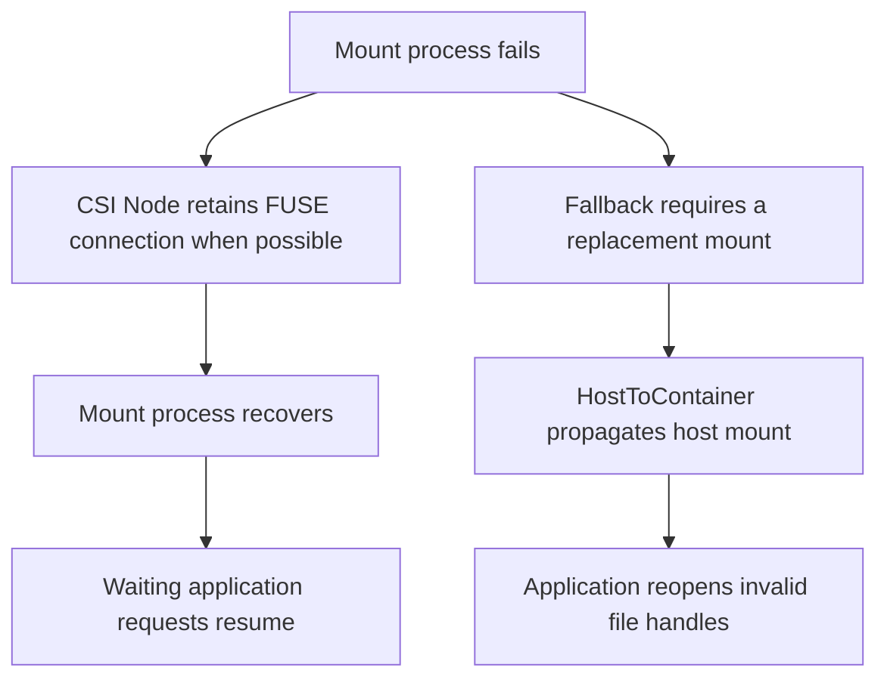

# Recover JuiceFS CSI Mounts After a FUSE Process Failure

Author: [nawazdhandala](https://www.github.com/nawazdhandala)

Tags: JuiceFS, Kubernetes, CSI, Troubleshooting

Description: Configure JuiceFS CSI recovery safeguards, distinguish descriptor-preserving recovery from remount propagation, and rehearse application recovery safely in staging.

A replacement JuiceFS Mount Pod can be running while an application still sees `Transport endpoint is not connected`. The application may hold a stale mount or an unusable open file descriptor. Pod health alone does not prove that the application's filesystem view recovered.

JuiceFS CSI has a newer recovery mechanism that preserves the FUSE connection, plus a mount-propagation safeguard for remount scenarios. Configure both deliberately and test the application behavior you depend on.

This guide uses **JuiceFS CSI Driver and Helm chart 0.34.0**, with a **Community Edition 1.4.2** mount image. It addresses the normal Mount Pod deployment mode on Linux Kubernetes nodes. Sidecar and serverless modes need their own deployment-specific review.

## Separate smooth recovery from remount recovery

FUSE connects kernel filesystem requests to the JuiceFS userspace process. Starting with CSI Driver 0.25.0, the documented smooth-recovery path lets CSI Node retain file descriptors while the Mount Pod recovers. Requests can wait during that interval instead of immediately losing their filesystem connection.

That mechanism depends on the relevant node-side components remaining healthy. Node loss, CSI Node failure, unavailable metadata, or repeated out-of-memory termination can exceed what a quick Mount Pod restart can resolve. Do not translate a recovery feature into a guarantee of zero application latency or unlimited waiting.

The [pinned recovery documentation](https://github.com/juicedata/juicefs-csi-driver/blob/v0.34.0/docs/en/guide/configurations.md#automatic-mount-point-recovery) still recommends mount propagation as a safeguard. It allows a replacement host mount to become visible inside application containers. In that fallback path, applications may need to reopen files because an existing descriptor can remain invalid.



Older drivers lack the newer descriptor-preserving behavior. Upgrade through the supported procedure rather than expecting a propagation setting alone to provide the same semantics.

## Pin the client that will actually serve the mount

The driver and mount image have separate versions. For chart 0.34.0, this values fragment selects Mount Pod mode and the reviewed CE image:

```yaml
mountMode: mountpod
defaultMountImage:
  ce: juicedata/mount:ce-v1.4.2@sha256:4177c77bc873898127debf45786515b78c79bee18fed378d276fb221baa85640
```

Merge it into the full installation values; preserve cluster-specific kubelet paths, resources, registry configuration, and existing settings. The image reference is a pinned example, not an instruction to replace every existing client immediately. Mirror it through your approved registry when required.

Render the exact chart before a deployment change. After rollout, inspect the actual Mount Pod image and logs. Updating chart defaults does not prove that a previously running Mount Pod already uses the new client. The [configuration guide](https://github.com/juicedata/juicefs-csi-driver/blob/v0.34.0/docs/en/guide/configurations.md) explains how configuration changes apply to new versus existing Mount Pods.

## Add propagation to the application volume mount

`HostToContainer` brings relevant host mount changes into the container. It does not require the application to create host mounts. Avoid choosing `Bidirectional` merely because it sounds more complete; it has different security and propagation implications. Kubernetes explains these modes in its [volume documentation](https://kubernetes.io/docs/concepts/storage/volumes/#mount-propagation).

Here is a staging observer using an existing PVC named `juicefs-recovery-test`. Before deploying it, place a file named `recovery-check.txt` in that test volume containing exactly `recovery-v1` followed by an optional newline. The PVC must be isolated from production applications.

```yaml
apiVersion: apps/v1
kind: Deployment
metadata:
  name: juicefs-recovery-observer
  namespace: storage-test
spec:
  replicas: 1
  selector:
    matchLabels:
      app: juicefs-recovery-observer
  template:
    metadata:
      labels:
        app: juicefs-recovery-observer
    spec:
      containers:
        - name: reader
          image: busybox:1.37.0
          command: ["/bin/sh", "-c"]
          args:
            - |
              while :; do
                if value=$(cat /data/recovery-check.txt); then
                  printf 'read: %s\n' "$value"
                else
                  echo 'read failed' >&2
                fi
                sleep 2
              done
          readinessProbe:
            exec:
              command:
                - /bin/sh
                - -c
                - 'test "$(cat /data/recovery-check.txt)" = recovery-v1'
            timeoutSeconds: 2
            periodSeconds: 5
          volumeMounts:
            - name: data
              mountPath: /data
              readOnly: true
              mountPropagation: HostToContainer
      volumes:
        - name: data
          persistentVolumeClaim:
            claimName: juicefs-recovery-test
```

This container reads through the volume but does not write data or request privileged execution. Its readiness check detects whether the known file is readable with the expected content. No liveness probe restarts it merely because storage is temporarily unavailable.

The loop opens the path on every iteration. It tests renewed path access, not survival of an already-open file descriptor. Keep that distinction when interpreting the result.

## Rehearse one controlled interruption

Use an explicitly selected staging context. First record the application Pod UID, node, actual Mount Pod, driver version, and current images. Confirm the Mount Pod is not shared by unrelated applications or volumes under an enabled sharing policy.

Capture application logs with timestamps:

```bash
kubectl --context staging -n storage-test logs \
  deployment/juicefs-recovery-observer --timestamps --follow
```

In a separate terminal, an approved Mount Pod replacement test can use:

```bash
kubectl --context staging -n kube-system delete pod \
  REPLACE_WITH_CONFIRMED_TEST_MOUNT_POD --wait=false
```

Replace the context, namespace, and exact inspected name. Do not guess the target from a similar name or delete all Mount Pods. Normal Pod deletion tests controlled recreation; it does **not** reproduce every abrupt FUSE crash or out-of-memory failure. Rehearse those separately using your staging fault-injection procedure.

Observe whether the same application Pod regains successful reads, how long calls pause, whether readiness recovers, and whether the Mount Pod repeatedly fails. Repeat with a small application-specific test that keeps a descriptor open if descriptor continuity is a requirement.

## Diagnose an incomplete recovery

If the Mount Pod cannot stay healthy, inspect its termination reason, resource limit, metadata connectivity, object credentials, and node health. Increasing restart frequency does not fix the underlying cause.

If the Mount Pod is healthy but the application still sees a stale endpoint, inspect the application manifest's propagation setting and node-side recovery logs. If only existing descriptors fail, test reopening the path and confirm the application's retry behavior. The [troubleshooting guide](https://github.com/juicedata/juicefs-csi-driver/blob/v0.34.0/docs/en/administration/troubleshooting-cases.md) covers this mount-loss symptom.

Use the approved application restart procedure when recovery requires reopening state that the application cannot repair itself. Avoid destructive cache cleanup or indiscriminate node-side unmounts while diagnosing the incident.

Local validation rendered the pinned Helm chart, checked the image binding, and parsed the observer manifest and shell commands. No Kubernetes failure was injected and no live FUSE recovery was tested. Accept the rollout only after staging demonstrates the required path access, descriptor behavior, readiness response, and recovery time for your application.
