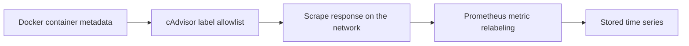

# Reduce cAdvisor Label Cost Without Losing Container Identity

Author: [nawazdhandala](https://www.github.com/nawazdhandala)

Tags: Prometheus, Docker, Monitoring

Description: Control cAdvisor metadata labels at the exporter, use metric relabeling carefully, and measure series count, churn, and label cost without merging containers.

A cAdvisor scrape can attach deployment metadata to hundreds of metric families and thousands of container samples. Some labels are valuable for grouping. Others, such as build hashes or CI run identifiers, make queries harder to maintain and carry information no monitoring rule uses.

Reducing those labels is useful, but it does not automatically reduce the number of active series. If every container still has a unique `id`, removing a label that was fixed for that container may leave the series count unchanged. Distinguish label storage cost, series churn, and active cardinality before promising a savings figure.

This guide uses cAdvisor 0.55.1 and Prometheus 3.7.3 as concrete reference versions. The examples apply to a standalone Docker cAdvisor deployment, not automatically to the kubelet's embedded collector.

## Measure the dimension you want to reduce

Cardinality is the number of distinct time series. Each unique combination of metric name and label values identifies a series. Churn is the rate at which new series appear and old ones disappear. Label cost includes the memory, indexing, storage, and response bytes associated with metadata.

For example, 400 containers each producing 30 single-series measurements already represent roughly 12,000 series before device, interface, or other per-metric dimensions. Adding one fixed build label to each existing container does not multiply that count by the number of builds. If its value changes on an otherwise stable identity, however, that change produces new series.

Prometheus advises keeping label values bounded and avoiding unbounded dimensions. Apply that guidance with knowledge of which labels actually vary independently. [Metric and label naming](https://prometheus.io/docs/practices/naming/).

Capture a baseline over both ordinary operation and a deployment window:

```promql
count({job="cadvisor"})
```

This is a current-series view for the example job, not a full historical cardinality report. Pair it with scrape sample counts, payload size, scrape duration, and the Prometheus TSDB status API's head statistics. TSDB means time-series database. [Prometheus TSDB status API](https://prometheus.io/docs/prometheus/latest/querying/api/#tsdb-stats).

## Prefer filtering at the exporter when you control it

cAdvisor 0.55.1 defaults to storing container labels for exposition. Its `whitelisted_container_labels` option only takes effect when `store_container_labels` is false. Configure both together. [Versioned flag definitions](https://github.com/google/cadvisor/blob/v0.55.1/cmd/cadvisor.go).

Merge this fragment into the existing reviewed Compose service, preserving other required arguments and host settings:

```yaml
services:
  cadvisor:
    image: ghcr.io/google/cadvisor:0.55.1@sha256:e02855207ec07bb45ee41f720645945251f093f24c28f8c29cf718490f784922
    command:
      - --store_container_labels=false
      - --whitelisted_container_labels=com.docker.compose.project,com.docker.compose.service
```

Use raw Docker label names in that list. The example retains Compose project and service names because they help operators identify a workload without attaching every deployment label. It does not create those labels if the container lacks them.

Inspect the raw scrape to see the exported form. The raw Docker label `com.docker.compose.service` becomes a Prometheus label such as `container_label_com_docker_compose_service` after prefixing and sanitization. Distinct raw names can sanitize to the same name, so do not deliberately rely on punctuation to distinguish important metadata.

The base-label function retains container identity, its first alias when present, and image information. It also includes environment metadata already present in the container information. Therefore, this container-label list is not a blanket environment-variable filter. Review any environment-metadata collection settings separately, and never put secrets in metric labels. [Versioned label construction](https://github.com/google/cadvisor/blob/v0.55.1/metrics/prometheus.go).

## Separate target relabeling from metric relabeling

Prometheus target relabeling changes discovered targets and their labels before scraping. Metric relabeling operates on samples after they have been fetched and before ingestion. Removing exporter-provided labels belongs in the latter stage.

For a temporary ingestion-side policy, merge this into the correct existing scrape job:

```yaml
scrape_configs:
  - job_name: cadvisor
    static_configs:
      - targets: ["cadvisor:8080"]
    metric_relabel_configs:
      - action: labeldrop
        regex: 'container_label_(build_sha|ci_run_id)'
```

The target assumes Prometheus shares a Docker network with a service named `cadvisor`. Preserve your actual discovery, transport, authentication, and scrape settings instead of replacing a production job with this minimal example.

The rule removes two named metadata labels. It does not drop samples or aggregate them. Prometheus relabel regular expressions are anchored, so this pattern selects the two full label names shown. Metric relabeling does not apply to automatically generated series such as `up`. [Relabel configuration](https://prometheus.io/docs/prometheus/latest/configuration/configuration/#metric_relabel_configs).

This approach reduces stored metadata but still transfers the original exporter response over the network. Filtering at the exporter can reduce response size too. Neither change guarantees fewer active series when another retained label already distinguishes every container.



## Preserve labels that distinguish real measurements

Do not drop `id`, `instance`, `device`, or `interface` just because they have many values. Two containers can share a service name; two interfaces can report separate traffic. Removing the only distinguishing dimension can make different samples collide rather than combine them correctly.

For example, these conceptual samples represent different containers:

```text
metric{id="container-a",service="api"} 10
metric{id="container-b",service="api"} 20
```

Dropping `id` does not produce a valid aggregated value of 30. It produces two inputs with the same remaining identity. Use an explicit query or recording rule for aggregation after keeping the source measurements distinct.

Before dropping a label, compare the complete remaining label sets for representative workloads. Include replicas, restarts, multiple devices, and multiple network interfaces. A test with only one container cannot reveal an identity collision.

## Validate the policy with actual examples

Validate the final scrape configuration with the matching `promtool check config`. Then test relabeling on synthetic samples that include both removable metadata and essential identity labels. The expected outcome is unchanged sample values and preserved identity, with only the named metadata removed.

In staging, inspect the running cAdvisor arguments and a raw `/metrics` response. Confirm the two approved Docker labels are retained, an unapproved label is absent, and required identity remains. Check dashboards that group by the old metadata before deployment.

Compare these outcomes separately:

| Observation | What it establishes |
| --- | --- |
| Smaller raw response | Exporter-side metadata or sample reduction |
| Fewer ingested samples | Samples or metric families were removed |
| Same series count, fewer labels | Metadata reduction without active-cardinality reduction |
| Less growth during deployments | Possible churn improvement, subject to workload comparison |
| Missing replicas or scrape errors | Potential identity collision or broken policy |

If the dominant cost is the number of measurements per container, review unused metric groups or unnecessary scrape targets. Label deletion is not the appropriate substitute for those decisions.

## Roll out with a stable identity contract

Record the approved labels, their source, and the queries that depend on them. Roll out to a small host group, compare a normal workload and a deployment, and retain the previous argument list for rollback.

Remember that label changes create new series identities and do not rewrite historical data. Old label sets remain until retention removes them. Use an observation window long enough to distinguish that transition from a lasting improvement.

A successful policy reduces unnecessary metadata while preserving the ability to tell containers, hosts, and devices apart. Measure the result in the dimension you intended to change rather than equating fewer label names with fewer series.
